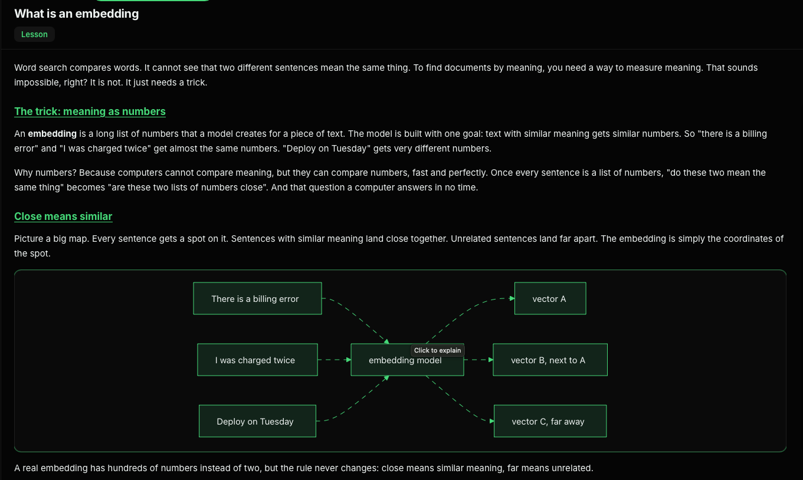
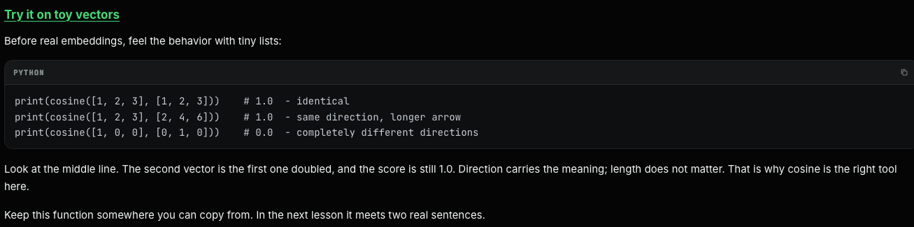

# 1. Calling a model from Python

```
import os
from openai import OpenAI

client = OpenAI(
    base_url=os.environ["OPENAI_BASE_URL"],
    api_key=os.environ["OPENAI_API_KEY"],
)

response = client.chat.completions.create(
    model="glm-5.2",
    messages=[
        {"role": "user", "content": "What does the df command show?"}
    ],
)

print(response.choices[0].message.content)
```


```
Answer the question using only the document below. If the answer
is not in the document, say "The document does not contain this
information."
```



# text-embedding-3-small

```
curl -s "$OPENAI_BASE_URL/v1/embeddings" \
  -H "Authorization: Bearer $OPENAI_API_KEY" \
  -H "Content-Type: application/json" \
  -d '{"model": "text-embedding-3-small", "input": "I was charged twice for my invoice"}' \
  > embedding.json
```
jq '.data[0].embedding | length' embedding.json

# Cosine similarity
```
import math

def cosine(a, b):
    dot = sum(x * y for x, y in zip(a, b))
    length_a = math.sqrt(sum(x * x for x in a))
    length_b = math.sqrt(sum(y * y for y in b))
    return dot / (length_a * length_b)
```



```
import math
import os
from openai import OpenAI

client = OpenAI(
    base_url=os.environ["OPENAI_BASE_URL"],
    api_key=os.environ["OPENAI_API_KEY"],
)

def cosine(a, b):
    dot = sum(x * y for x, y in zip(a, b))
    length_a = math.sqrt(sum(x * x for x in a))
    length_b = math.sqrt(sum(y * y for y in b))
    return dot / (length_a * length_b)

response = client.embeddings.create(
    model="text-embedding-3-small",
    input=[
        "I was charged twice for my invoice",
        "There is a billing error on my account",
    ],
)

vec_a = response.data[0].embedding
vec_b = response.data[1].embedding
print(round(cosine(vec_a, vec_b), 3))
```