# Retrieval-augmented generation (RAG)

Follow these ten lessons in order to build a simple RAG workflow, from the
problem it solves to a complete pipeline that retrieves evidence and
generates a grounded answer. Lesson folders keep the supporting code, data,
and screenshots together; this is the chapter's single README and learning
path.

## Learning path

| Step | Lesson | Materials |
| --- | --- | --- |
| 1 | [The Problem RAG Solves](#1-the-problem-rag-solves) | [`ask.py`](./01-the-problem-rag-solves/ask.py) |
| 2 | [Tools You Will Use](#2-tools-you-will-use) | [`call-embedding.py`](./02-tools-you-will-use/call-embedding.py) |
| 3 | [Grounding a Prompt](#3-grounding-a-prompt) | [Lesson folder](./03-grounding-a-prompt/) |
| 4 | [Embeddings](#4-embeddings) | [`embedding.json`](./04-embeddings/embedding.json) |
| 5 | [Measuring Similarity](#5-measuring-similarity) | [`score-pairs.py`](./05-measuring-similarity/score-pairs.py) |
| 6 | [Semantic Search](#6-semantic-search) | [`rank-support-messages.py`](./06-semantic-search/rank-support-messages.py) |
| 7 | [Chunking](#7-chunking) | [`create_chunk.py`](./07-chunking/create_chunk.py), [`data.txt`](./07-chunking/data.txt), [`chunks.json`](./07-chunking/chunks.json) |
| 8 | [Build Your Own Vector Store](#8-build-your-own-vector-store) | [`create_store.py`](./08-build-your-own-vector-store/create_store.py), [`query_store.py`](./08-build-your-own-vector-store/query_store.py), [query task](#query-the-store), [quick check](#quick-check-your-vector-store) |
| 9 | [Chroma: A Real Vector Database](#9-chroma-a-real-vector-database) | [`add_chunks_chroma.py`](./09-chroma-a-real-vector-database/add_chunks_chroma.py), [`query_your_collection.py`](./09-chroma-a-real-vector-database/query_your_collection.py) |
| 10 | [The Full RAG Pipeline](#10-the-full-rag-pipeline) | [`full-rag-pipeline.py`](<./10-The Full RAG pipeline/full-rag-pipeline.py>) |

## Before you start

The examples use Python, the OpenAI Python SDK, `python-dotenv`, and Chroma.
From the repository root, install the packages and configure your API
credentials:

```bash
python3 -m pip install openai python-dotenv chromadb
export OPENAI_API_KEY="your-api-key"
export OPENAI_BASE_URL="https://api.openai.com"
```

`OPENAI_BASE_URL` is optional when using OpenAI directly. For a compatible
provider, set it to that provider's API base URL. Keep credentials out of
source files and commits. Embedding and chat examples make live API requests
and may incur usage charges.

## 1. The Problem RAG Solves

A language model can answer general questions, but it does not automatically
know the contents of your documents or the latest information in your systems.
RAG retrieves relevant text from a source collection and includes that text
when asking the model to answer.

[`ask.py`](./01-the-problem-rag-solves/ask.py) is a starting point: it sends a
question to a chat model. By itself, it does not retrieve evidence. The
following lessons add the pieces needed to provide that evidence.

## 2. Tools You Will Use

The examples use an OpenAI-compatible API for chat and embeddings. The
[`call-embedding.py`](./02-tools-you-will-use/call-embedding.py) example sends
one text to the embeddings endpoint and prints the vector's dimensions and
first few values. An embedding is a list of numbers; the next lessons explain
what it represents and how to use it.

Run examples from the repository root:

```bash
python AI/02-RAG/02-tools-you-will-use/call-embedding.py
```

## 3. Grounding a Prompt

Retrieval only helps if the answer is grounded in the retrieved text. A prompt
can make that requirement explicit:

> Answer the question using only the document below. If the answer is not in
> the document, say "The document does not contain this information."

Provide the relevant document text with the question. This makes it clear
which source the model should use and what to do when the source has no answer.

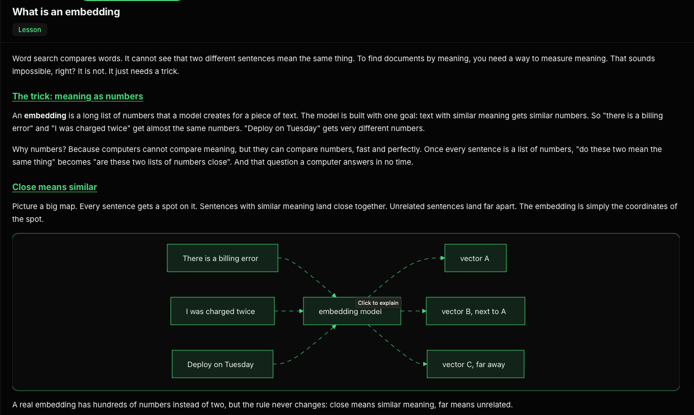

## 4. Embeddings

An embedding model turns text into a vector. Texts with related meaning tend
to have vectors that are close under a similarity measure. Embeddings can be
created for individual texts or in batches; the saved
[`embedding.json`](./04-embeddings/embedding.json) is an example response.

## 5. Measuring Similarity

Cosine similarity compares two vectors by measuring the angle between them.
For non-zero vectors, values nearer to `1` indicate a more similar direction.
This implementation is used by
[`score-pairs.py`](./05-measuring-similarity/score-pairs.py):

```python
import math

def cosine(a, b):
    dot = sum(x * y for x, y in zip(a, b))
    length_a = math.sqrt(sum(x * x for x in a))
    length_b = math.sqrt(sum(y * y for y in b))
    return dot / (length_a * length_b)
```

The script embeds two related statements and one unrelated statement, then
compares their scores. These visuals accompany the similarity lesson:

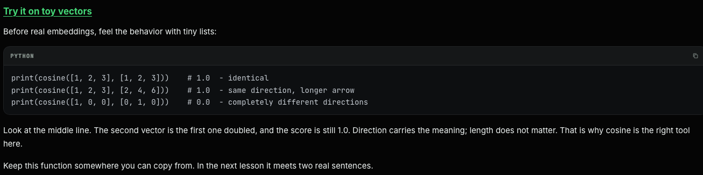


## 6. Semantic Search

Semantic search embeds a query and a set of candidate texts, scores each
candidate against the query, and sorts the results by score. Unlike keyword
search, it can find related wording even when the query and source use
different words.

[`rank-support-messages.py`](./06-semantic-search/rank-support-messages.py)
demonstrates ranking candidate support messages against a question. The
highest-scoring result is the best semantic match, not a guarantee that it
contains a complete or correct answer.


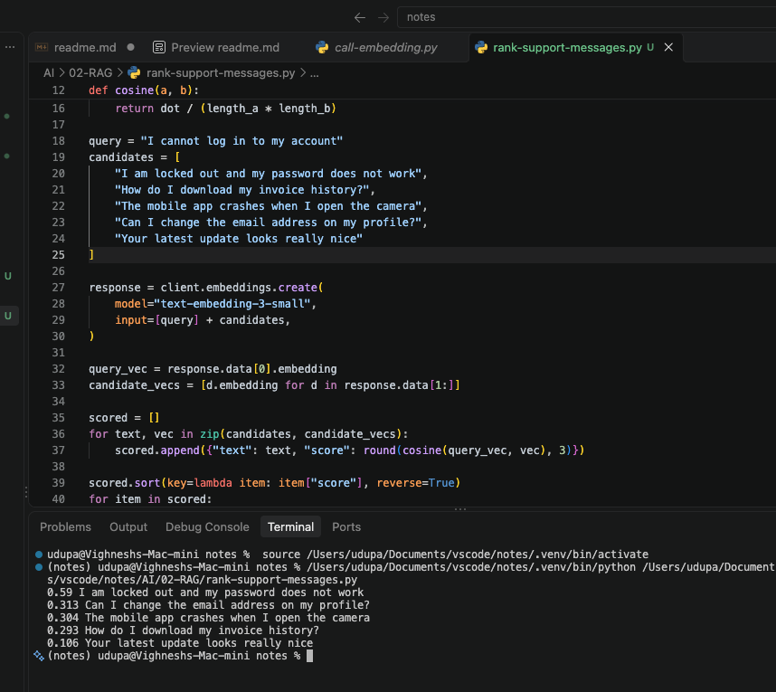

## 7. Chunking

Documents are split into smaller pieces called chunks before embedding. This
keeps retrieval focused: the model can receive the most relevant passages
rather than an entire long document.

The sample source is [`data.txt`](./07-chunking/data.txt). The script
[`create_chunk.py`](./07-chunking/create_chunk.py) splits it at paragraph
breaks and writes [`chunks.json`](./07-chunking/chunks.json). Run it from any
working directory:

```bash
python AI/02-RAG/07-chunking/create_chunk.py
```

The script uses the source and output files beside itself. For another
document, the basic paragraph split looks like this:

```python
text = open("runbook.txt").read()
chunks = [p.strip() for p in text.split("\n\n") if p.strip()]

for i, chunk in enumerate(chunks):
    print(f"--- chunk {i} ({len(chunk)} chars)")
    print(chunk)
```

After chunking, embed each chunk and keep its text with its vector. Reuse those
vectors for later searches instead of embedding the source documents every
time.

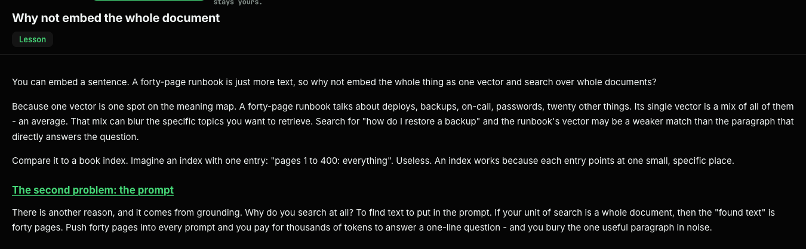
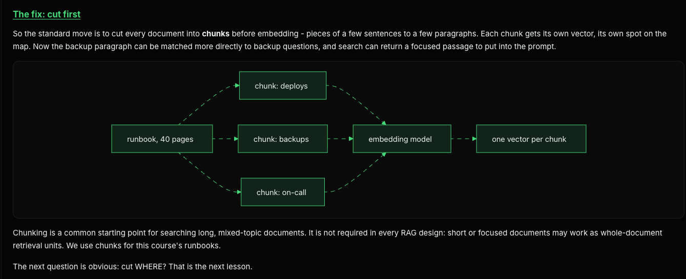

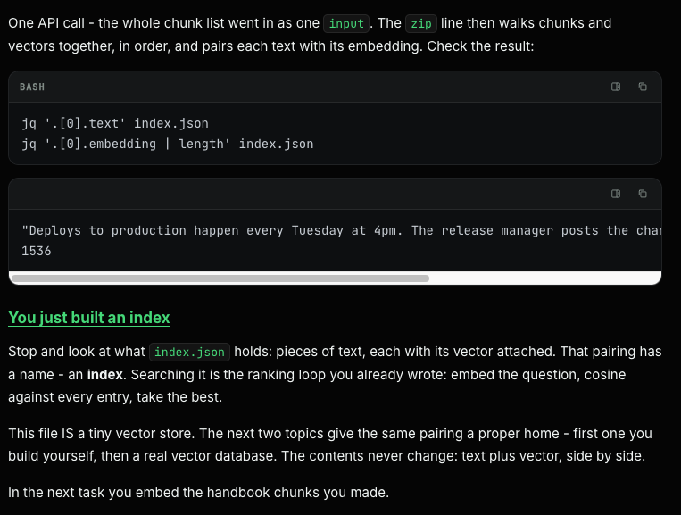

## 8. Build Your Own Vector Store

A vector store keeps each chunk alongside its embedding so that a query can
retrieve matching chunks later. The lesson's
[`create_store.py`](./08-build-your-own-vector-store/create_store.py) example
embeds sample documents and stores their text and vectors in SQLite.

The workflow is:

1. Split source documents into chunks.
2. Embed each chunk and store the text and vector together.
3. Embed an incoming question.
4. Compare the question vector with the stored vectors and retrieve the best
   matches.

The sample screenshots walk through building and querying the store:

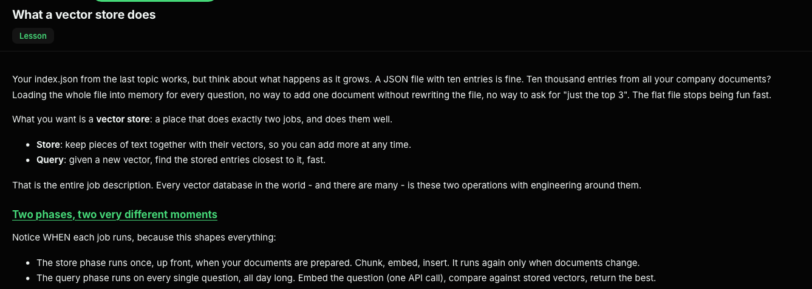
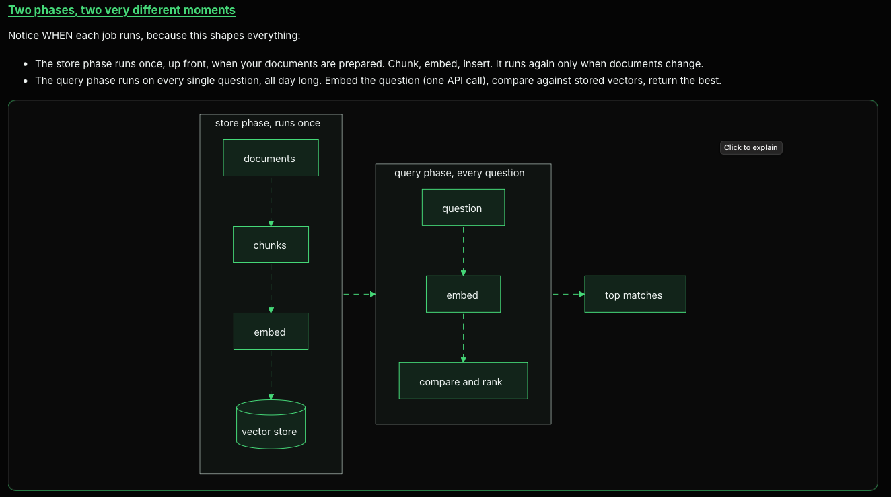
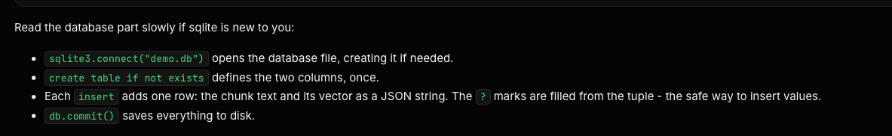
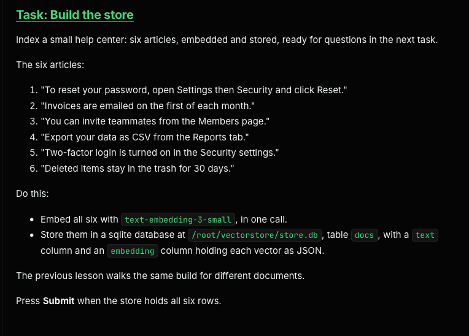

### Query the store

After building the store, try the task shown below: embed a question, compare
it with the stored vectors, and return the two most relevant articles. The
task asks what to do when a user says, "I removed a file by mistake, can I get
it back?" Compare your approach with the
[`query_store.py`](./08-build-your-own-vector-store/query_store.py) example.

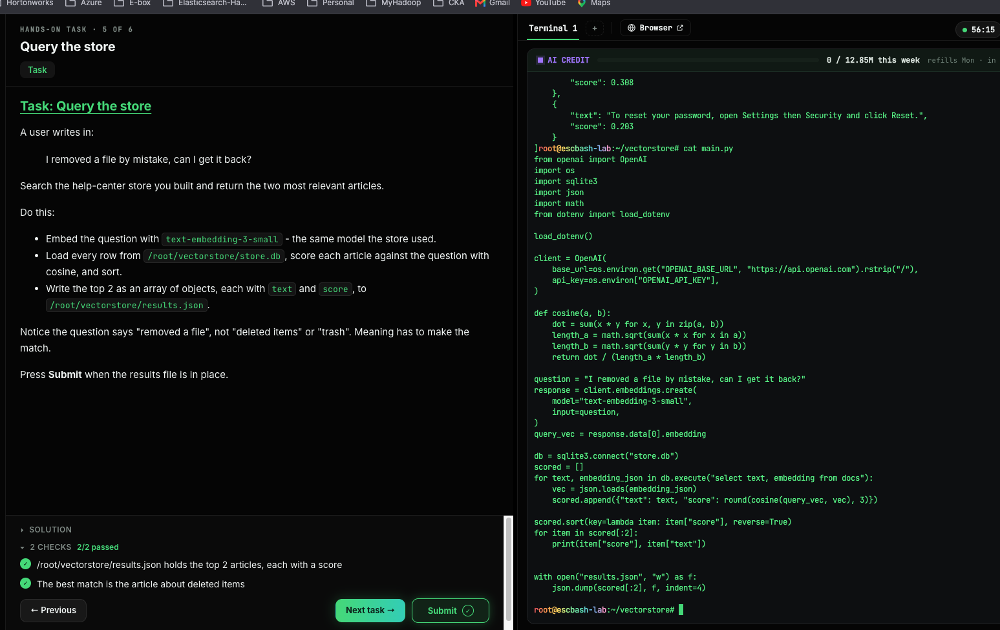

### Quick check: your vector store

Finish with the [vector-store quick check](./08-build-your-own-vector-store/screenshots/image-18.png):
why must the query use the same embedding model as the documents in the store?
The numbers from different embedding models are not directly comparable.

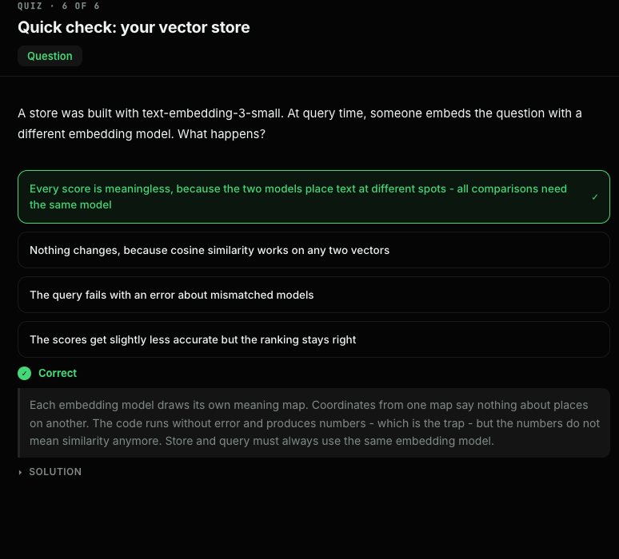

Here is the SQLite storage step with three scheduling notes:

```python
import json
import os
import sqlite3
from openai import OpenAI

client = OpenAI(
    base_url=os.environ["OPENAI_BASE_URL"],
    api_key=os.environ["OPENAI_API_KEY"],
)

docs = [
    "Deploys to production happen every Tuesday at 4pm.",
    "The staging environment resets nightly at midnight.",
    "On-call handover is Friday at 10am.",
]

response = client.embeddings.create(
    model="text-embedding-3-small",
    input=docs,
)

db = sqlite3.connect("demo.db")
db.execute("create table if not exists docs (text TEXT, embedding TEXT)")
for doc, data in zip(docs, response.data):
    db.execute(
        "insert into docs values (?, ?)",
        (doc, json.dumps(data.embedding)),
    )
db.commit()
print("stored", len(docs), "docs")
```

For a question such as "When does new code go live?", embed the question once,
load the stored vectors, and rank them:

```python
import json
import math
import os
import sqlite3
from openai import OpenAI

client = OpenAI(
    base_url=os.environ["OPENAI_BASE_URL"],
    api_key=os.environ["OPENAI_API_KEY"],
)

def cosine(a, b):
    dot = sum(x * y for x, y in zip(a, b))
    length_a = math.sqrt(sum(x * x for x in a))
    length_b = math.sqrt(sum(y * y for y in b))
    return dot / (length_a * length_b)

question = "When does new code go live?"
response = client.embeddings.create(
    model="text-embedding-3-small",
    input=question,
)
query_vec = response.data[0].embedding

db = sqlite3.connect("demo.db")
scored = []
for text, embedding_json in db.execute("select text, embedding from docs"):
    vec = json.loads(embedding_json)
    scored.append({"text": text, "score": round(cosine(query_vec, vec), 3)})

scored.sort(key=lambda item: item["score"], reverse=True)
for item in scored[:2]:
    print(item["score"], item["text"])
```

This is similar to the ranking loop in [semantic search](#6-semantic-search),
but candidate vectors are loaded from SQLite instead of recomputed. The
question and stored documents must use the same embedding model; vectors from
different models do not share a comparable coordinate space.

## 9. Chroma: A Real Vector Database

The SQLite vector store in the previous lesson made the search process
visible: load each vector, calculate its score, sort, then take the top
results. A vector database such as Chroma stores documents and embeddings in
a collection and provides nearest-neighbor search, so application code does
not need to implement that scan-and-sort loop itself.

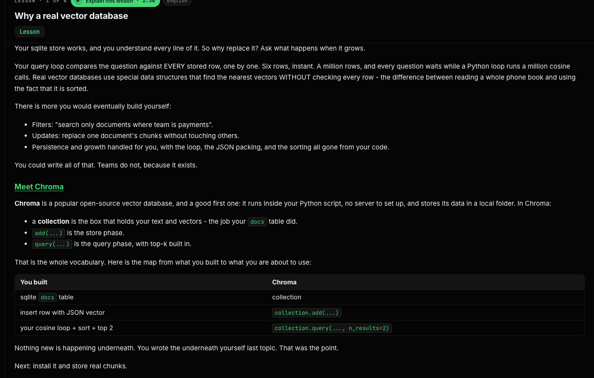

In Chroma, a **collection** groups documents and their vectors. The
`PersistentClient` keeps its database on disk, `get_or_create_collection()`
opens or creates a collection, `add()` stores text with its embedding, and
`query()` retrieves the nearest matches. This replaces the SQLite table and
the manual cosine-scoring and sorting loop from Step 8.

| What the SQLite example did | Chroma equivalent |
| --- | --- |
| Store text and its vector in a row | `collection.add(...)` |
| Load every row, score, sort, and take the top two | `collection.query(..., n_results=2)` |

The `add_chunks_chroma.py` script embeds the chunks created in
[Step 7](#7-chunking) and writes them to the `handbook` collection. Chroma
persists its local database in this lesson folder. The database files are
local generated data and are excluded from Git.

The essential collection operations look like this:

```python
collection = chroma.get_or_create_collection("handbook")
collection.add(
    ids=["chunk-0", "chunk-1"],
    documents=chunks,
    embeddings=vectors,
)
print("stored:", collection.count())
```

Each ID identifies one stored entry, and the `documents` and `embeddings`
items must line up in the same order. The runnable chunk loader uses
`upsert()` rather than `add()` so that running it again updates existing
chunk IDs instead of failing on duplicates. See
[`add_chunks_chroma.py`](./09-chroma-a-real-vector-database/add_chunks_chroma.py)
for the complete example that reads and embeds the Step 7 chunks.

From the repository root, build or update the collection, then query it:

```bash
python AI/02-RAG/09-chroma-a-real-vector-database/add_chunks_chroma.py
python AI/02-RAG/09-chroma-a-real-vector-database/query_your_collection.py
```

The query script embeds the question with the same model used for the stored
chunks and asks Chroma for the two closest results. Chroma returns documents
and **distances**, not cosine-similarity scores. Query results are grouped by
input query: `[0]` selects the results for the first question. With Chroma's
default squared Euclidean (`l2`) distance, **smaller means closer**. This is
why a result near zero can be a better match than one with a larger value. In
contrast, when you calculate cosine similarity directly, higher values (near
`1`) mean more similar. They are different metrics and their numbers should
not be compared as if they were the same scale.

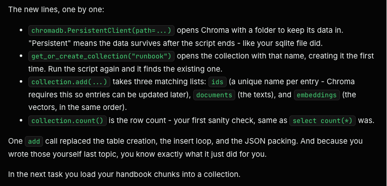

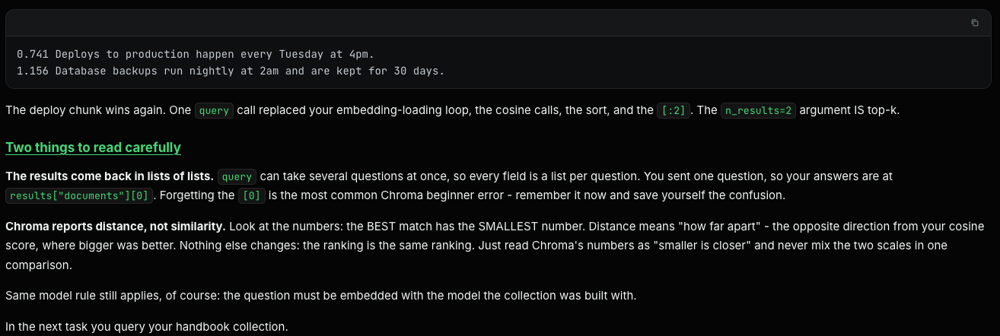

## 10. The Full RAG Pipeline

The earlier lessons built each RAG component separately. This final lesson
connects them into one small application. A complete pipeline has three
phases:

1. **Index** — split the source material into chunks, embed them, and keep each
   chunk with its vector. This is normally done once when documents are added
   or changed.
2. **Retrieve** — embed the incoming question and find the chunk with the
   highest cosine similarity. This runs for each question. The included
   in-memory example recreates its small index at startup; a production
   application would load a persisted index or vector database, as in Step 9.
3. **Generate** — give the question and retrieved chunk to the chat model
   with instructions to answer only from that evidence and to say when the
   evidence does not contain the answer.


The retriever always returns its closest available chunk—even if that chunk
isn't actually relevant. The grounding instructions are therefore important:
they tell the model to refuse when the retrieved chunk does not answer the
question, rather than filling the gap with general knowledge.


The runnable
[`full-rag-pipeline.py`](<./10-The Full RAG pipeline/full-rag-pipeline.py>)
shows the full sequence. It embeds a four-document engineering handbook,
retrieves the best match for each question with a cosine-similarity loop, and
sends the retrieved evidence and question to the model. The same selection
can be written compactly using `max()`:

```python
best_chunk = max(
    zip(chunks, vectors),
    key=lambda pair: cosine_similarity(query_vector, pair[1]),
)[0]
```


### Try the pipeline

From the repository root, run:

```bash
python "AI/02-RAG/10-The Full RAG pipeline/full-rag-pipeline.py"
```

The example asks two questions:

- **Answerable:** "Where do the release notes get published?"
- **Not answerable from the handbook:** "What is the wifi password in the
  office?"

The script saves the first retrieved chunk and both generated answers in the
lesson's ignored `outputs/` folder. Check that the first answer uses the
team-wiki evidence and the second says the document does not contain the
requested information.

