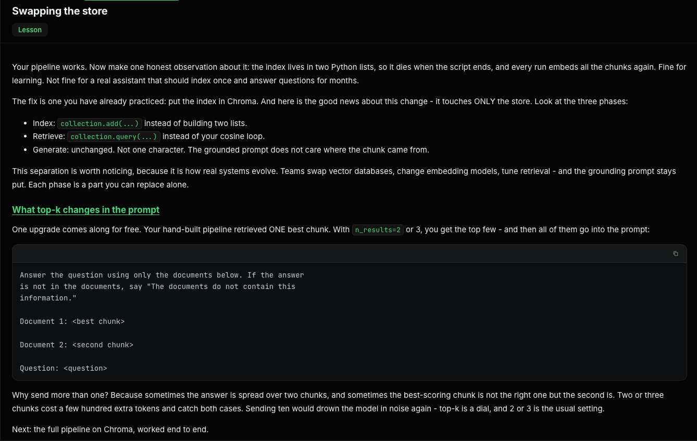
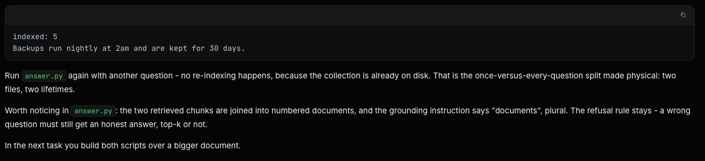

# RAG on Chroma:



# Pipeline on chroma worked through

```
# index.py - run once
import os
import chromadb
from openai import OpenAI

client = OpenAI(
    base_url=os.environ["OPENAI_BASE_URL"],
    api_key=os.environ["OPENAI_API_KEY"],
)

chunks = [
    "Deploys to production happen every Tuesday at 4pm.",
    "Database backups run nightly at 2am and are kept for 30 days.",
    "If the site goes down, check the load balancer health page first.",
    "On-call handover happens Friday at 10am in the platform channel.",
    "Error budgets reset on the first day of each quarter.",
]

response = client.embeddings.create(model="text-embedding-3-small", input=chunks)

chroma = chromadb.PersistentClient(path="/root/rag-chroma-demo")
collection = chroma.get_or_create_collection("ops")
collection.add(
    ids=[f"chunk-{i}" for i in range(len(chunks))],
    documents=chunks,
    embeddings=[d.embedding for d in response.data],
)
print("indexed:", collection.count())
```

```
# answer.py - run per question
import os
import sys
import chromadb
from openai import OpenAI

client = OpenAI(
    base_url=os.environ["OPENAI_BASE_URL"],
    api_key=os.environ["OPENAI_API_KEY"],
)

question = sys.argv[1]

q_vec = client.embeddings.create(
    model="text-embedding-3-small", input=question
).data[0].embedding

chroma = chromadb.PersistentClient(path="/root/rag-chroma-demo")
collection = chroma.get_collection("ops")
results = collection.query(query_embeddings=[q_vec], n_results=2)
top_chunks = results["documents"][0]

docs_text = "\n\n".join(
    f"Document {i+1}: {chunk}" for i, chunk in enumerate(top_chunks)
)
prompt = (
    "Answer the question using only the documents below. If the answer "
    "is not in the documents, say \"The documents do not contain this "
    "information.\"\n\n"
    f"{docs_text}\n\n"
    f"Question: {question}"
)
reply = client.chat.completions.create(
    model="glm-5.2",
    messages=[{"role": "user", "content": prompt}],
)
print(reply.choices[0].message.content)
```

Run them:

python3 index.py
python3 answer.py "When do backups run and how long are they kept?"


