# GitHub Actions

GitHub Actions automates work in a repository. A workflow listens for an event,
then asks a runner to execute jobs made up of ordered steps. This guide
introduces those pieces in sequence, from a first workflow to reusable
workflows, composite actions, and self-hosted runners.

## Contents

1. [Workflow structure](#1-understand-a-workflow-file)
2. [Triggers and filters](#2-choose-when-a-workflow-runs)
3. [Jobs and steps](#3-jobs-and-steps)
4. [Actions](#4-use-actions)
5. [Contexts and run data](#5-read-run-data-with-contexts)
6. [Reusable workflows](#6-reuse-an-entire-workflow)
7. [Composite actions](#7-build-a-composite-action)
8. [Self-hosted runners](#8-self-hosted-runners)

## At a glance: the CI/CD flow

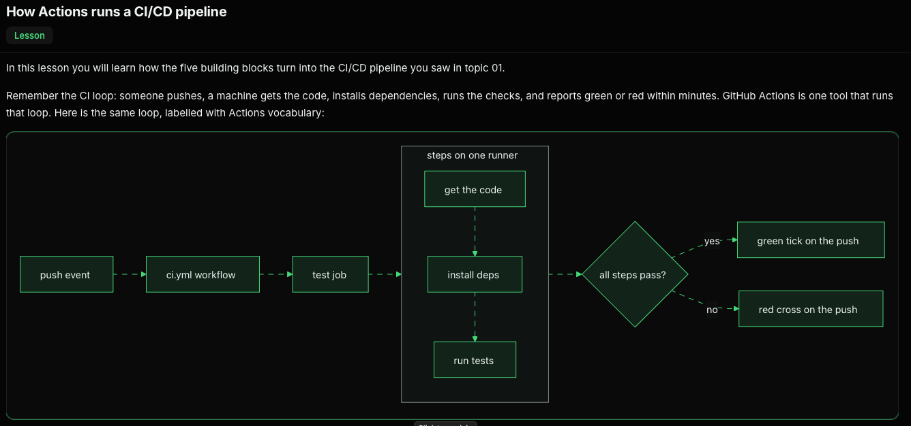

The diagram follows a push from the triggering event, through a workflow and
job, to the runner. The runner checks out code, installs dependencies, runs
tests, and reports whether the run succeeded.

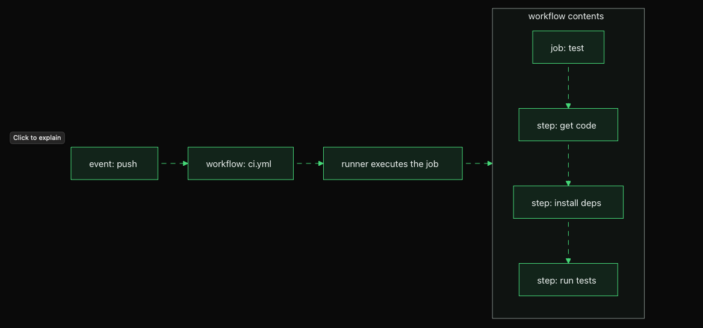

This second view zooms in on the same flow: the workflow contains a job, and
the job contains steps such as getting code, installing dependencies, and
running tests.

## 1. Understand a workflow file

GitHub Actions workflows are YAML files stored in the repository's
`.github/workflows/` directory. Each workflow has a name, one or more
triggering events, and one or more jobs.

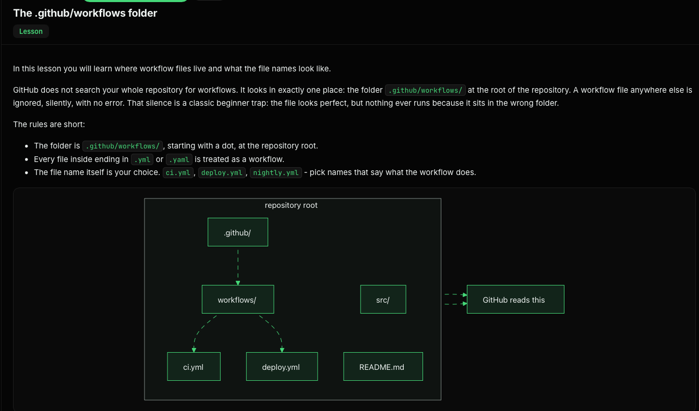

Read the file from top to bottom:

- `name` gives the workflow a display name in GitHub.
- `on` declares which event starts it, such as a push.
- `jobs` contains the work to run. Each job specifies a runner and steps.
- Each step is an item in a YAML list and can run a command or use an action.

GitHub looks for workflow files in one specific directory at the repository
root. The filename is up to you, and it can end in `.yml` or `.yaml`.

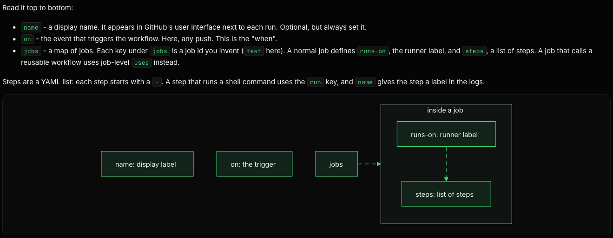

For example, save this as `.github/workflows/ci.yml`:

```yaml
name: Demo CI

on: push

jobs:
  test:
    runs-on: ubuntu-latest
    steps:
      - name: Say hello
        run: echo "Hello from CI"
```

### Check workflow syntax with actionlint

[`actionlint`](https://github.com/rhysd/actionlint) checks workflow files for
syntax and common configuration errors. Install it using a package manager or
the project's installation instructions, then run:

```bash
actionlint .github/workflows/ci.yml
```

The screenshot shows a malformed workflow being reported by `actionlint`, then
the corrected file passing without further output.

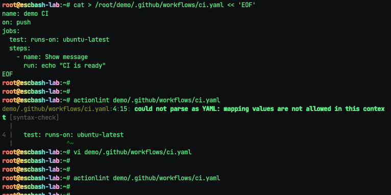

## 2. Choose when a workflow runs

The `on` section controls when GitHub starts a workflow. A plain `push` trigger
runs for pushes to any branch. Branch and path filters narrow that behavior.

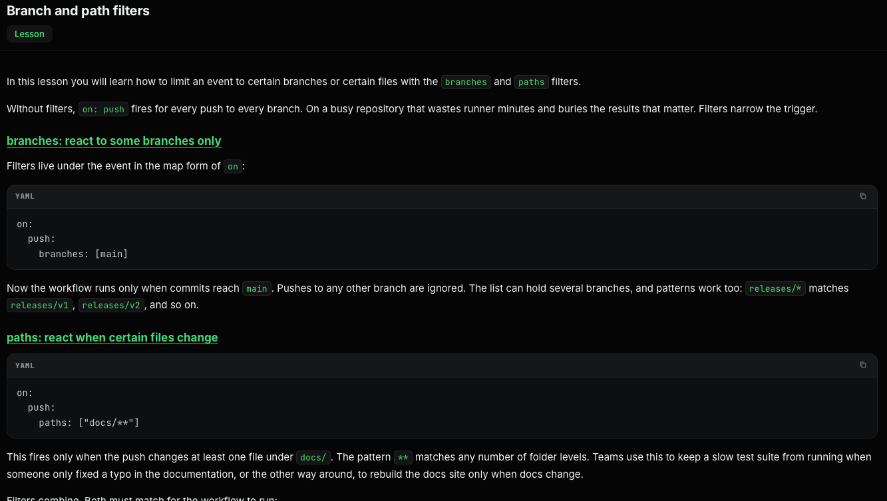

For example, run only for pushes to `main`:

```yaml
on:
  push:
    branches: [main]
```

Or run when files under `docs/` change:

```yaml
on:
  push:
    paths:
      - "docs/**"
```

When both branch and path filters are set for an event, both must match. Use
filters to avoid running work that is unrelated to a change.

### Scheduled and manual runs

Use `schedule` for recurring work and `workflow_dispatch` to add a manual
**Run workflow** button in GitHub.

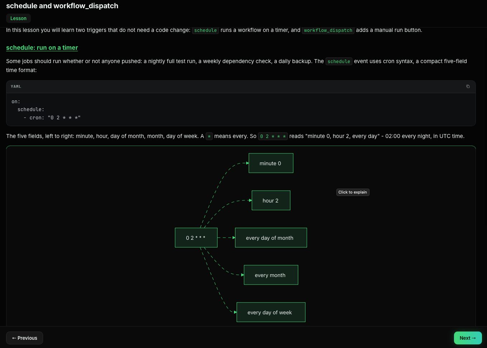

This example runs daily at 02:00 UTC and can also be started manually:

```yaml
name: Nightly checks

on:
  schedule:
    - cron: "0 2 * * *"
  workflow_dispatch:

jobs:
  sanity:
    runs-on: ubuntu-latest
    steps:
      - name: Show a message
        run: echo "Run the scheduled checks here"
```

The five cron fields are minute, hour, day of month, month, and day of week.
Remember that scheduled workflow times are interpreted in UTC.

## 3. Jobs and steps

A workflow can contain multiple jobs. A job runs on one runner, and its steps
execute in the order they appear. By default, a failed step causes the job to
stop and skip later steps.

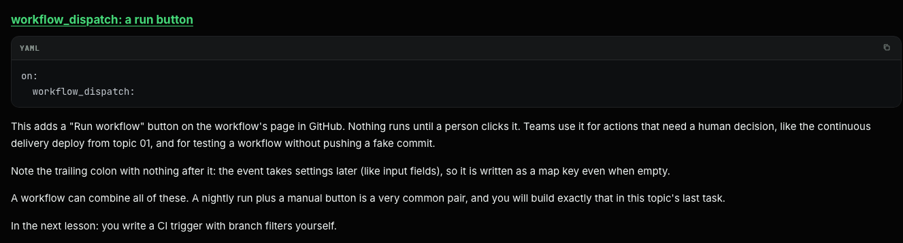

The screenshot emphasizes that later steps do not start until earlier steps
finish. Steps in the same job share that job's workspace, so files produced by
one step can be used by another.

There are two common kinds of step:

- `run` executes a shell command that you provide.
- `uses` invokes a packaged action.

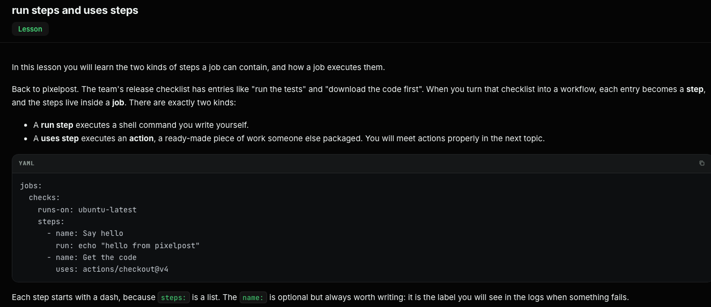

Here is a job with multiple command steps:

```yaml
jobs:
  inspect:
    runs-on: ubuntu-latest
    steps:
      - name: Print the current date
        run: date
      - name: Print the working directory
        run: pwd
      - name: Finish
        run: echo "Done"
```

### Multiple commands, shells, and working directories

Use the YAML `|` block syntax to put several shell commands in one `run` step.
Use `shell` to select a shell explicitly and `working-directory` to run a step
from a different directory.

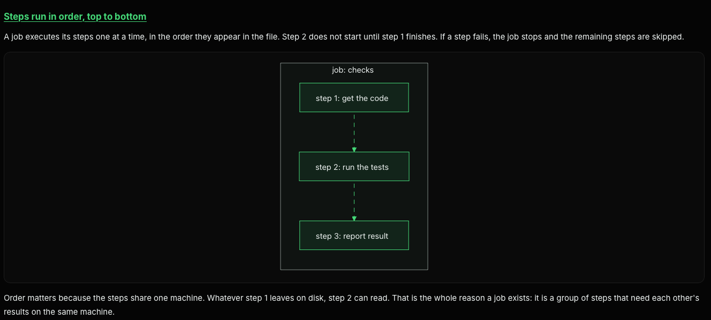

```yaml
steps:
  - name: Prepare a report
    run: |
      mkdir -p report
      date > report/generated-at.txt
      echo "Report folder ready"
  - name: List report files
    shell: bash
    working-directory: report
    run: ls
```

On Linux, bash is commonly the default shell. Explicitly setting `shell` is
useful when the same workflow needs predictable behavior across runner
operating systems.

## 4. Use actions

An action is a reusable unit of work. The `uses` field tells a step which
action to run.

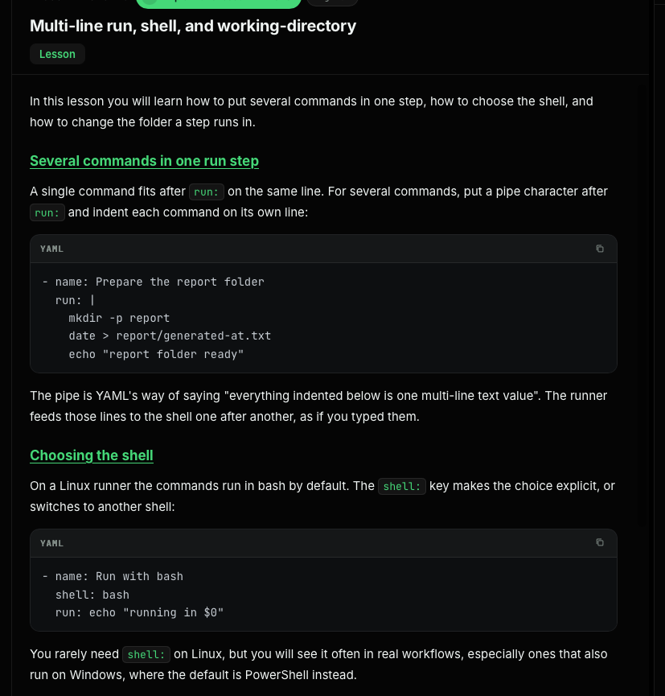

For a published action, a reference such as `actions/checkout@v4` contains:

- `actions`: the owner account.
- `checkout`: the action repository.
- `@v4`: the version, tag, branch, or commit ref.

The GitHub Marketplace lists published actions for common tasks. Prefer
well-maintained actions from trusted publishers, review an action before
adopting it, and pin a full commit SHA when your security requirements call for
immutable references.

### Check out the repository

A job starts on a runner; the runner does not automatically contain your
repository files. `actions/checkout` downloads the repository into the
workspace so later steps can read files such as `README.md`.

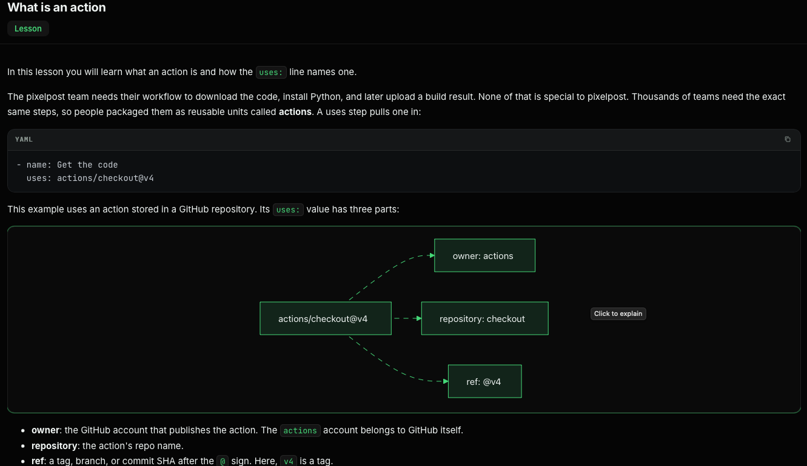

```yaml
steps:
  - name: Get the code
    uses: actions/checkout@v4
  - name: Read the README
    run: cat README.md
```

Actions can also be defined in the same repository or packaged as Docker
actions. The `uses` syntax depends on the action type; for a repository action,
the common form is `owner/repository@ref`.

### Set up a language runtime

For example, use the official Python setup action to select a Python version:

```yaml
- name: Install Python
  uses: actions/setup-python@v5
  with:
    python-version: "3.12"
```

## 5. Read run data with contexts

Values such as the branch name and commit hash change on every run. GitHub
provides these values through contexts, which you reference in an expression
using `${{ ... }}` syntax.

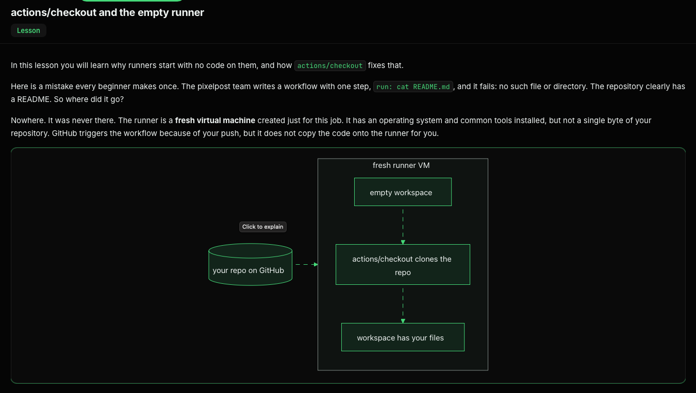

For example, this step prints the Git ref that triggered the run:

```yaml
steps:
  - name: Show the branch or ref
    env:
      GITHUB_REF_VALUE: ${{ github.ref }}
    run: echo "This run was triggered on $GITHUB_REF_VALUE"
```

The screenshot shows how GitHub evaluates the expression before the shell
command runs. Passing the value through `env` keeps untrusted event data out of
the shell script itself.

### Runs contain jobs, and jobs contain steps

A run is one execution of one workflow. Within a run, jobs may execute in
parallel unless dependencies are declared. Each job contains its own ordered
steps.

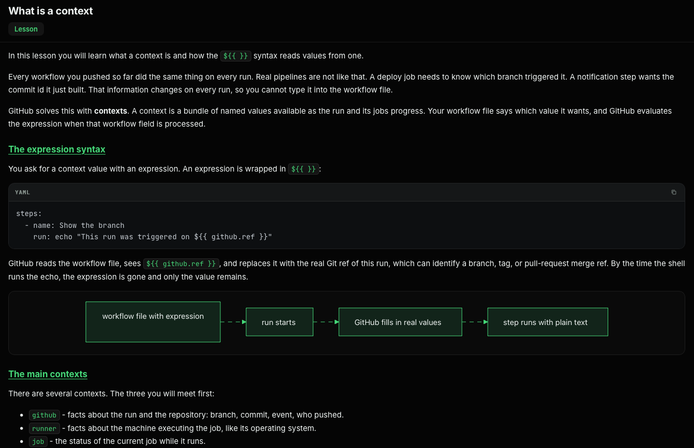

This hierarchy is useful when reading the Actions tab: a run has an overall
status, jobs have their own status, and each step has its own output and
success or failure state.

### Common contexts

The `github` context describes the event and repository. The `runner` context
describes the machine executing the job. The `job` context provides information
about the current job.

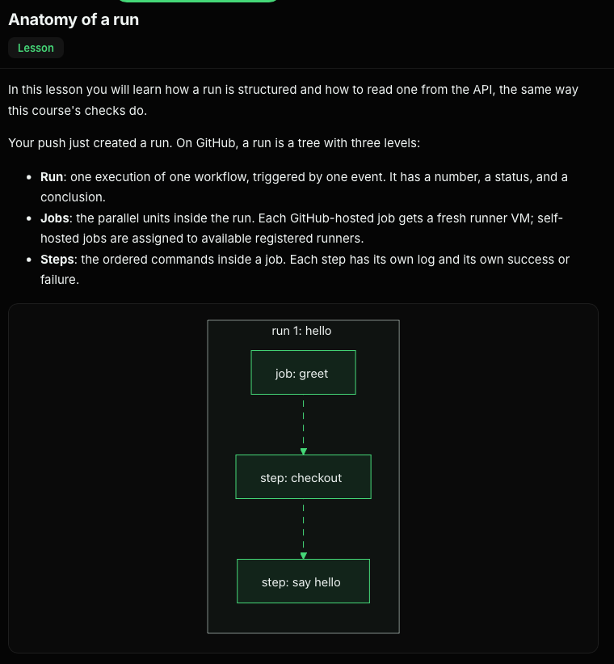

Some commonly used `github` values are:

- `github.repository`: the owner and repository name.
- `github.ref`: the full ref, such as `refs/heads/main`.
- `github.ref_name`: the short branch or tag name.
- `github.sha`: the commit being built.
- `github.event_name`: the event that started the run.
- `github.actor`: the user who triggered the run.

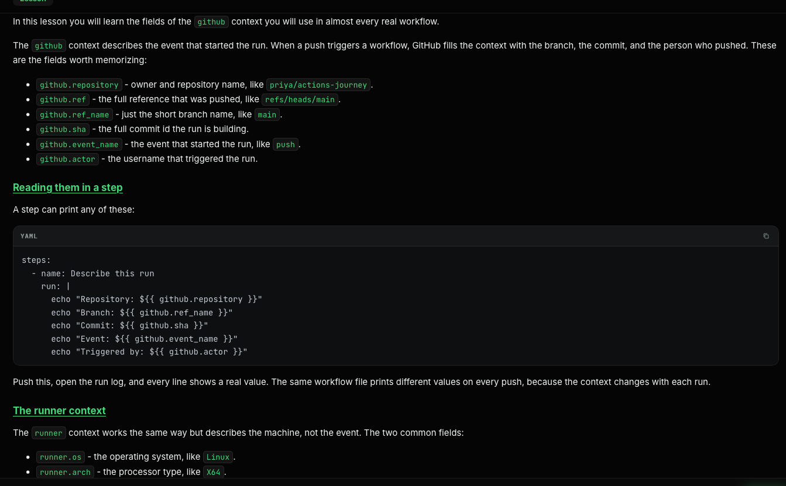

The screenshot shows context values being printed in a step. Treat values
derived from events, including branch names and user-provided inputs, as
untrusted data when using them in shell commands.

## 6. Reuse an entire workflow

A reusable workflow packages one or more jobs so other workflows can call
them. The called workflow declares `workflow_call` under `on`.

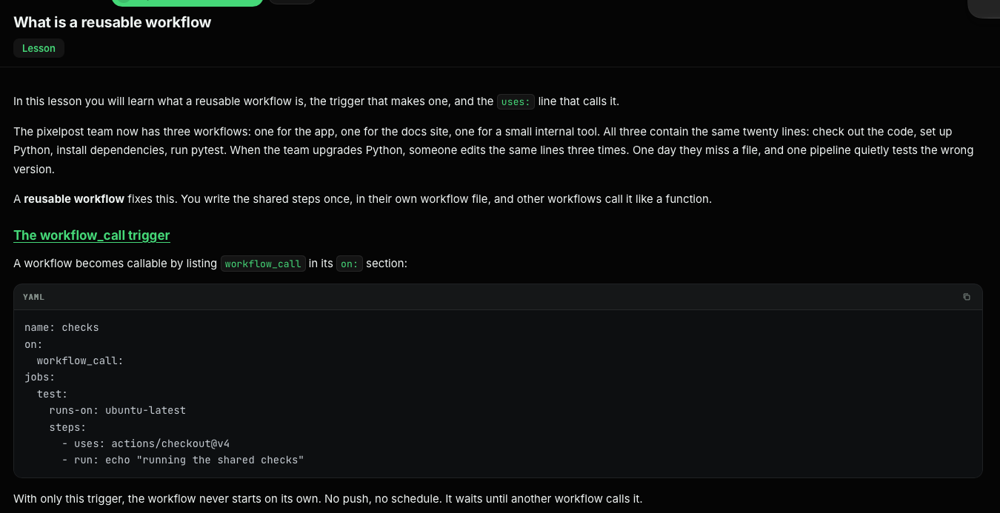

```yaml
name: Shared checks

on:
  workflow_call:

jobs:
  test:
    runs-on: ubuntu-latest
    steps:
      - uses: actions/checkout@v4
      - run: echo "Run shared checks here"
```

The caller uses the reusable workflow at the **job level**. That job does not
define its own `runs-on` or `steps`; the called workflow provides its jobs and
runners.

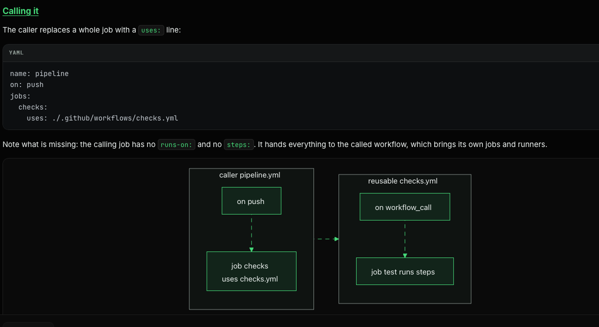

```yaml
name: CI

on: push

jobs:
  checks:
    uses: ./.github/workflows/shared-checks.yml
```

### Pass inputs and secrets

Declare inputs and secrets in the reusable workflow, then supply them from the
caller. Inputs are available through the `inputs` context.

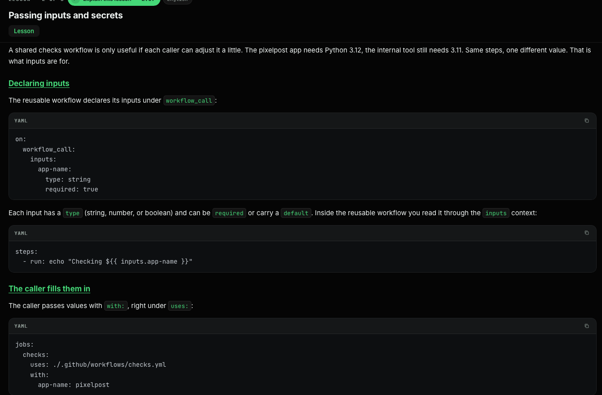

For example, the reusable workflow can declare an input like this:

```yaml
on:
  workflow_call:
    inputs:
      app-name:
        type: string
        required: true
```

The caller supplies it under `with`:

```yaml
jobs:
  checks:
    uses: ./.github/workflows/shared-checks.yml
    with:
      app-name: pixelpost
```

Secrets do not automatically become available inside a called workflow. Declare
the secrets that the called workflow accepts, then pass them explicitly (or use
`secrets: inherit` where appropriate and permitted).

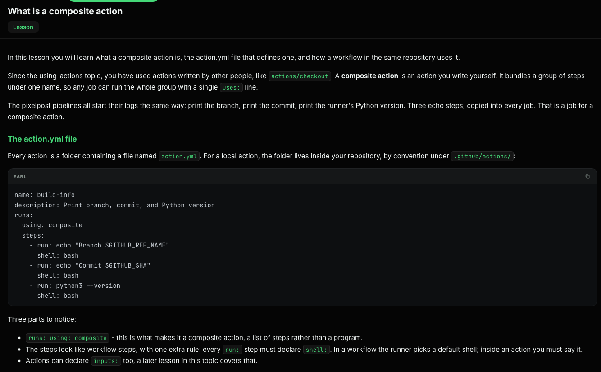

Never put a token value directly in workflow YAML. Store secrets in GitHub's
repository, organization, or environment secret settings and reference them
through the `secrets` context.

## 7. Build a composite action

A composite action packages a sequence of steps as an action. Define it in an
`action.yml` file, commonly under `.github/actions/<action-name>/`, and call it
from a workflow step.

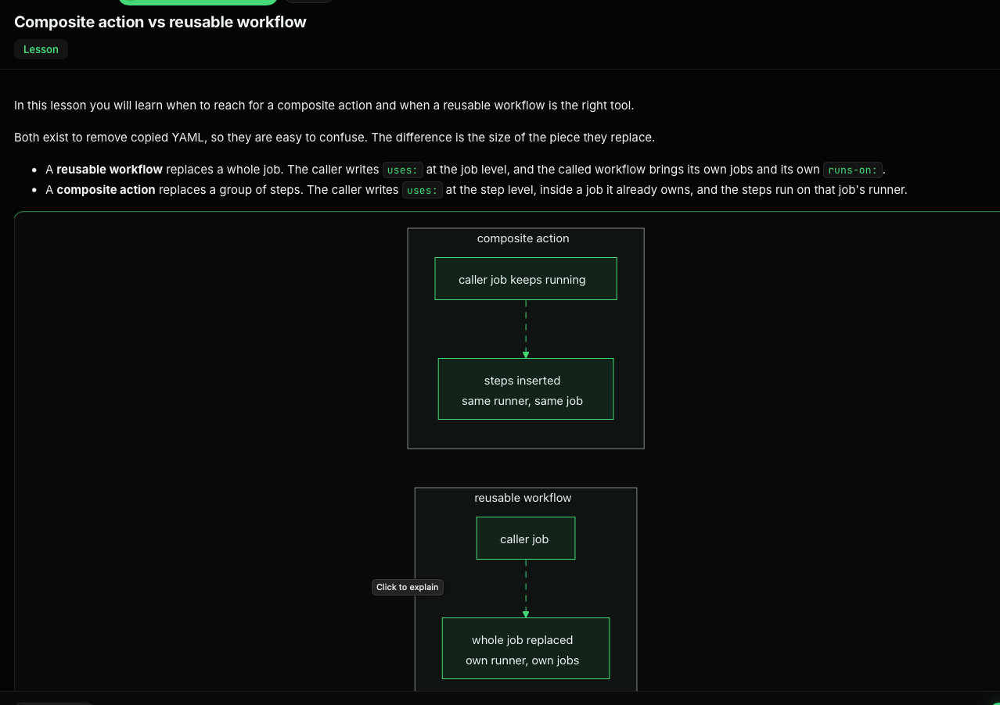

For example, a composite action can collect a few repeated commands under one
name. Each `run` step in the action must declare a `shell`:

```yaml
name: Build information
description: Print basic build details

runs:
  using: composite
  steps:
    - name: Show branch
      shell: bash
      run: echo "Branch $GITHUB_REF_NAME"
    - name: Show commit
      shell: bash
      run: echo "Commit $GITHUB_SHA"
```

Call the local action from a job with a step-level `uses`:

```yaml
steps:
  - uses: actions/checkout@v4
  - name: Print build information
    uses: ./.github/actions/build-info
```

### Composite action or reusable workflow?

Both help avoid duplicated YAML, but they package work at different levels.

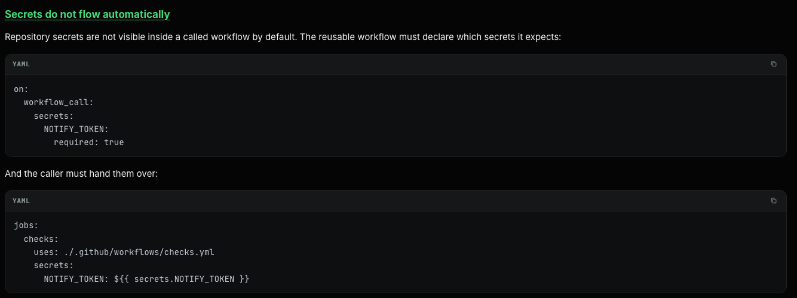

| Choose a... | It packages... | It runs... |
| --- | --- | --- |
| Composite action | A group of steps | Inside the caller's job, on the same runner |
| Reusable workflow | One or more jobs | As its own jobs, with their own runner configuration |

Use a composite action for a recipe of steps that belongs inside an existing
job. Use a reusable workflow when the shared unit needs a complete job or
multiple jobs, such as a common CI pipeline. Pass data through declared
inputs, outputs, artifacts, and secrets rather than relying on files shared
between separate jobs.

## 8. Self-hosted runners

GitHub-hosted runners are managed by GitHub. A self-hosted runner is a machine
you register to execute jobs for your repository or organization.

To add one, open the repository's **Settings → Actions → Runners** page and
follow GitHub's current setup instructions. Registration tokens are
short-lived; do not paste a personal access token or registration token into
this README, commit it to the repository, or persist it in shell history or
Git credentials. Treat a self-hosted runner as part of your infrastructure:
limit which repositories and workflows can use it, and keep it updated.

## Continue learning

Try a small workflow, inspect its run in the GitHub Actions tab, and then add
one capability at a time: a path filter, a setup action, a context value, or a
reusable component. The screenshots above follow the same progression, from
workflow structure through reuse and runner choices.
