# Addressing and routing

This guide covers how addresses identify machines and interfaces, how subnet masks divide networks, and how the kernel decides where to send packets.

## IPv4

Each IPv4 address is 32 bits, written as four groups of 8 bits (called octets). The dots are just a readable way to separate those groups.

In one 8-bit group, the bit positions have these values:

```text
Bit:    1   1   1   1   1   1   1   1
Value: 128  64  32  16   8   4   2   1
```

Those values are powers of 2, from (2^7) down to (2^0). Adding them gives:

```text
2⁷ + 2⁶ + 2⁵ + 2⁴ + 2³ + 2² + 2¹ + 2⁰ = 255
```

So an octet can represent values from 0 to 255—that’s 256 possible values. The highest value is 255 because counting starts at zero.

For four octets, the total number of possible combinations is:

```text
256 × 256 × 256 × 256 = 256⁴ = 2³² = 4,294,967,296
```

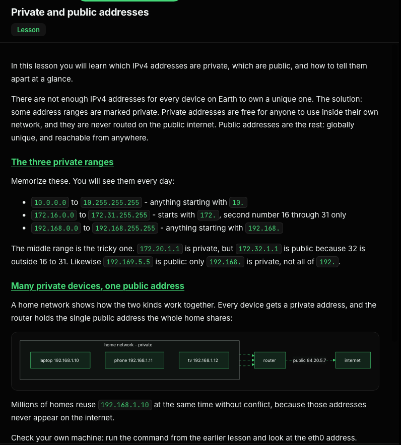

## Interfaces and addresses

An IP address is assigned to a network interface. An interface is a connection point the operating system uses to send and receive packets. A machine may have several interfaces: a physical network card, loopback, a VPN, or virtual interfaces for containers and bridges.

The interface list shows each interface and its state. `UP` means enabled; `DOWN` means it is not operational. Loopback can show `UNKNOWN`, which is normal.

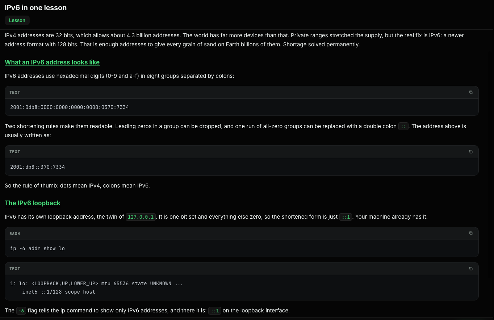

IPv6 uses 128-bit addresses written as hexadecimal groups separated by colons. Leading zeroes in a group can be omitted, and one run of all-zero groups can be shortened to `::`.

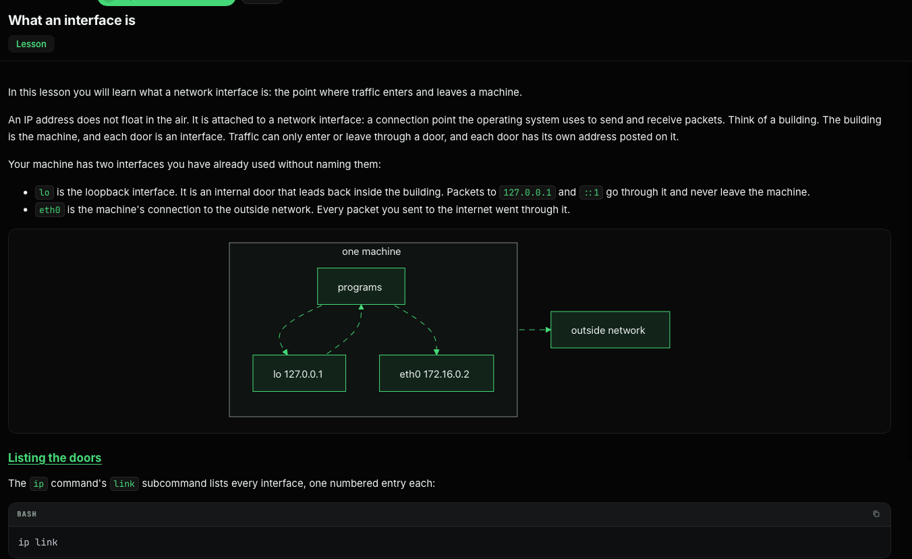

`ip addr` displays addresses assigned to interfaces. Its output includes the interface name and state, IP address and prefix, link-layer address, and scope.

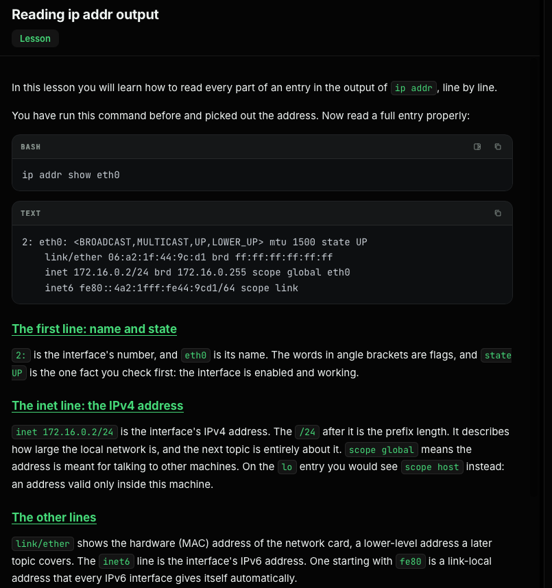

Linux also supports virtual interfaces. A dummy interface connects to nothing, but the kernel can treat it like an interface and use it in routing and testing.

```bash
ip link add dummy0 type dummy
ip link set dummy0 up
ip addr show dummy0
```

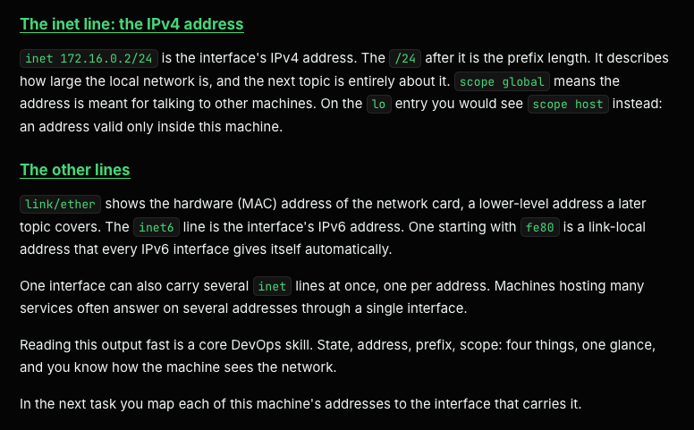

## Subnets and CIDR

A subnet mask divides an IP address into a network part and a host part. For example, with `255.255.255.0`, the first three octets identify the network and the last identifies a host.

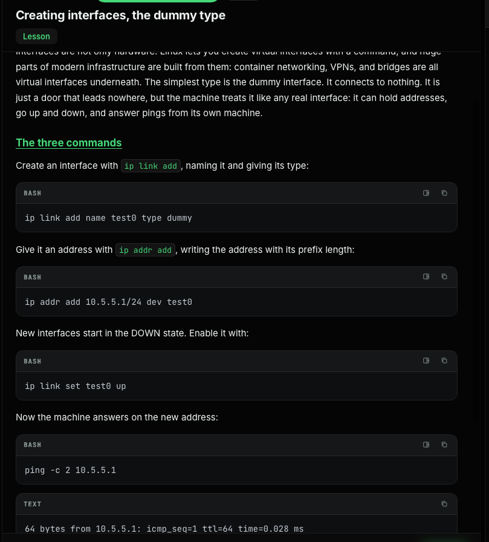

CIDR notation writes the number of network bits after a slash. For example, `/24` is equivalent to `255.255.255.0`.

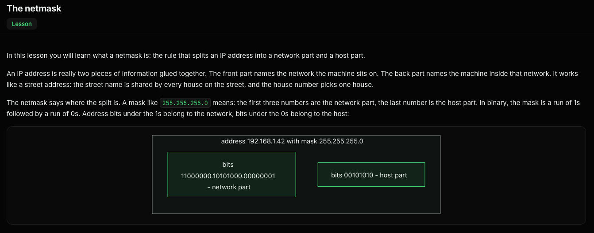

Common prefixes:

- `/8` — `255.0.0.0`
- `/16` — `255.255.0.0`
- `/24` — `255.255.255.0`

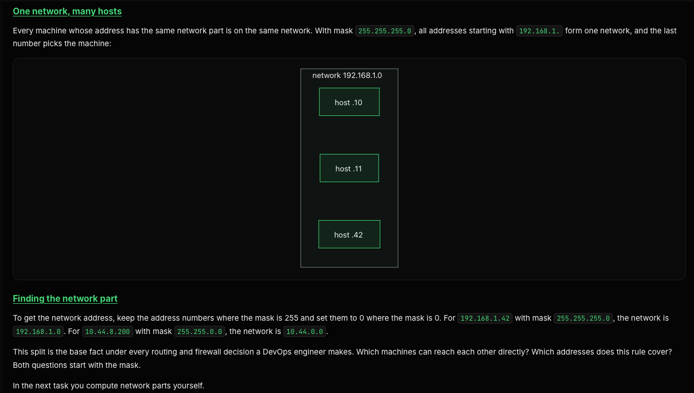

The netmask determines which destinations are on the same local network and which must be sent to a router.

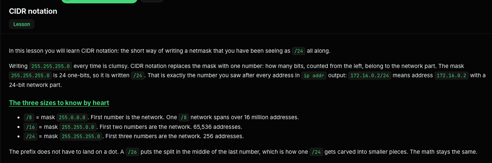

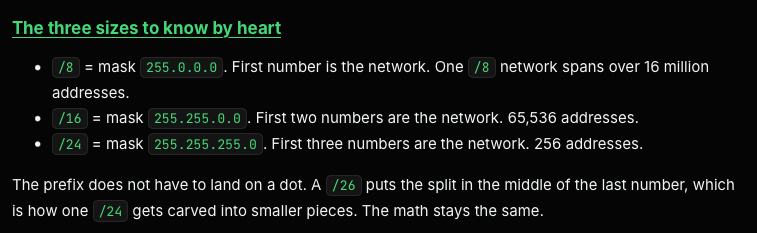

The first address in a subnet is the network address; the last is the broadcast address. In a typical IPv4 subnet, the addresses between them are available for hosts.

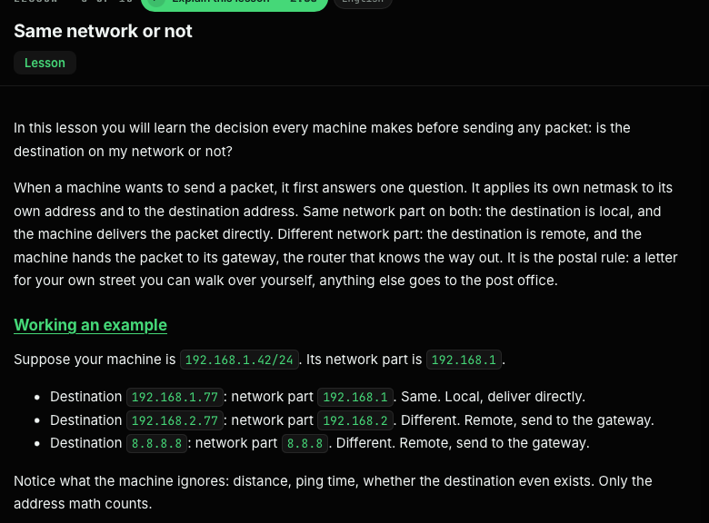

## MAC addresses, ARP, and the neighbor table

An IP address identifies a destination across networks. On the local link, Ethernet uses a MAC address to deliver a frame to the next device.

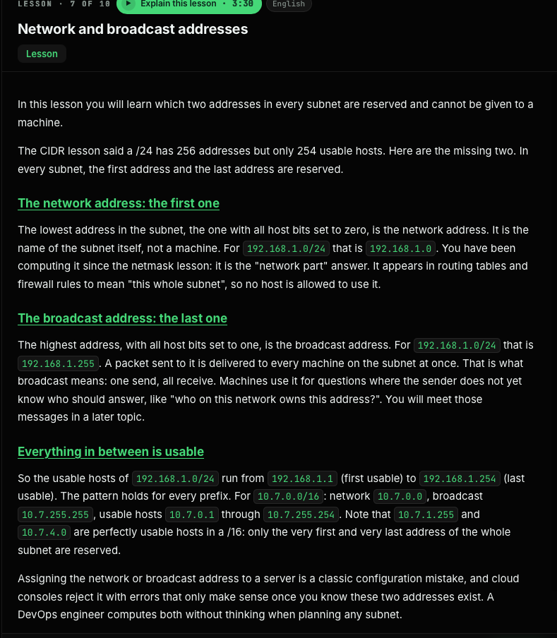

ARP discovers the MAC address associated with a local IPv4 address. A machine broadcasts a request, and the owner of the IP replies with its MAC address.

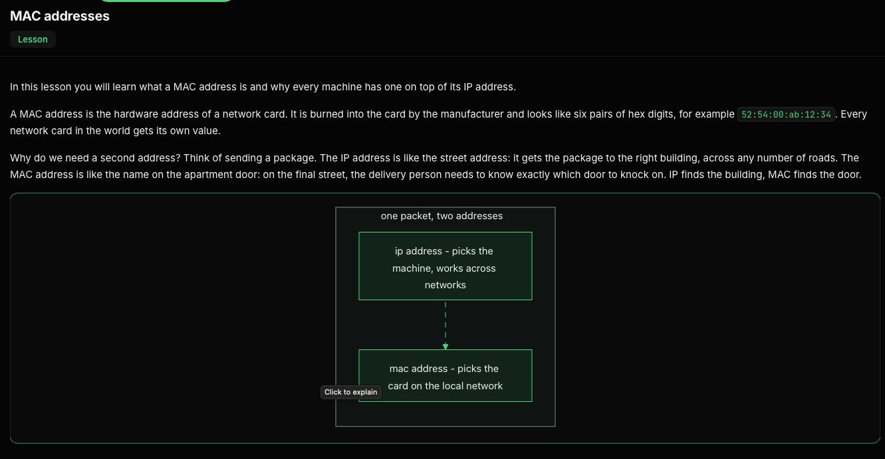

The kernel caches these IP-to-MAC mappings in its neighbor table. `ip neigh` displays the table; `arping` sends an ARP request directly.

```bash
ip neigh
arping -c 2 192.168.1.1
```

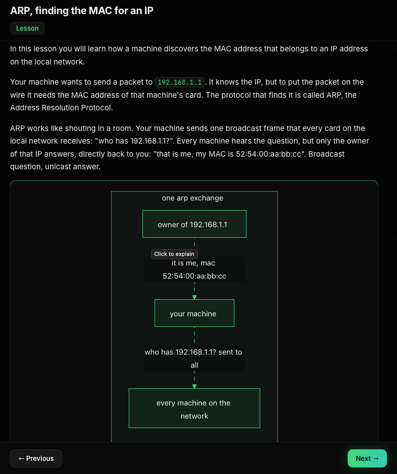

Example gateway and neighbor output:

```text
root@escbash-lab:~/answers# ip -4 route show default
default via 172.30.0.1 dev eth0
root@escbash-lab:~/answers# ip route show
default via 172.30.0.1 dev eth0
172.30.0.0/30 dev eth0 proto kernel scope link src 172.30.0.2
root@escbash-lab:~/answers# ip neigh
172.30.0.1 dev eth0 lladdr 6e:a4:b5:08:53:0c REACHABLE
```

Flushing the neighbor table and then generating traffic can make an entry appear again:

```bash
ip neigh flush all
ip neigh
arping -c 4 172.30.0.1
ip neigh
```

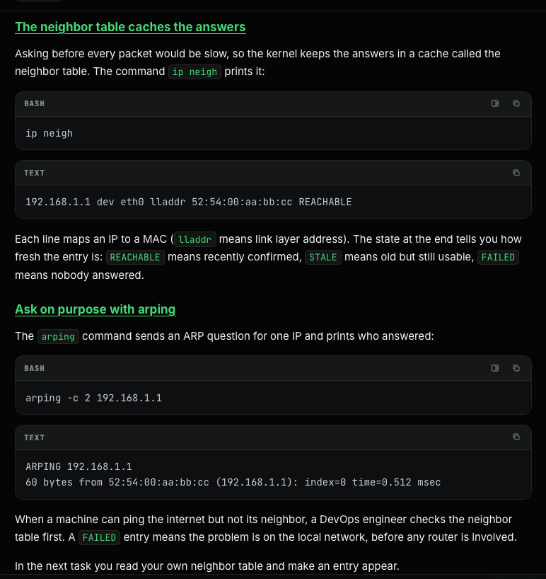

## Default gateway and route selection

The default gateway is the router a machine uses when no more-specific route matches a destination. Inspect routes with `ip route`:

```text
default via 172.30.0.1 dev eth0
172.30.0.0/30 dev eth0 proto kernel scope link src 172.30.0.2
```

The kernel uses the most-specific matching prefix. A `/16` route wins over the default route (`/0`) for destinations inside that `/16`.

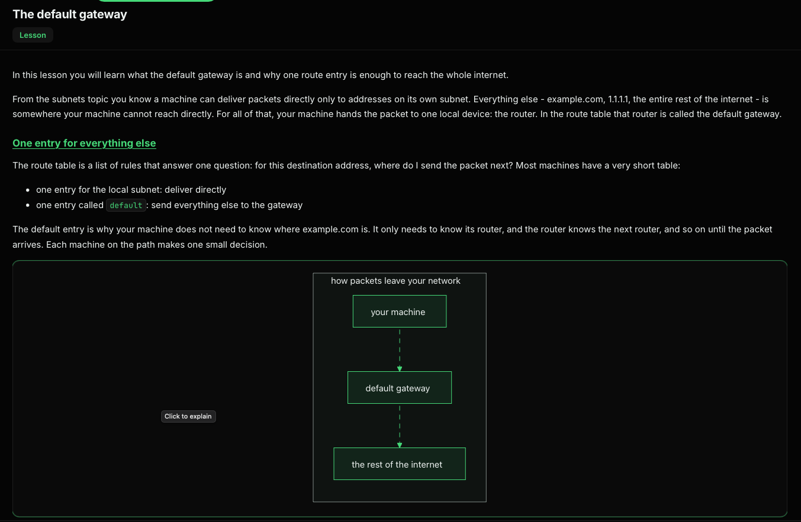

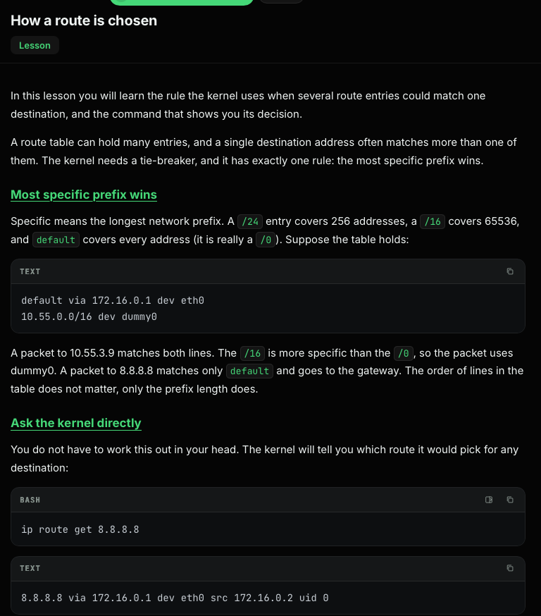

Check the kernel’s current decision for a destination:

```bash
ip route get 10.55.3.9
```

Add a dummy interface and a route to demonstrate longest-prefix matching:

```bash
ip link add dummy0 type dummy
ip link set dummy0 up
ip route add 10.55.0.0/16 dev dummy0
ip route get 10.55.3.9
```

The final lookup should use `dev dummy0` instead of the default gateway. These changes are temporary; remove them with:

```bash
ip route del 10.55.0.0/16 dev dummy0
ip link del dummy0
```

You can ask the kernel how it would route several destinations and save the answers:

```bash
for dst in 1.1.1.1 9.9.9.9 127.0.0.1 10.55.3.9 10.55.200.1 172.16.0.2; do
  ip route get "$dst"
done
```

## Traceroute

The default gateway is only the first hop to a remote destination. `traceroute` reveals responding routers along the path by sending probes with increasing IP time-to-live (TTL) values. Each router decrements the TTL; when it reaches zero, the router usually returns an ICMP time-exceeded message.

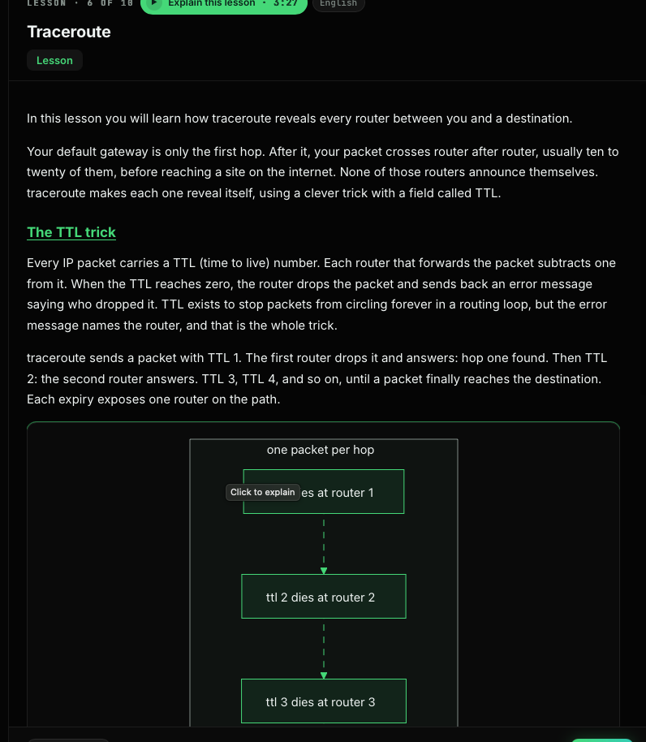

Each probe uses a different TTL, exposing the next hop in sequence:

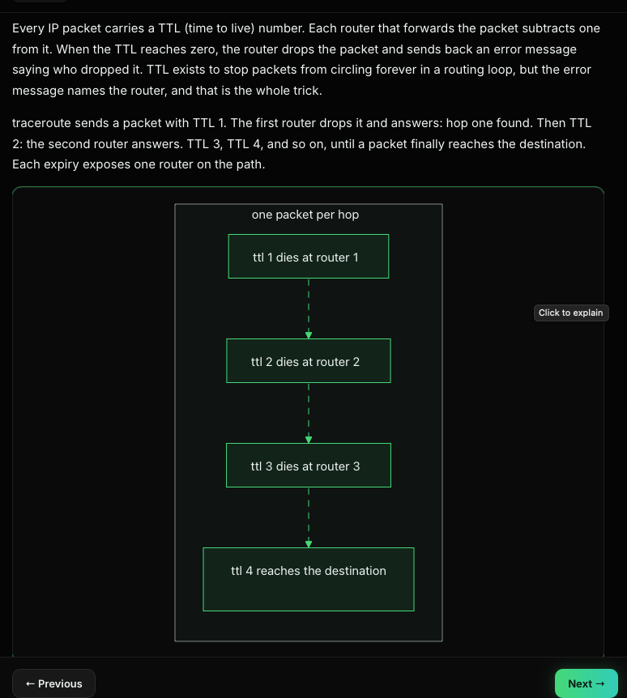

Run a numeric trace to avoid reverse-DNS lookups:

```bash
traceroute -n 1.1.1.1
```

Each output line is a hop, normally with three probe times. `* * *` means probes did not receive a response before the timeout; some routers suppress these messages, so a missing hop does not necessarily mean traffic stopped there.

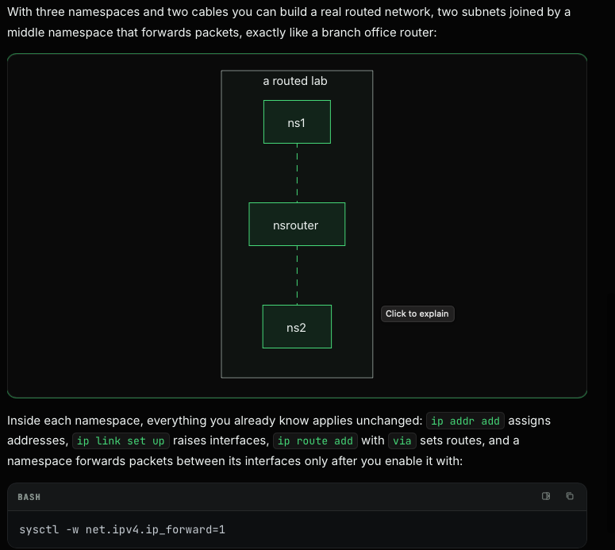

## Network namespaces and veth pairs

A network namespace has its own interfaces, IP addresses, routes, and network stack. Processes run inside it see that namespace’s networking, which makes namespaces useful for creating small multi-machine labs on one Linux host.

Create and inspect namespaces:

```bash
ip netns add ns1
ip netns exec ns1 ip addr
ip netns list
```

A new namespace has a loopback interface, initially down. Bring it up when you need loopback networking:

```bash
ip -n ns1 link set lo up
```

A veth pair acts like a virtual cable: packets sent through one end arrive at the peer. Put each end in a different namespace to connect them:

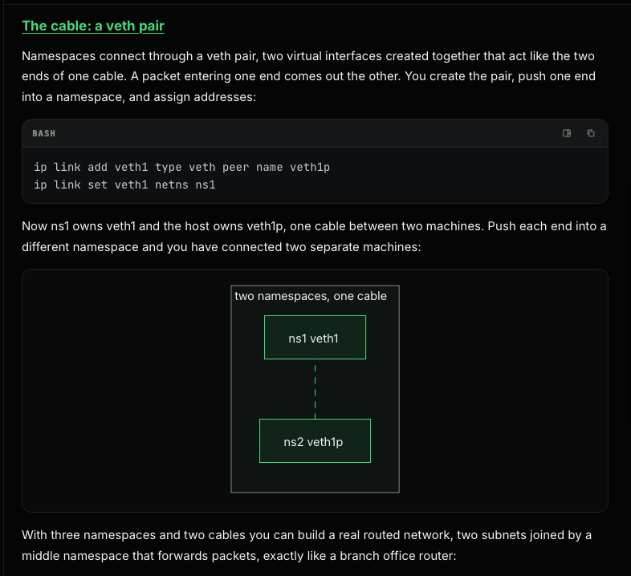

```bash
ip link add veth1 type veth peer name veth1p
ip link set veth1 netns ns1
ip link set veth1p netns ns2

ip -n ns1 addr add 10.100.1.1/24 dev veth1
ip -n ns2 addr add 10.100.1.2/24 dev veth1p
ip -n ns1 link set veth1 up
ip -n ns2 link set veth1p up

ip netns exec ns1 ping -c 4 10.100.1.2
```

The interfaces must be up before the link can carry traffic. Since both addresses are in the same `/24`, the namespaces communicate directly over the veth pair; a router and IP forwarding are not needed.

## Route between namespaces

Two directly connected namespaces demonstrate a single link. To route between different subnets, connect each endpoint to a router namespace with its own veth pair:

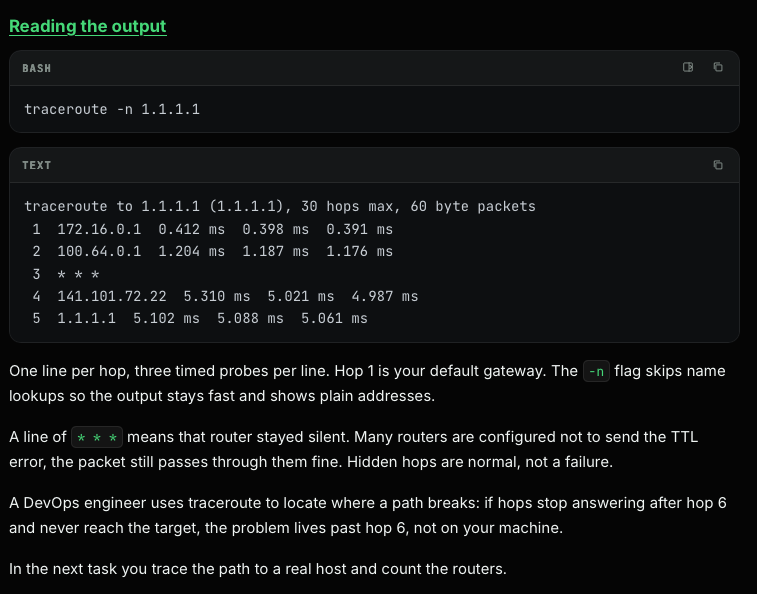

The lab topology is:

```text
ns1 (10.100.1.1/24) -- 10.100.1.254/24 nsrouter
ns2 (10.100.2.1/24) -- 10.100.2.254/24 nsrouter
```

Create the namespaces (skip this if they already exist):

```bash
ip netns add ns1
ip netns add ns2
ip netns add nsrouter
```

Create the two virtual cables and move each end into its namespace:

```bash
ip link add veth1 type veth peer name veth1p
ip link set veth1 netns ns1
ip link set veth1p netns nsrouter

ip link add veth2 type veth peer name veth2p
ip link set veth2 netns ns2
ip link set veth2p netns nsrouter
```

Assign addresses and bring up all four interfaces:

```bash
ip -n ns1 addr add 10.100.1.1/24 dev veth1
ip -n nsrouter addr add 10.100.1.254/24 dev veth1p
ip -n ns2 addr add 10.100.2.1/24 dev veth2
ip -n nsrouter addr add 10.100.2.254/24 dev veth2p

ip -n ns1 link set veth1 up
ip -n nsrouter link set veth1p up
ip -n ns2 link set veth2 up
ip -n nsrouter link set veth2p up
```

Enable IPv4 forwarding in the router namespace, then add a route in each endpoint namespace. Each route uses the router address on that endpoint’s directly connected subnet as its next hop:

```bash
ip netns exec nsrouter sysctl -w net.ipv4.ip_forward=1

ip -n ns1 route add 10.100.2.0/24 via 10.100.1.254
ip -n ns2 route add 10.100.1.0/24 via 10.100.2.254
```

Verify the routes and forwarding setting, then ping from `ns1` to `ns2`:

```bash
ip -n ns1 route
ip -n ns2 route
ip netns exec nsrouter sysctl net.ipv4.ip_forward
ip netns exec ns1 ping -c 4 10.100.2.1
```

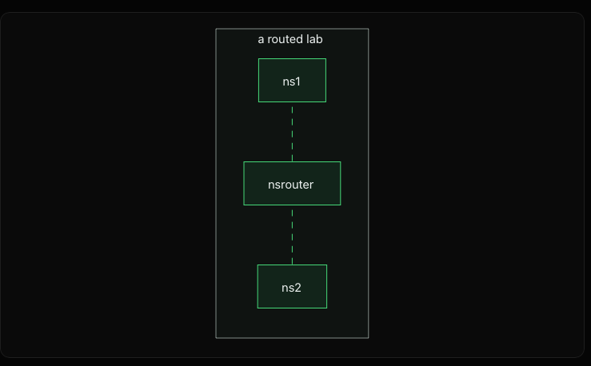

The ping crosses `nsrouter`, so forwarding must be enabled there. This setting is scoped to the router namespace; it does not enable forwarding on the host’s network stack.

# Add route table 
```
p route get 10.55.3.9
10.55.3.9 via 172.30.0.1 dev eth0 src 172.30.0.2 uid 0 
    cache 
root@escbash-lab:~# ip route
default via 172.30.0.1 dev eth0 
172.30.0.0/30 dev eth0 proto kernel scope link src 172.30.0.2 
root@escbash-lab:~# ip link set dummy up
Cannot find device "dummy"
root@escbash-lab:~# ip link set dummy0 up
root@escbash-lab:~# ip route add 10.55.0.0/16 dev dummy0
root@escbash-lab:~# 
root@escbash-lab:~# 
root@escbash-lab:~# ip route get 10.55.3.9
10.55.3.9 dev dummy0 src 172.30.0.2 uid 0 
    cache 
root@escbash-lab:~# 
root@escbash-lab:~# ip route get 10.55.3.9 > /root/answers/route-decision.txt
root@escbash-lab:~# 
```