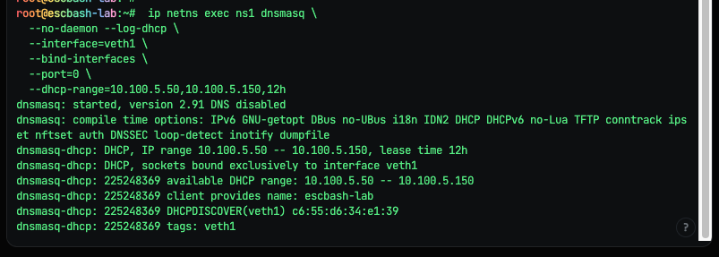
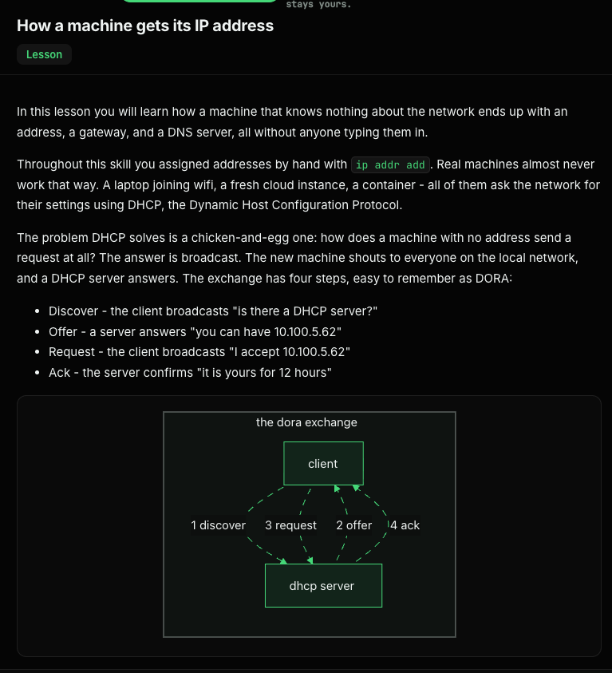
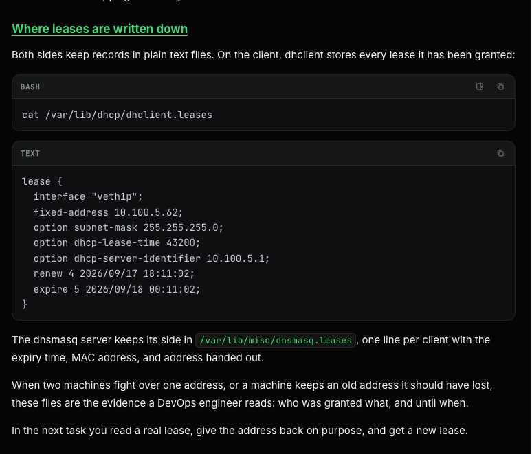
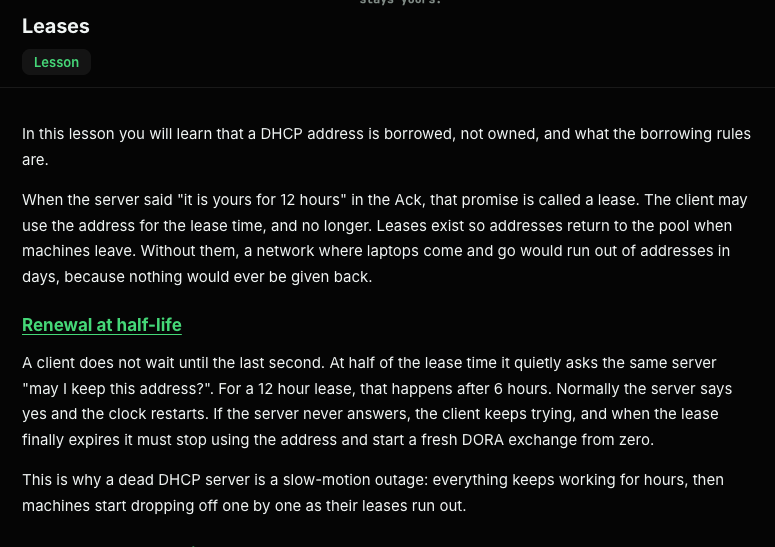
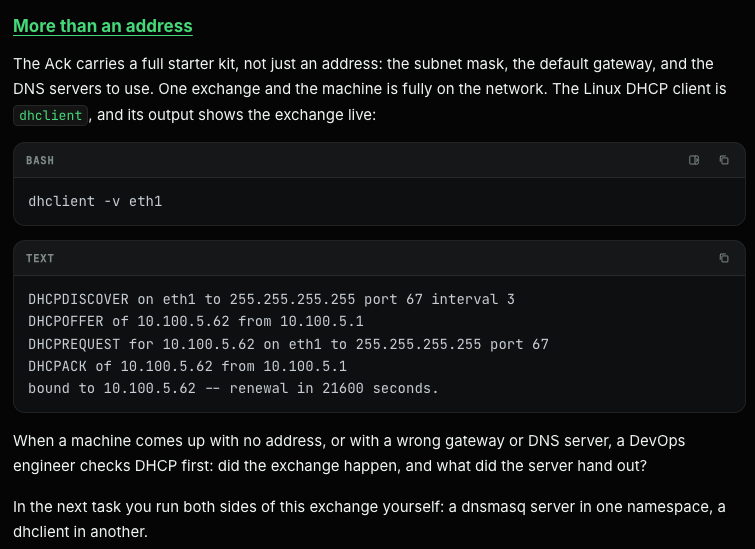
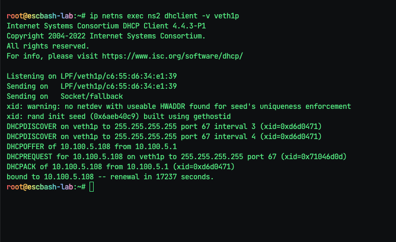

# DHCP

The Dynamic Host Configuration Protocol (DHCP) lets a client obtain network settings without manually assigning them. A server can provide an IP address, subnet mask, default gateway, DNS servers, and a lease duration.

## The DORA exchange

When a client has no address, it broadcasts a request on the local network. The exchange is commonly remembered as DORA:

1. **Discover** — the client looks for DHCP servers.
2. **Offer** — a server offers an address and configuration.
3. **Request** — the client asks to use the offered address.
4. **Acknowledge** — the server confirms the lease.



The address is leased for a limited time rather than permanently assigned. Clients normally try to renew a lease before it expires. A lease also carries other options, such as the subnet mask and router address.

## Run a DHCP lab with network namespaces

This example assumes two namespaces are connected by a veth pair:

- `ns1` has `veth1` up with address `10.100.5.1/24`.
- `ns2` has `veth1p` up, with no IPv4 address yet.

See the [addressing and routing guide](../addressing-and-routing/readme.md) for namespace and veth setup.

Start `dnsmasq` as a DHCP-only server in `ns1`. Run it in the foreground so its DHCP logs remain visible:

```bash
ip netns exec ns1 dnsmasq \
  --no-daemon --log-dhcp \
  --interface=veth1 \
  --bind-interfaces \
  --port=0 \
  --dhcp-range=10.100.5.50,10.100.5.150,12h
```

`--port=0` disables DNS service; DHCP remains enabled. In a second terminal, request a lease from `ns2`:

```bash
ip netns exec ns2 dhclient -v veth1p
```

The verbose client output should show `DHCPDISCOVER`, `DHCPOFFER`, `DHCPREQUEST`, and `DHCPACK`, followed by the address it bound. The server log shows the corresponding activity:







Verify that the interface now has an address in the configured range:

```bash
ip -n ns2 -4 addr show dev veth1p
```

The server may assign any available address in `10.100.5.50`–`10.100.5.150`. In this lab the server address, `10.100.5.1`, is also advertised as the router.

## Release and inspect a lease

Release the lease from the client:

```bash
ip netns exec ns2 dhclient -r -v veth1p
```

The client sends a DHCP release to the server. On systems using ISC `dhclient`, granted leases are recorded in `/var/lib/dhcp/dhclient.leases`; the exact location depends on the client and distribution.




