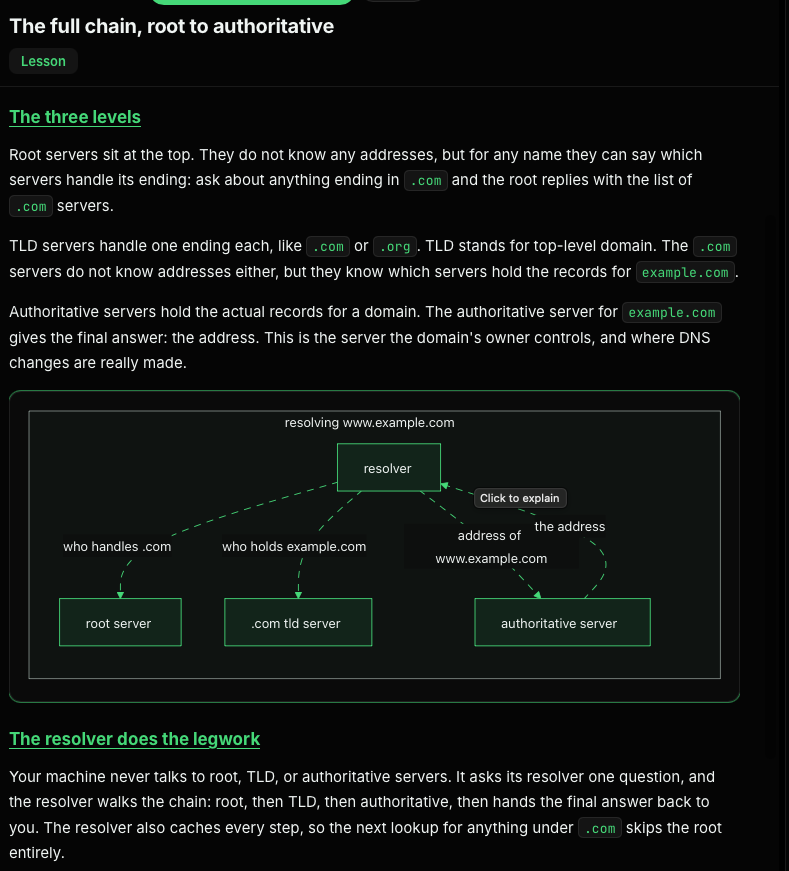
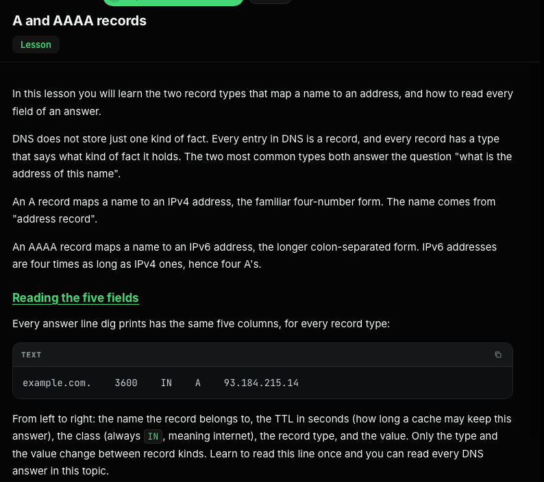
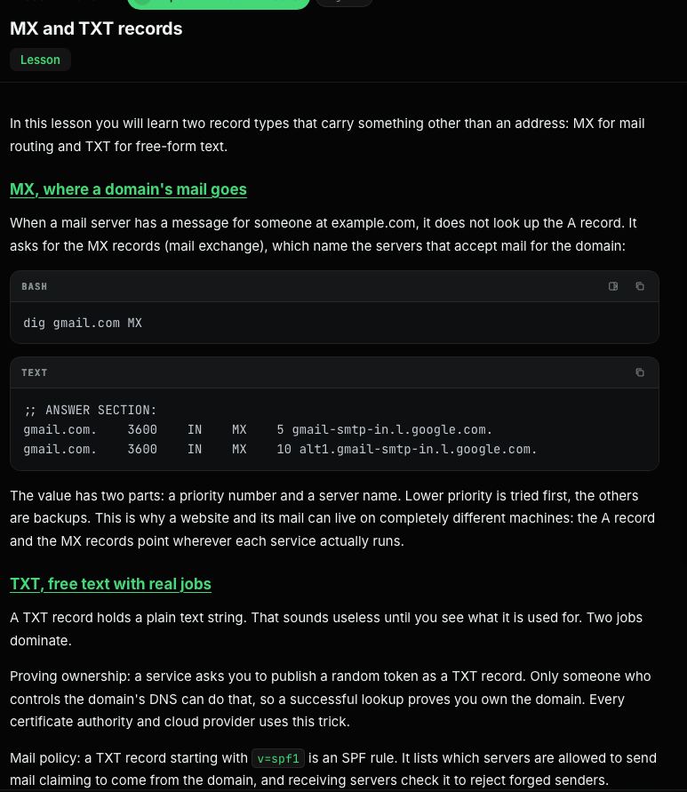
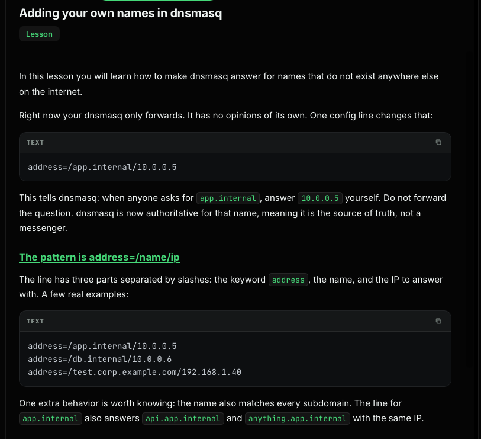
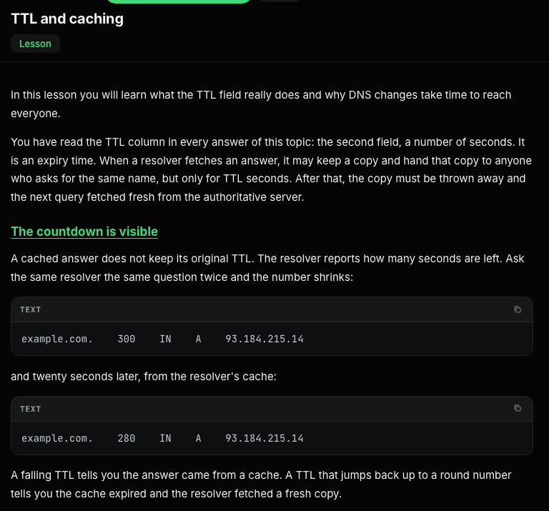
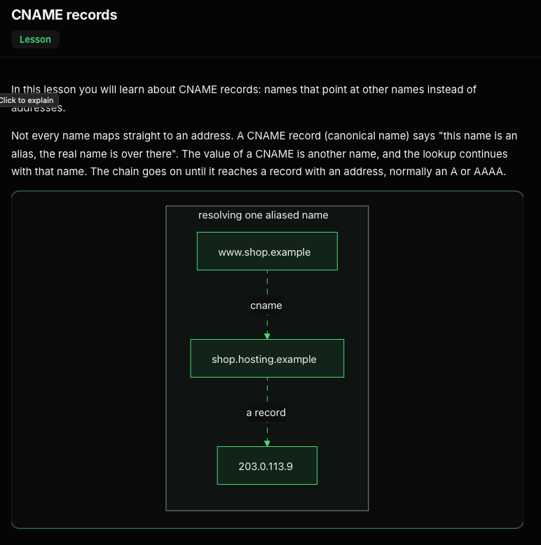
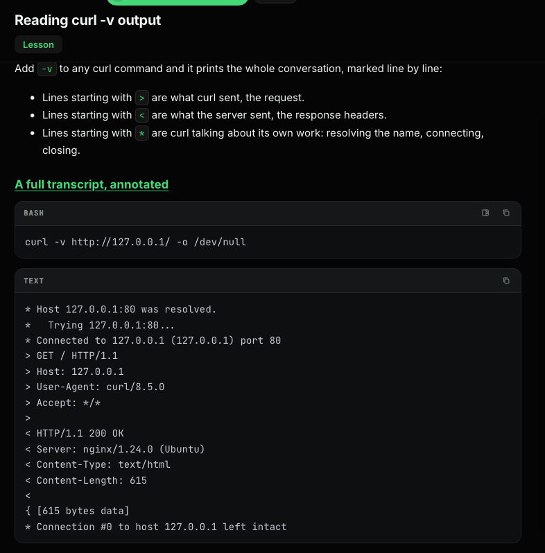

# DNS

DNS maps names to records. A resolver can answer from cache, serve locally configured names, or forward a query to an upstream resolver.

## Querying DNS

`dig` is a flexible DNS troubleshooting tool. Common examples:

```bash
dig example.com A                    # query IPv4 records
dig @1.1.1.1 example.com MX          # query a specific DNS server
dig +short example.com               # concise output
dig +trace example.com A             # follow DNS delegation
dig @hera.ns.cloudflare.com example.com A +norecurse
```

`getent hosts name` uses the system name-service switch (NSS), which may check `/etc/hosts` before DNS. `nslookup` is another DNS lookup utility. The `SERVER` line in `dig` output identifies the server the client queried; if it is `127.0.0.1`, that is a local resolver and does not reveal whether it forwarded the query upstream.



An authoritative answer has the `aa` flag in the `dig` response header. `dig +trace` follows referrals from the root to the top-level domain and then the domain’s authoritative name servers.



## Record types

- `A` maps a name to an IPv4 address.
- `AAAA` maps a name to an IPv6 address.
- `CNAME` aliases one name to another name.
- `MX` identifies mail servers for a domain.
- `TXT` stores text values used for purposes such as domain verification and email policy.

An answer can contain multiple valid addresses, and DNS answers may vary by resolver or over time.





## DNS delegation and cache TTL

The DNS hierarchy includes root servers, top-level domain servers (such as `.com`), and authoritative servers for a domain. A recursive resolver follows referrals and can cache answers.

The TTL is the number of seconds a resolver may keep a record. A cached answer reports the remaining TTL, which counts down as the cache ages.



If a local caching resolver listens on port `5353`, query it with `dig`’s `-p` option:

```bash
dig @127.0.0.1 -p 5353 example.com
```

Repeat the same query after a few seconds and compare the TTL column for the same answer record.

To observe a DNS query while it is in flight, start a system lookup in the background and inspect UDP sockets. DNS commonly uses port 53; the lookup can finish quickly, so repeat if needed:

```bash
for i in $(seq 1 20); do
  getent hosts example.com >/dev/null &
  ss -uapn
  wait
done
```

## dnsmasq as a local resolver

dnsmasq can answer names configured locally, forward other queries to an upstream resolver, and cache responses according to their TTL.

Example `/etc/dnsmasq.d/lab.conf`:

```ini
listen-address=127.0.0.1
bind-interfaces
no-resolv
server=1.1.1.1
```

With that configuration, dnsmasq listens locally and forwards unknown names to `1.1.1.1`. To define an internal name locally, add an address rule:

```ini
address=/app.internal/127.0.0.1
```

Then test the resolver directly:

```bash
dig @127.0.0.1 example.com
dig @127.0.0.1 app.internal
```

The `SERVER: 127.0.0.1#53` line means the client queried dnsmasq; dnsmasq may have answered from its cache, from a local rule, or by forwarding upstream.





To use dnsmasq as the machine’s default resolver, the resolver configuration should point at it, for example:

```text
nameserver 127.0.0.1
options timeout:2 attempts:3 rotate edns0
```

If `/etc/nsswitch.conf` has `hosts: files dns`, system lookups check `/etc/hosts` first and then DNS. `NXDOMAIN` means the DNS response says the queried name does not exist.

Example resolver output:

```text
root@escbash-lab:~# dig example.com
;; ->>HEADER<<- opcode: QUERY, status: NOERROR, id: 34415
;; flags: qr rd ra; QUERY: 1, ANSWER: 2, AUTHORITY: 0, ADDITIONAL: 1
;; ANSWER SECTION:
example.com.            162     IN      A       104.20.23.154
example.com.            162     IN      A       172.66.147.243
;; Query time: 0 msec
;; SERVER: 127.0.0.1#53(127.0.0.1) (UDP)
```

An unsuccessful lookup can show `status: NXDOMAIN` in the header:

```text
root@escbash-lab:~# dig app.internall
;; ->>HEADER<<- opcode: QUERY, status: NXDOMAIN, id: 18609
;; QUESTION SECTION:
;app.internall.                 IN      A
```

In this example, the name was mistyped: `app.internall` has an extra `l`.
