# Firewalls

A firewall filters packets by checking them against an ordered set of rules. These notes introduce Linux `iptables`, explain how to read and manage rules, and walk through a few practice scenarios.

## Packet paths and chains

Linux `iptables` has three built-in filter chains:

- **INPUT**: packets arriving for this machine.
- **OUTPUT**: packets created by this machine.
- **FORWARD**: packets passing through this machine to another destination.

The kernel chooses the packet path before checking rules. A connection to a local web server uses INPUT; traffic routed between network namespaces uses FORWARD.

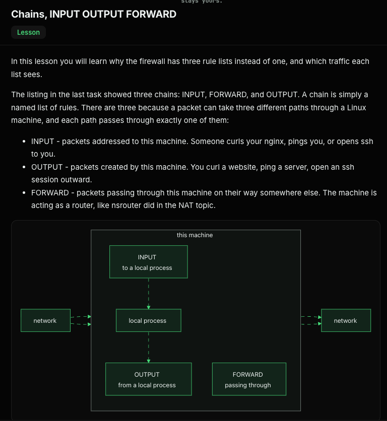

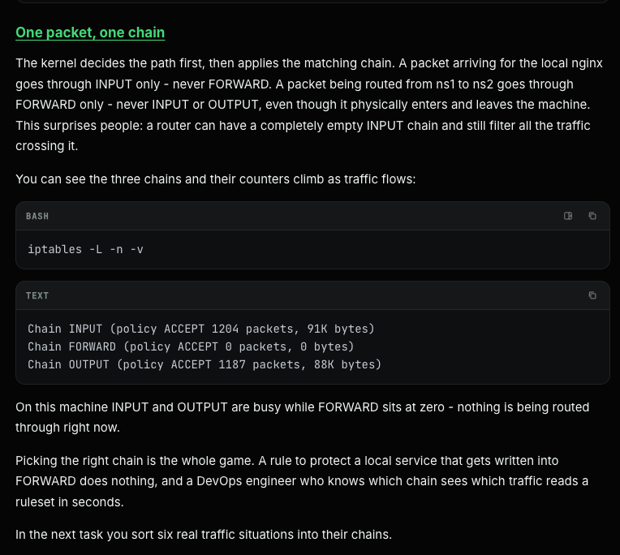

List the rules and policies:

```bash
iptables -L -n
```

Add `-v` to see packet and byte counters:

```bash
iptables -L -n -v
```

## Reading a rule

A rule belongs to a chain and has zero or more matches followed by a target. Matches describe which packets the rule applies to; the target specifies what happens to a matching packet.

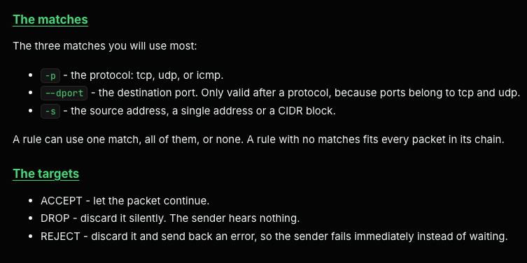

Common matches and targets:

- `-p`: protocol, such as `tcp`, `udp`, or `icmp`.
- `--dport`: destination port; use it with a protocol such as TCP or UDP.
- `-s`: source address or CIDR range.
- `ACCEPT`: allow the packet to continue.
- `DROP`: silently discard the packet.
- `REJECT`: discard the packet and send an error back.

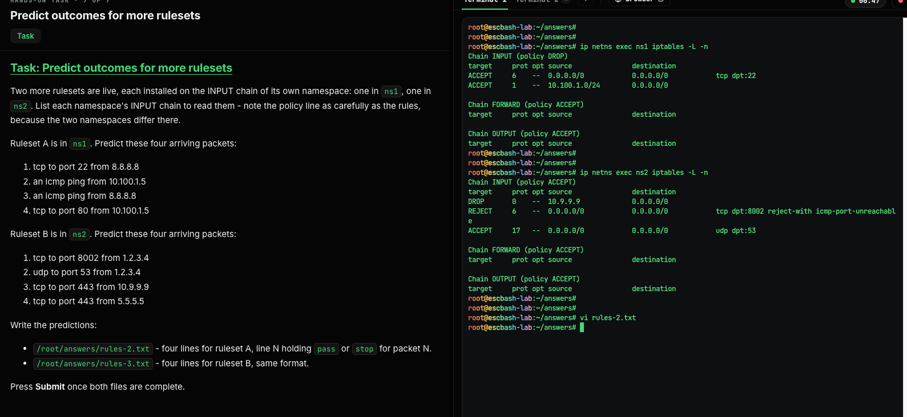

For example:

```bash
iptables -A INPUT -p tcp --dport 22 -s 10.0.0.0/8 -j ACCEPT
```

This appends a rule to INPUT that accepts TCP packets destined for port 22 when they come from `10.0.0.0/8`.

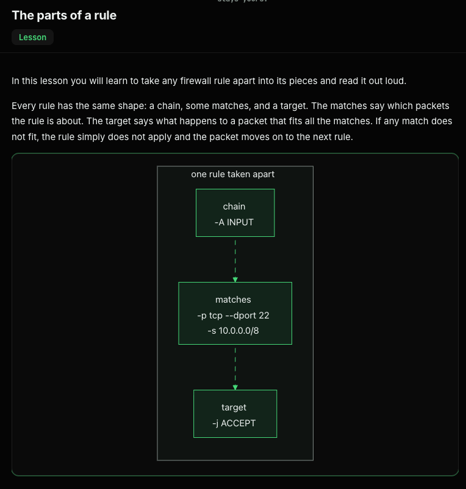

## Rule order and rule management

Rules are checked from top to bottom. When a packet matches a terminating target such as `ACCEPT` or `DROP`, processing stops. If no rule matches, the chain policy decides what happens.

A broad rule placed before a more specific one can shadow it. For example, a TCP DROP rule before a TCP port 8000 ACCEPT rule drops port 8000 packets before the allow rule is reached.

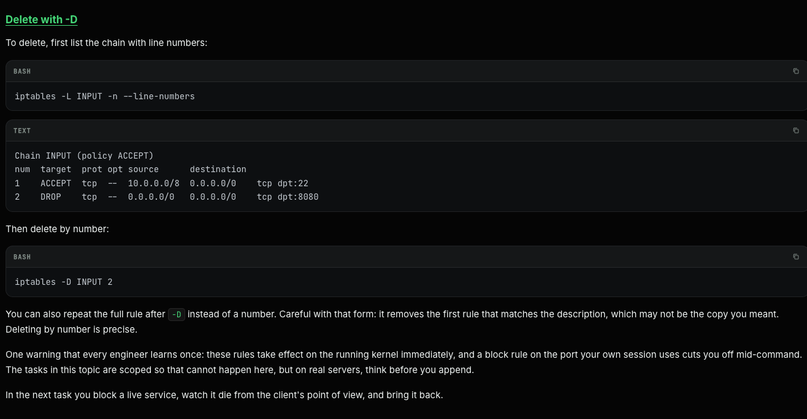

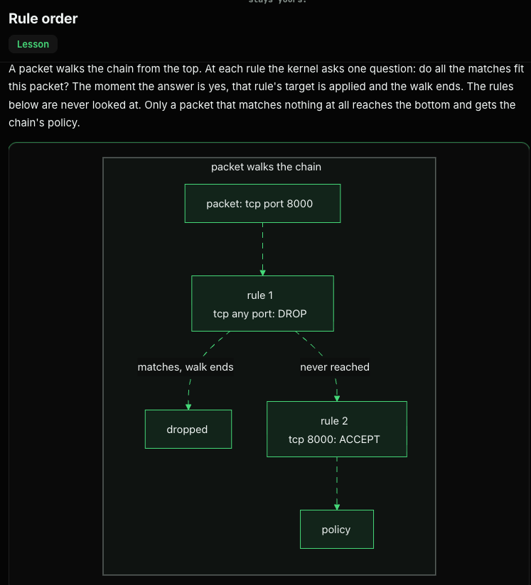

Use these options to manage rule position:

- `-A CHAIN`: append to the end of the chain.
- `-I CHAIN [N]`: insert at the start, or at position `N`.
- `-D CHAIN N`: delete the rule at position `N`.

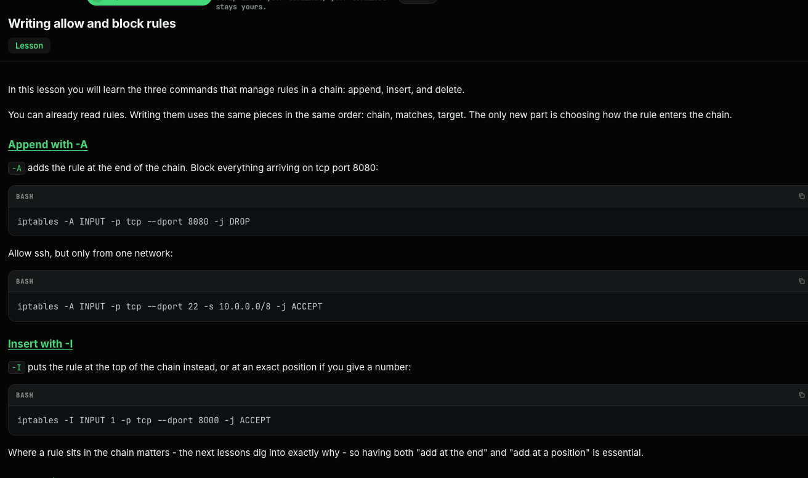

Before deleting by number, list the chain with line numbers. Rule numbers can change after each insertion or deletion:

```bash
iptables -L INPUT -n --line-numbers
iptables -D INPUT 2
```

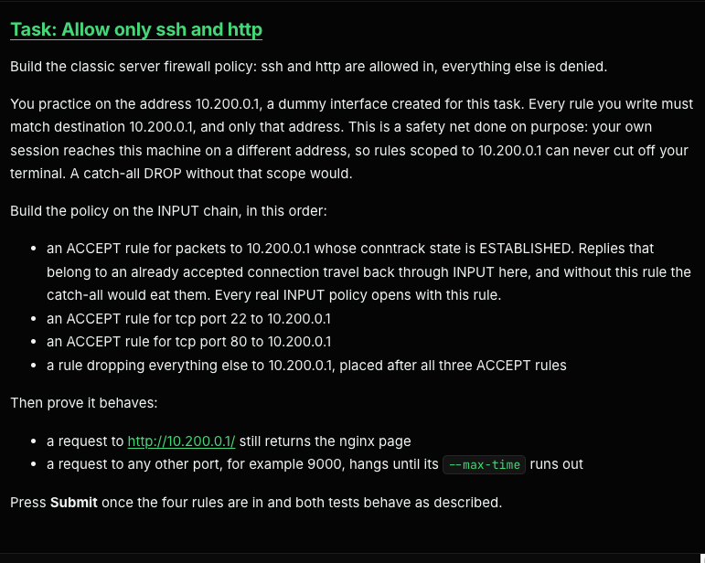

## Predicting rule outcomes

For each packet, start at the top of its chain and stop at the first matching terminating rule. If no rule matches, apply the chain policy.

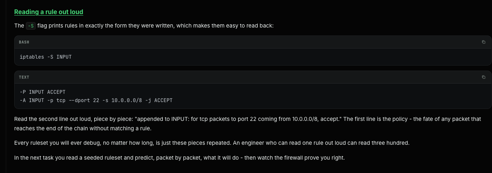

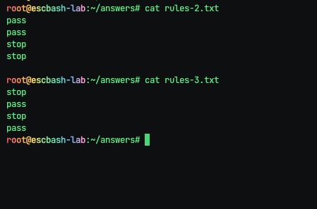

## DROP and REJECT

Both targets deny the packet, but they produce different client behavior. `DROP` gives no response, so the client waits and eventually times out. `REJECT` returns an error, so the client fails immediately.

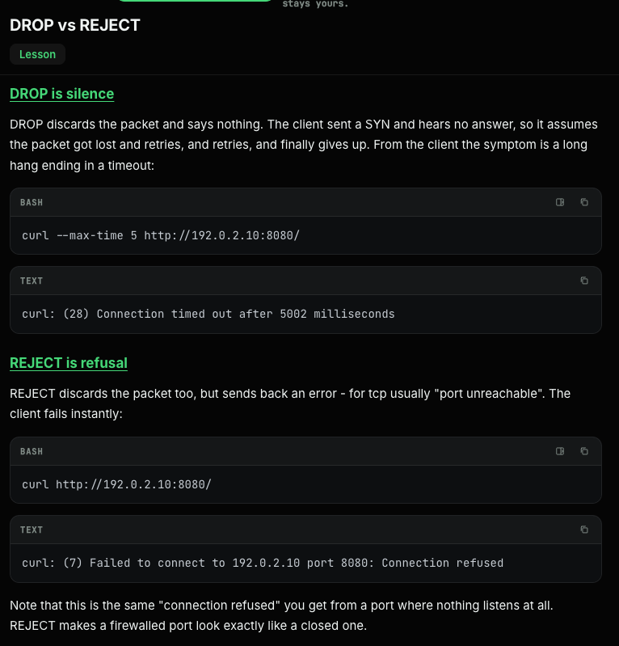

## Practice walkthroughs

### Block a local HTTP service on TCP port 8080

Start a test server in one terminal:

```bash
python3 -m http.server 8080
```

In another terminal, confirm it responds, then add a rule to silently drop incoming TCP traffic for port 8080:

```bash
curl --max-time 3 localhost:8080
iptables -A INPUT -p tcp --dport 8080 -j DROP
iptables -L INPUT -n --line-numbers
curl --max-time 3 localhost:8080
```

The first request returns the directory listing; the request after adding the rule times out. Remove the rule and confirm the service is reachable again:

```bash
iptables -D INPUT 1
curl --max-time 3 localhost:8080
```

In the recorded test, `curl -v localhost:8080` first tried IPv6 (`::1`) and got connection refused, then tried IPv4 (`127.0.0.1`) and waited until interrupted. The IPv4 INPUT rule caused the timeout. Use `--max-time` while testing DROP rules so the client does not wait indefinitely.

### Allow only SSH and HTTP to a specific address

This task uses `10.200.0.1`, assigned to the `fw0` interface. Scope every rule to that destination address so the catch-all rule does not block the management connection to the machine's other address.

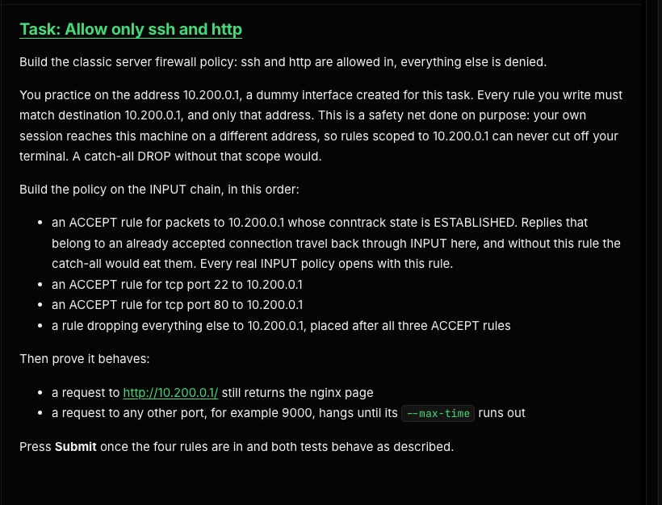

Add the rules to INPUT in this order:

```bash
iptables -A INPUT -d 10.200.0.1 -m conntrack --ctstate ESTABLISHED -j ACCEPT
iptables -A INPUT -p tcp --dport 22 -d 10.200.0.1 -j ACCEPT
iptables -A INPUT -d 10.200.0.1 -p tcp --dport 80 -j ACCEPT
iptables -A INPUT -d 10.200.0.1 -j DROP
```

The established-connection rule preserves replies for existing connections. SSH and HTTP are allowed next; the final rule drops other traffic addressed to `10.200.0.1`.

Check that HTTP responds and that an unallowed port times out:

```bash
curl http://10.200.0.1
curl --max-time 3 http://10.200.0.1:9000
```

### Fix a rule-order mistake in a network namespace

This ruleset drops all TCP traffic before it reaches the later allow rule for port 8000:

```text
-A INPUT -p tcp -j DROP
-A INPUT -p tcp --dport 8000 -j ACCEPT
```

Insert the specific allow rule at the top, then remove the now-redundant duplicate at line 3:

```bash
ip netns exec ns1 iptables -I INPUT 1 -p tcp -m tcp --dport 8000 -j ACCEPT
ip netns exec ns1 iptables -S INPUT
ip netns exec ns1 iptables -D INPUT 3
ip netns exec ns1 iptables -L -n --line-numbers
```

The resulting order is:

```text
-A INPUT -p tcp -m tcp --dport 8000 -j ACCEPT
-A INPUT -p tcp -j DROP
```

Port 8000 now matches the first rule; other TCP traffic reaches the broad DROP rule.
