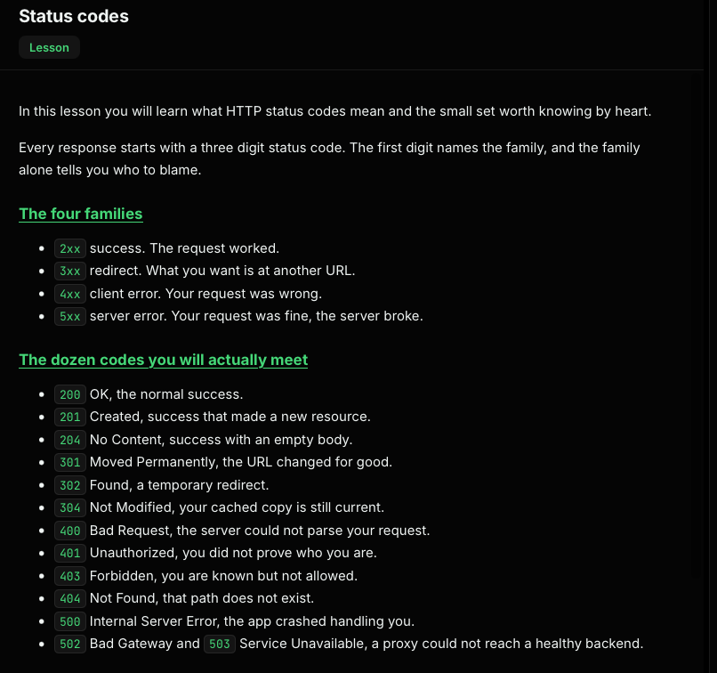
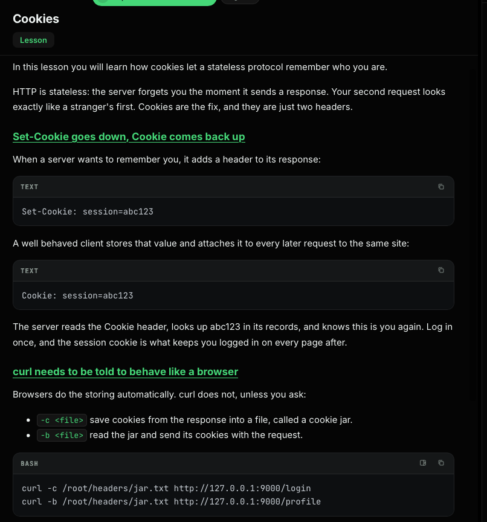
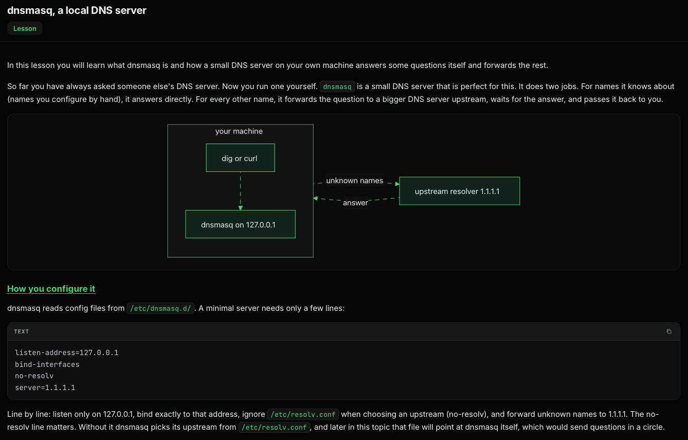
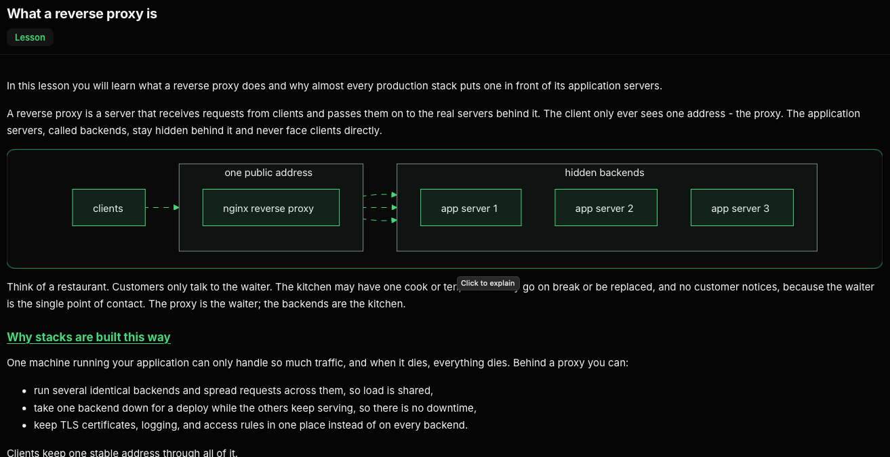
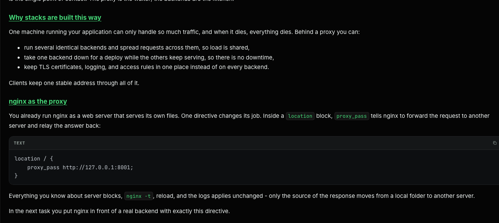
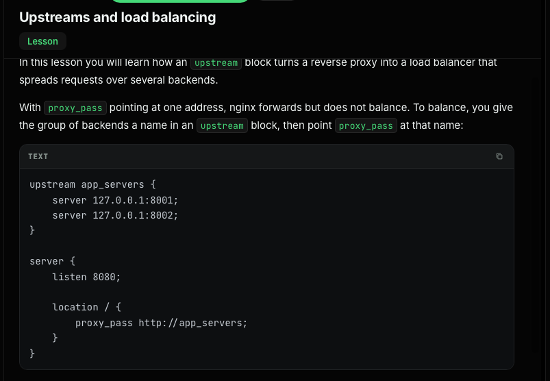
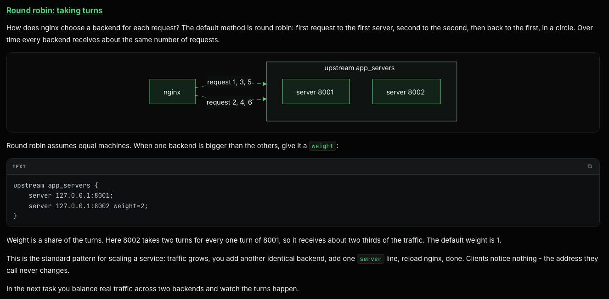

# HTTP and Nginx

HTTP is the application protocol used by web clients and servers. `curl` is useful for sending requests and inspecting responses; Nginx can serve multiple sites on the same address and port.

## HTTP requests and status codes

You can send a basic HTTP request with netcat:

```bash
printf 'GET / HTTP/1.1\r\nHost: localhost\r\nConnection: close\r\n\r\n' \
  | nc 127.0.0.1 80
```

Ask curl to print just the HTTP status code:

```bash
curl -s -o /dev/null -w '%{http_code}\n' http://127.0.0.1/nope
```



The first digit gives the broad category: `2xx` success, `3xx` redirect, `4xx` client error, and `5xx` server error.

To follow redirects, use `-L`. `-o` sends the response body to a file or target such as `/dev/null`; `-v` writes curl’s diagnostic transcript to stderr.

```bash
# Save the verbose transcript, discard the response body
curl -s -v -L http://127.0.0.1:8080/promo \
  -o /dev/null > /root/headers/redirect-followed.txt 2>&1

# Save the final response body instead
curl -s -L http://127.0.0.1:8080/promo \
  > /root/headers/redirect-followed.txt
```

To save response headers, use `-D`:

```bash
curl -s -L -D /root/headers/redirect-headers.txt \
  -o /dev/null http://127.0.0.1:8080/promo
```



## JSON responses

Many HTTP APIs return JSON. Use curl to fetch the response body and save it for inspection:

```bash
curl -s http://127.0.0.1:8080/api/status \
  > /root/headers/status.json
```

The `jq` utility parses JSON and can extract a field:

```bash
jq '.status' /root/headers/status.json
```

HTTP status and JSON content are separate checks. A `200 OK` response can contain an application-level error, while a `4xx` or `5xx` response can still include a JSON error object. Inspect both the status code and response body when debugging APIs.

## Cookies

HTTP is stateless: cookies let a server associate later requests with earlier ones. The server sends `Set-Cookie`; the client returns a `Cookie` header on later requests.

Use curl’s cookie jar options to save and replay cookies:

```bash
curl -c /root/headers/jar.txt http://127.0.0.1:9000/login
curl -b /root/headers/jar.txt http://127.0.0.1:9000/profile
```



## Nginx server blocks

A basic Nginx server block can listen on port 8080 and serve a directory:

```nginx
server {
    listen 8080;
    root /var/www/myapp;
    index index.html;
}
```

Test a configuration and reload Nginx:

```bash
nginx -t
systemctl reload nginx
```

Nginx can host several sites on the same IP address and port. It selects a `server` block by the request’s `Host` header:

```nginx
server {
    listen 8080;
    server_name site-a.test;
    root /var/www/site-a;
    index index.html;
}

server {
    listen 8080;
    server_name site-b.test;
    root /var/www/site-b;
    index index.html;
}
```

The names do not need to exist in DNS to test name-based virtual hosting locally; send the host explicitly:

```bash
curl -H 'Host: site-a.test' http://127.0.0.1:8080/
curl -H 'Host: site-b.test' http://127.0.0.1:8080/
```

## Reverse proxy and load balancing

A reverse proxy accepts client requests and forwards them to one or more backend servers. The client connects to the proxy rather than directly to a backend, so the proxy can provide a common entry point, hide backend addresses, and distribute traffic.





Start with a backend listening on port `8001`:

```bash
curl http://127.0.0.1:8001
# backend-1
```

An Nginx server block on port `8080` can forward all matching requests to that backend:

```nginx
server {
    listen 8080;

    location / {
        proxy_pass http://127.0.0.1:8001;
    }
}
```

Test the configuration, reload Nginx, and verify the proxy:

```bash
nginx -t
systemctl reload nginx
curl http://127.0.0.1:8080
# backend-1
```

A direct request and a proxied request reach the same application, but the client address seen at the backend may differ because Nginx opens the upstream connection.

### Upstreams

For load balancing, define named upstream servers and use the upstream name as the `proxy_pass` target:





```nginx
upstream backend_pool {
    server 127.0.0.1:8001;
    server 127.0.0.1:8002;
}

server {
    listen 8080;

    location / {
        proxy_pass http://backend_pool;
    }
}
```

With no additional load-balancing directive, Nginx distributes requests across the servers using a round-robin policy. Nginx also supports weighting servers according to their capacity:

```nginx
upstream backend_pool {
    server 127.0.0.1:8001 weight=3;
    server 127.0.0.1:8002 weight=1;
}
```

If a backend is not available, remove it temporarily with `down` during maintenance:

```nginx
upstream backend_pool {
    server 127.0.0.1:8001;
    server 127.0.0.1:8002 down;
}
```
