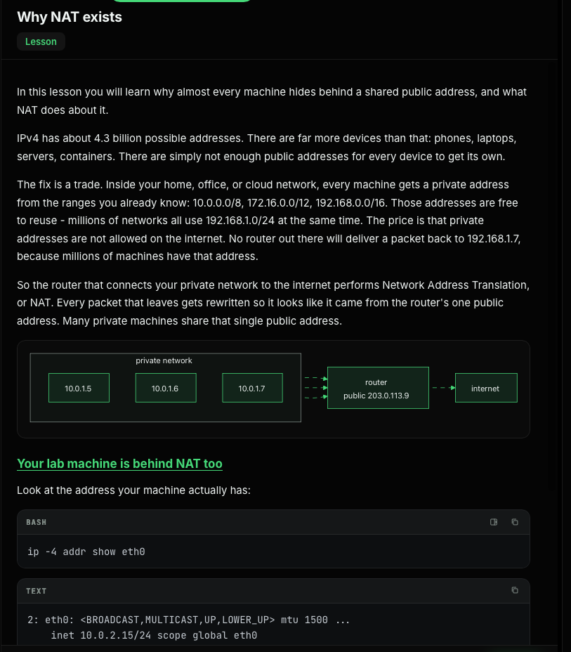
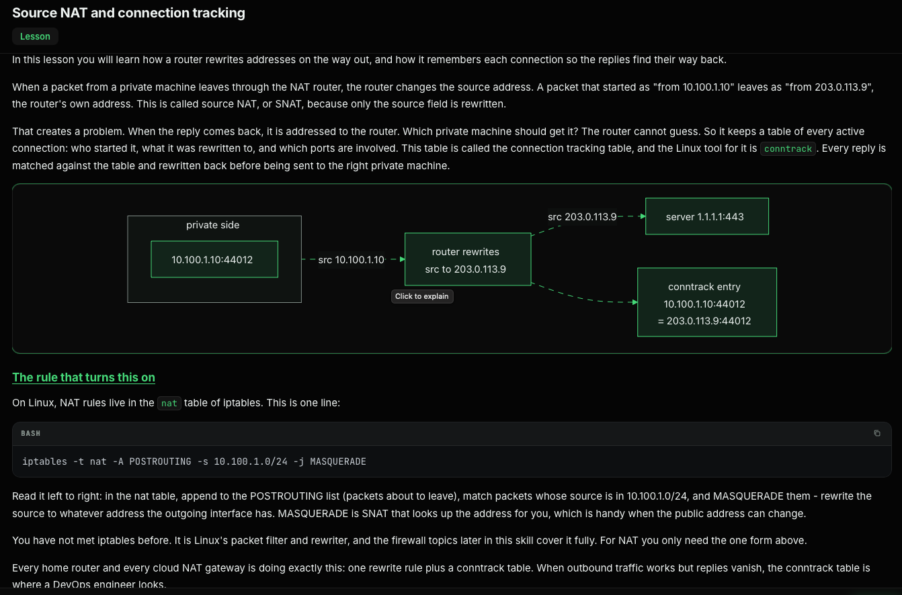
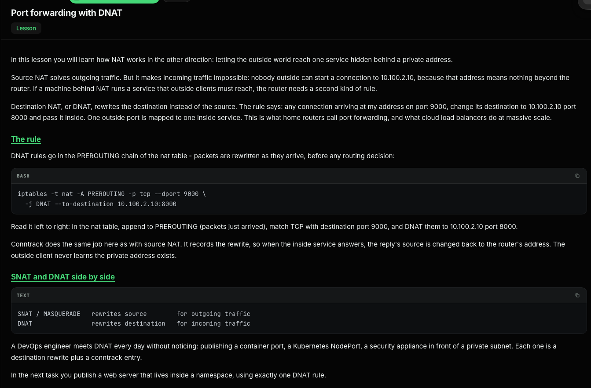

# NAT and port forwarding

Network Address Translation (NAT) rewrites packet addresses as traffic passes through a router. Source NAT is commonly used for outbound traffic; destination NAT is used to forward incoming traffic to a service on a private network. Linux connection tracking remembers these rewrites so reply packets can be translated back.



## Source NAT with masquerading

This lab uses three namespaces and two subnets behind `nsrouter`, plus an outside-facing interface:

```text
ns1 (10.100.1.10/24) -- 10.100.1.1/24 nsrouter
ns2 (10.100.2.10/24) -- 10.100.2.1/24 nsrouter
outside network       -- 10.100.0.2/24 nsrouter (veth0p)
```

The [addressing and routing guide](../addressing-and-routing/readme.md) covers creating the namespaces, veth pairs, addresses, and routes. For this section, forwarding is enabled in `nsrouter`, and `ns1` has a route to `ns2` through `10.100.1.1`:

```bash
ip netns exec nsrouter sysctl -w net.ipv4.ip_forward=1
ip -n ns1 route add default via 10.100.1.1
```

With a return route through `nsrouter`, `ns2` can reply to `ns1` directly. To demonstrate why source NAT is useful, remove `ns2`'s default route so it cannot route replies to the `10.100.1.0/24` subnet:

```bash
ip -n ns2 route del default via 10.100.2.1
ip -n ns2 route
```

Add a `MASQUERADE` rule in the router namespace. It matches traffic from `ns1` as it leaves on the `ns2`-facing interface and rewrites the source address to that interface's address (`10.100.2.1`):

```bash
ip netns exec nsrouter iptables -t nat -S POSTROUTING

ip netns exec nsrouter iptables -t nat -A POSTROUTING \
  -s 10.100.1.0/24 -o veth2p -j MASQUERADE
```

Check the rule and test connectivity:

```bash
ip netns exec nsrouter iptables -t nat -S POSTROUTING
ip netns exec ns1 ping -c 3 10.100.2.10
ip netns exec nsrouter conntrack -L
```

Because `ns2` sees the request as coming from its directly connected router address, it can send the reply to `10.100.2.1` without a default route. Connection tracking reverses the translation on the reply so it reaches `ns1`.



`MASQUERADE` is a form of source NAT that uses the current address of the outgoing interface. It is useful when that address may change. The rule is scoped to the `ns1` subnet and `veth2p`; it does not masquerade unrelated traffic.

## Port forwarding with destination NAT

Source NAT helps internal clients initiate outbound connections. To let an outside client reach a service inside `ns2`, use destination NAT (DNAT). In this example, a web server listens on port `8000` in `ns2`, and the router exposes it as port `9000` on its outside address.

The previous section removed `ns2`'s default route to demonstrate masquerading. Restore it so replies from the service can route back through the router:

```bash
ip -n ns2 route add default via 10.100.2.1
```

Start the service in `ns2` in one terminal:

```bash
ip netns exec ns2 python3 -m http.server 8000 --bind 0.0.0.0
```

In another terminal, add a rule in the router's `PREROUTING` chain to change the destination of incoming TCP connections:

```bash
ip netns exec nsrouter iptables -t nat -S PREROUTING

ip netns exec nsrouter iptables -t nat -A PREROUTING \
  -i veth0p -p tcp --dport 9000 \
  -j DNAT --to-destination 10.100.2.10:8000
```

From a machine that can reach the router's outside address, test the forwarded port:

```bash
curl -v http://10.100.0.2:9000/
```

The router must have IP forwarding enabled, `ns2` must have a return route through `10.100.2.1`, and the `FORWARD` firewall policy must allow the traffic. A request to `10.100.2.10:9000` is not equivalent: the DNAT rule applies to traffic arriving on `veth0p` at the router, not to traffic sent directly to `ns2`.



## SNAT and DNAT at a glance

| Technique | Table chain | Rewrites | Typical use |
|---|---|---|---|
| `SNAT` / `MASQUERADE` | `POSTROUTING` | Source address | Allow private hosts to send traffic through a router |
| `DNAT` | `PREROUTING` | Destination address and optionally port | Forward an outside connection to an internal service |

These `iptables` rules are runtime configuration; they do not automatically persist after the namespace or host is recreated.
