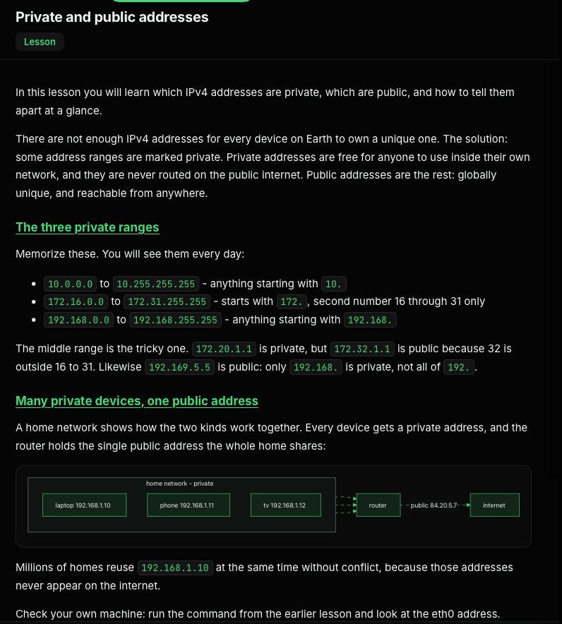

# IPV4

Each IPv4 address is 32 bits, written as four groups of 8 bits (called octets). The dots are just a readable way to separate those groups.
In one 8-bit group, the bit positions have these values:
```
Bit:    1   1   1   1   1   1   1   1
Value: 128  64  32  16   8   4   2   1
```
Those values are powers of 2, from (2^7) down to (2^0). Adding them gives:
```
2⁷ + 2⁶ + 2⁵ + 2⁴ + 2³ + 2² + 2¹ + 2⁰ = 255
```
So an octet can represent values from 0 to 255—that’s 256 possible values. The highest value is 255 because counting starts at zero.

For four octets, the total number of possible combinations is:
```
256 × 256 × 256 × 256 = 256⁴ = 2³² = 4,294,967,296
```

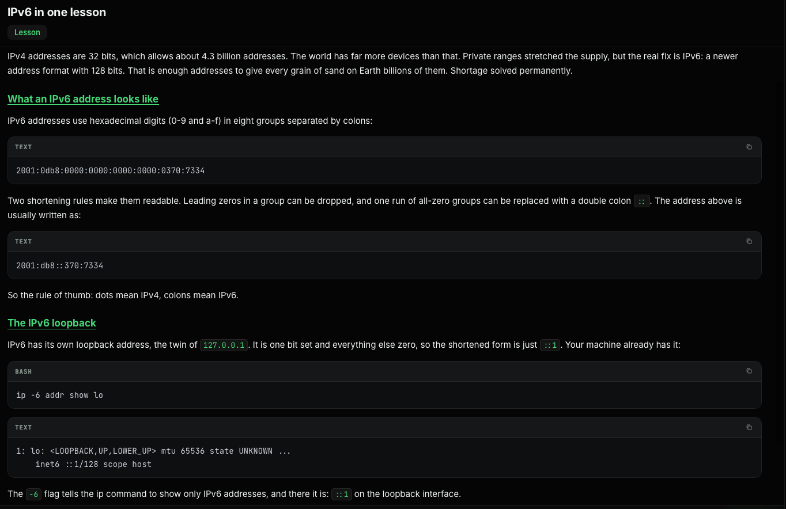

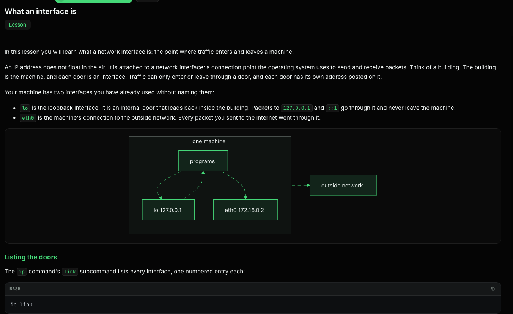

Each entry names the interface and shows its state. UP means the interface is enabled and passing traffic. A DOWN interface is a closed door: its addresses stop answering. The loopback interface reports UNKNOWN instead of UP, which is normal for lo and nothing to worry about.

Real servers often have more doors: a second network card, VPN interfaces, bridges for containers. A DevOps engineer reads this list to learn which networks a machine is connected to, and a door showing DOWN when it should be UP explains many outages in one line.

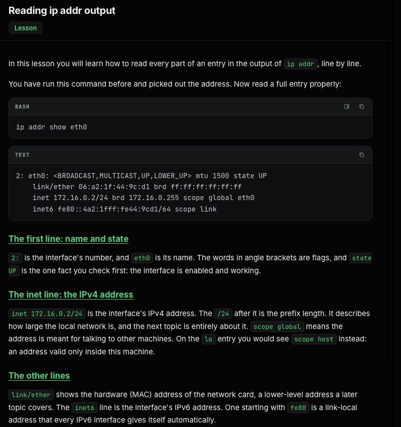

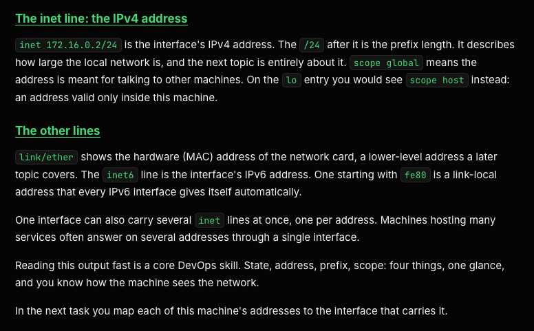

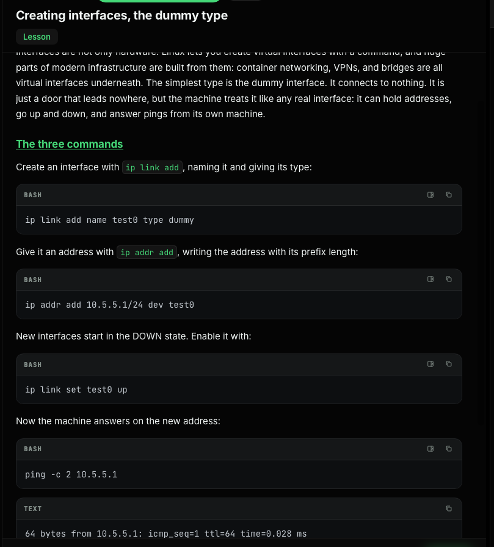

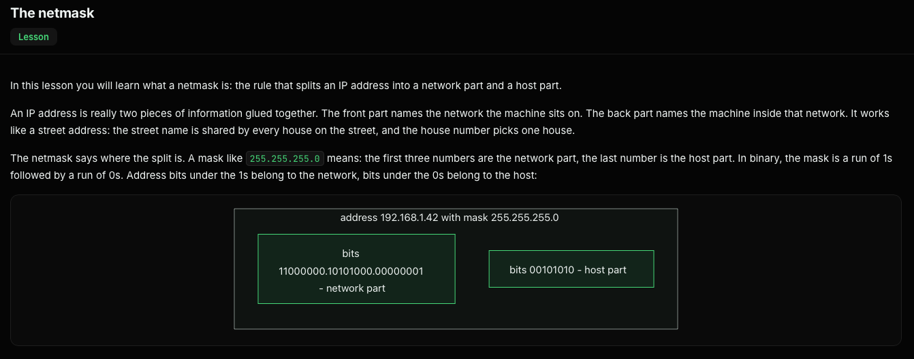

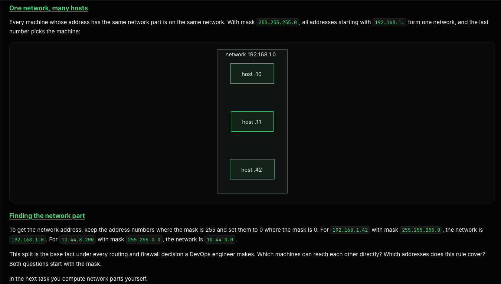

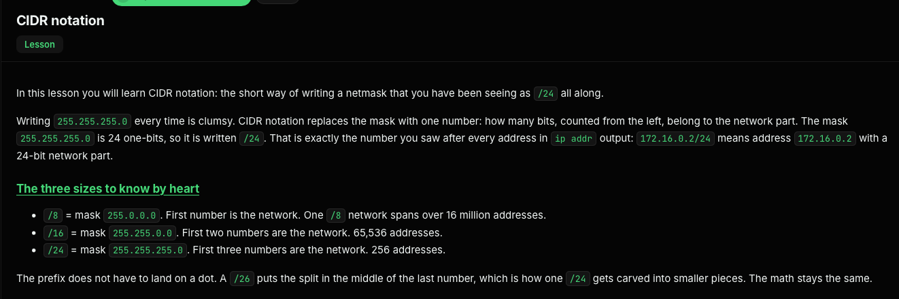

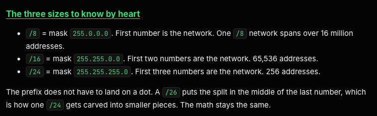

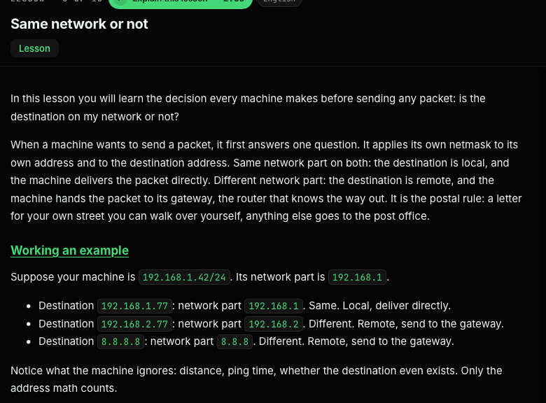

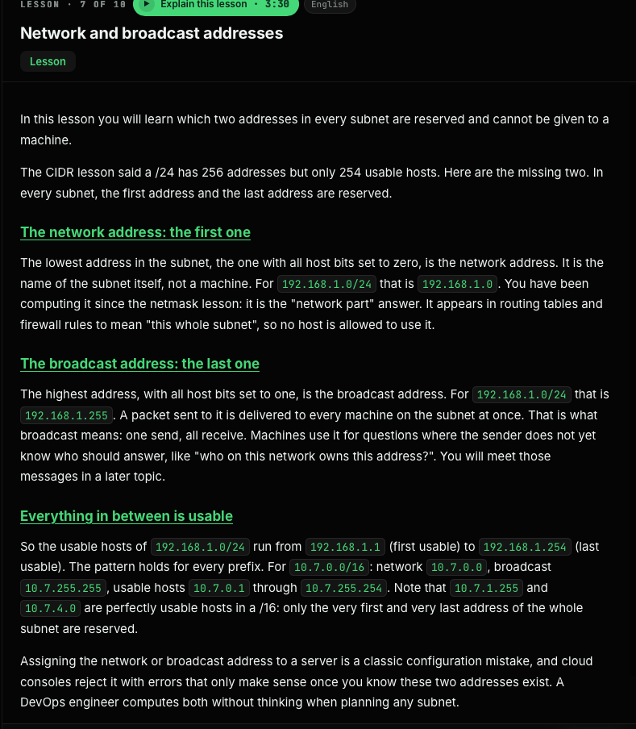

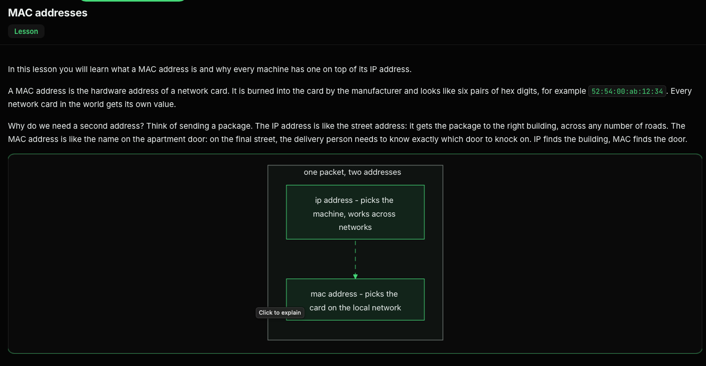

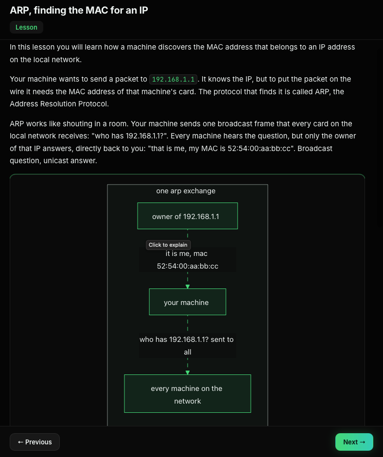

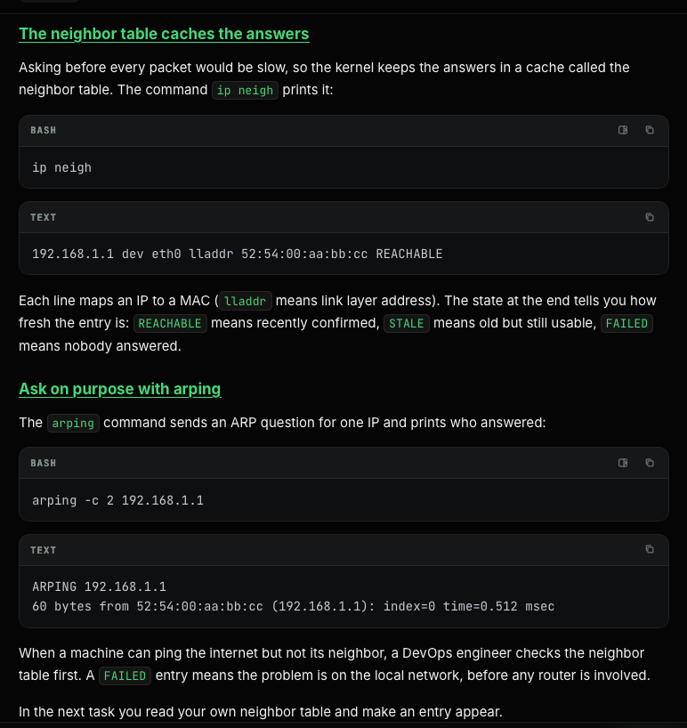

```
vi gateway-neighbor.txt
root@escbash-lab:~/answers# ip -4 route show default
default via 172.30.0.1 dev eth0 
root@escbash-lab:~/answers# ip route show
default via 172.30.0.1 dev eth0 
172.30.0.0/30 dev eth0 proto kernel scope link src 172.30.0.2 
root@escbash-lab:~/answers# ip neigh
172.30.0.1 dev eth0 lladdr 6e:a4:b5:08:53:0c REACHABLE 
root@escbash-lab:~/answers# 
```

```
root@escbash-lab:~# ip neigh flush all && ip neigh > /root/answers/neigh-before.txt
root@escbash-lab:~# 
root@escbash-lab:~# cd answers/
root@escbash-lab:~/answers# ll
total 28
drwxr-xr-x 2 root root  4096 Oct 30 17:01 ./
drwx------ 5 root root  4096 Oct 30 16:54 ../
-rw------- 1 root root 12288 Oct 30 16:59 .neigh-before.txt.swp
-rw-r--r-- 1 root root    18 Oct 30 16:34 eth0-mac.txt
-rw-r--r-- 1 root root    56 Oct 30 16:54 gateway-neighbor.txt
-rw-r--r-- 1 root root     0 Oct 30 17:01 neigh-before.txt
root@escbash-lab:~/answers# cat neigh-before.txt 
root@escbash-lab:~/answers# 
root@escbash-lab:~/answers# ip neigh
172.30.0.1 dev eth0 lladdr 6e:a4:b5:08:53:0c REACHABLE 
root@escbash-lab:~/answers# arping -c 4 172.30.0.1
ARPING 172.30.0.1 from 172.30.0.2 eth0
Unicast reply from 172.30.0.1 [6E:A4:B5:08:53:0C]  0.646ms
Unicast reply from 172.30.0.1 [6E:A4:B5:08:53:0C]  0.729ms
Unicast reply from 172.30.0.1 [6E:A4:B5:08:53:0C]  0.684ms
Unicast reply from 172.30.0.1 [6E:A4:B5:08:53:0C]  0.684ms
Sent 4 probes (1 broadcast(s))
Received 4 response(s)
root@escbash-lab:~/answers# 
root@escbash-lab:~/answers# 
root@escbash-lab:~/answers# ip neigh
172.30.0.1 dev eth0 lladdr 6e:a4:b5:08:53:0c REACHABLE 
root@escbash-lab:~/answers# ip neigh > /root/answers/neigh-after.txt
root@escbash-lab:~/answers# 
```