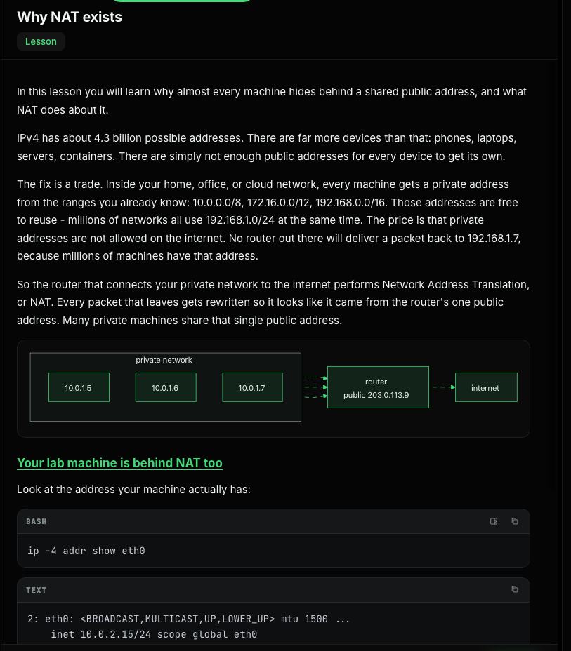
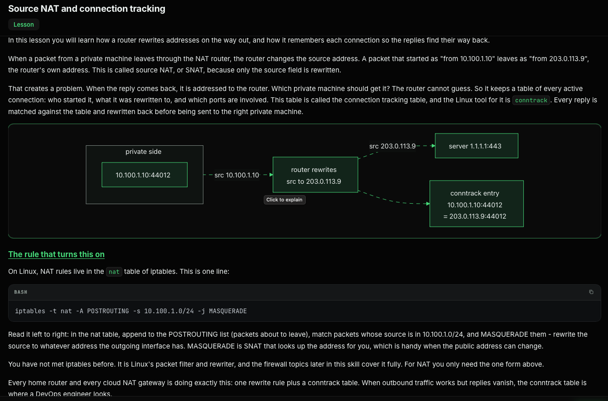
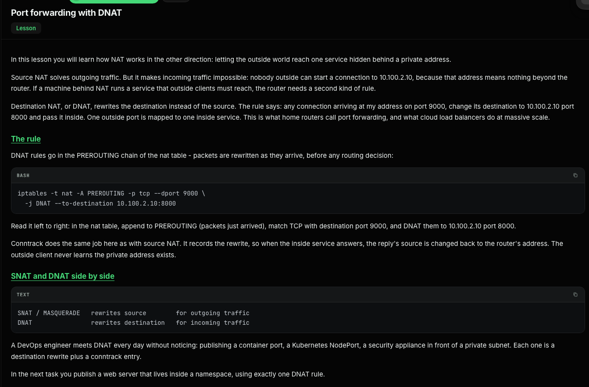
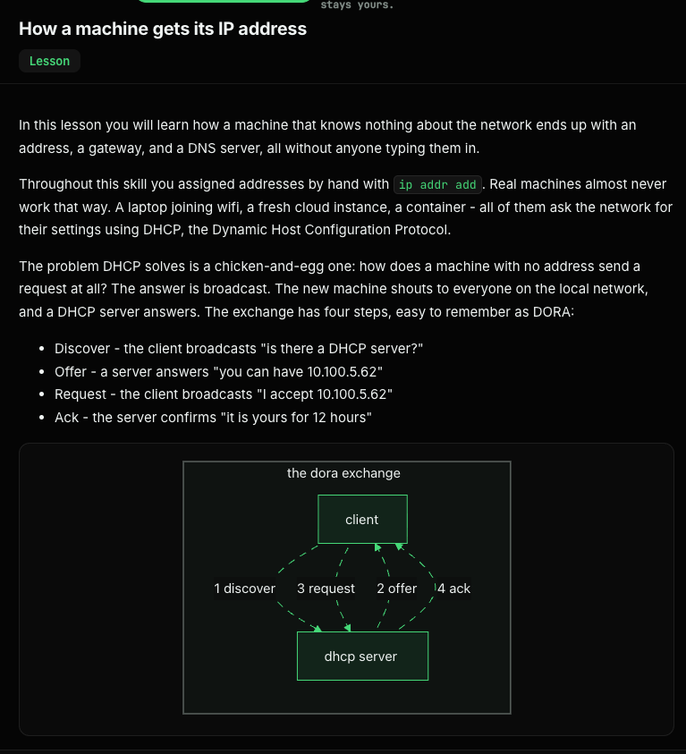
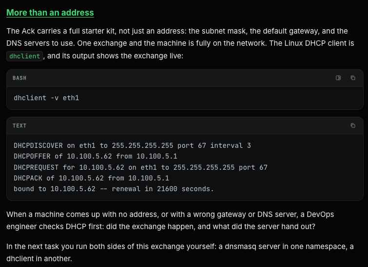
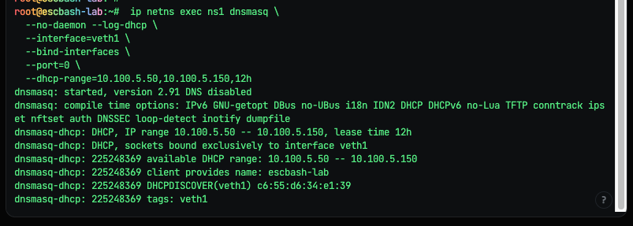
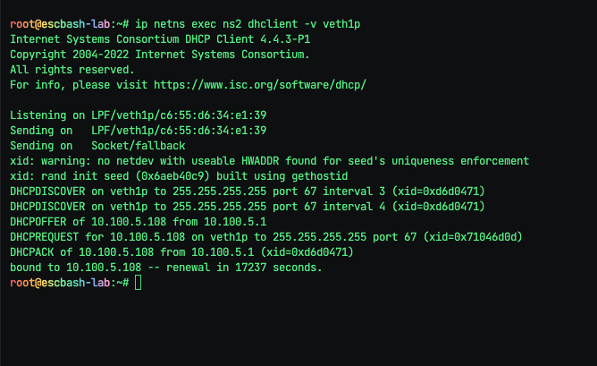
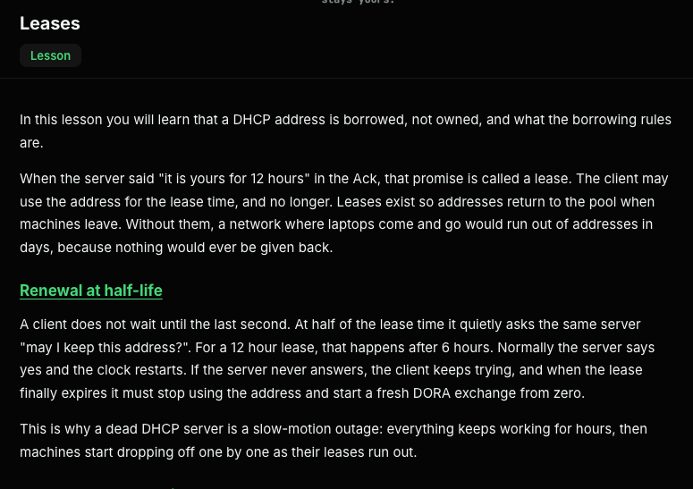
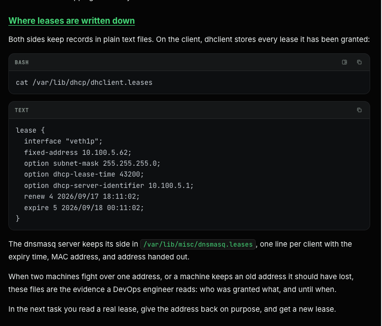

# NAT:





# This works too:
```

root@escbash-lab:~# ip -n ns1 ip route
Object "ip" is unknown, try "ip help".
root@escbash-lab:~# ip -n ns1 route
10.100.1.0/24 dev veth1 proto kernel scope link src 10.100.1.10 
root@escbash-lab:~# 
root@escbash-lab:~# 
root@escbash-lab:~# ip -n nsrouter route
10.100.1.0/24 dev veth1p proto kernel scope link src 10.100.1.1 
10.100.2.0/24 dev veth2p proto kernel scope link src 10.100.2.1 
root@escbash-lab:~# ip -n ns1 ip route
Object "ip" is unknown, try "ip help".
root@escbash-lab:~# ip -n ns1 route
10.100.1.0/24 dev veth1 proto kernel scope link src 10.100.1.10 
root@escbash-lab:~# ip -n ns1 route add default via 10.100.1.1 
root@escbash-lab:~# 
root@escbash-lab:~# ip netns exec ns1 ping -c 2 10.100.2.1
PING 10.100.2.1 (10.100.2.1) 56(84) bytes of data.
64 bytes from 10.100.2.1: icmp_seq=1 ttl=64 time=0.038 ms
64 bytes from 10.100.2.1: icmp_seq=2 ttl=64 time=0.018 ms

--- 10.100.2.1 ping statistics ---
2 packets transmitted, 2 received, 0% packet loss, time 1008ms
rtt min/avg/max/mdev = 0.018/0.028/0.038/0.010 ms
root@escbash-lab:~# 
root@escbash-lab:~# ip -n ns1 route
default via 10.100.1.1 dev veth1 
10.100.1.0/24 dev veth1 proto kernel scope link src 10.100.1.10 
root@escbash-lab:~# ip -n nsroute route
Cannot open network namespace "nsroute": No such file or directory
root@escbash-lab:~# ip -n nsrouter route
10.100.1.0/24 dev veth1p proto kernel scope link src 10.100.1.1 
10.100.2.0/24 dev veth2p proto kernel scope link src 10.100.2.1 
root@escbash-lab:~# ip netns exec ns2 ping -c 4 10.100.1.1
ping: connect: Network is unreachable
root@escbash-lab:~# 
root@escbash-lab:~# 
root@escbash-lab:~# ip netns exec ns2 ip route
10.100.2.0/24 dev veth2 proto kernel scope link src 10.100.2.10 
root@escbash-lab:~# 
root@escbash-lab:~# ip netns exec ns2 ip route add default via 10.100.2.1
root@escbash-lab:~# 
root@escbash-lab:~# ip netns exec ns2 ping -c 4 10.100.1.1
PING 10.100.1.1 (10.100.1.1) 56(84) bytes of data.
64 bytes from 10.100.1.1: icmp_seq=1 ttl=64 time=0.037 ms
64 bytes from 10.100.1.1: icmp_seq=2 ttl=64 time=0.019 ms
64 bytes from 10.100.1.1: icmp_seq=3 ttl=64 time=0.018 ms
64 bytes from 10.100.1.1: icmp_seq=4 ttl=64 time=0.018 ms

--- 10.100.1.1 ping statistics ---
4 packets transmitted, 4 received, 0% packet loss, time 3061ms
rtt min/avg/max/mdev = 0.018/0.023/0.037/0.008 ms
root@escbash-lab:~# 
root@escbash-lab:~# 
root@escbash-lab:~# ip netns exec ns1 ping -c 3 10.100.2.10
PING 10.100.2.10 (10.100.2.10) 56(84) bytes of data.
64 bytes from 10.100.2.10: icmp_seq=1 ttl=63 time=0.033 ms
64 bytes from 10.100.2.10: icmp_seq=2 ttl=63 time=0.024 ms
64 bytes from 10.100.2.10: icmp_seq=3 ttl=63 time=0.022 ms

--- 10.100.2.10 ping statistics ---
3 packets transmitted, 3 received, 0% packet loss, time 2044ms
rtt min/avg/max/mdev = 0.022/0.026/0.033/0.004 ms
root@escbash-lab:~# 
```

But we are removing the default route from ns2 and ping would fail and then we add masquerade

```
ip netns exec ns2 ip route del default via 10.100.2.1
ip netns exec ns2 ip route
10.100.2.0/24 dev veth2 proto kernel scope link src 10.100.2.10 
```

First check if any already matching masquerade rule
```
ip netns exec nsrouter iptables -t nat -S POSTROUTING
-P POSTROUTING ACCEPT

root@escbash-lab:~# ip netns exec nsrouter iptables -t nat -A POSTROUTING \
  -s 10.100.1.0/24 -o veth2p -j MASQUERADE
root@escbash-lab:~# ip netns exec nsrouter iptables -t nat -S POSTROUTING
-P POSTROUTING ACCEPT
-A POSTROUTING -s 10.100.1.0/24 -o veth2p -j MASQUERADE
root@escbash-lab:~# 
```
# Command to check the source address getting re-written with router's address
```
ip netns exec nsrouter conntrack -L
```




```
root@escbash-lab:~# ip netns exec ns2 ip route
default via 10.100.2.1 dev veth2 
10.100.2.0/24 dev veth2 proto kernel scope link src 10.100.2.10 
root@escbash-lab:~# 
root@escbash-lab:~# ip netns exec nsrouter ip route
10.100.0.0/24 dev veth0p proto kernel scope link src 10.100.0.2 
10.100.1.0/24 dev veth1p proto kernel scope link src 10.100.1.1 
10.100.2.0/24 dev veth2p proto kernel scope link src 10.100.2.1 
root@escbash-lab:~# ip netns exec iptables -t nat -S POSTROUTING
Cannot open network namespace "iptables": No such file or directory
root@escbash-lab:~# ip netns exec nsrouter iptables -t nat -S POSTROUTING
-P POSTROUTING ACCEPT
root@escbash-lab:~# 
root@escbash-lab:~# 
root@escbash-lab:~# 
root@escbash-lab:~# ip netns exec nsrouter curl http://10.100.2.10:8000
hello from ns2
root@escbash-lab:~# ip netns exec ns1 curl http://10.100.2.10:8000
curl: (7) Failed to connect to 10.100.2.10 port 8000 after 0 ms: Couldn't connect to server
root@escbash-lab:~# 
root@escbash-lab:~# ip netns exec nsrouter iptables -t nat -S PREROUTING
-P PREROUTING ACCEPT
root@escbash-lab:~# 
root@escbash-lab:~# ip netns exec nsrouter iptables -S FORWARD
-P FORWARD ACCEPT
root@escbash-lab:~# 
root@escbash-lab:~# ip netns exec nsrouter iptables -t nat -A PREROUTING \
  -i veth0p -p tcp --dport 9000 \
  -j DNAT --to-destination 10.100.2.10:8000
root@escbash-lab:~# 
root@escbash-lab:~# 
root@escbash-lab:~# curl http://10.100.2.10:9000
^[c^C
root@escbash-lab:~# ip netns exec nsrouter iptables -t nat -S PREROUTING
-P PREROUTING ACCEPT
-A PREROUTING -i veth0p -p tcp -m tcp --dport 9000 -j DNAT --to-destination 10.100.2.10:8000
root@escbash-lab:~# curl http://10.100.2.10:9000
^[c^C
root@escbash-lab:~# 
root@escbash-lab:~# curl -v http://10.100.0.2:9000/
*   Trying 10.100.0.2:9000...
* Connected to 10.100.0.2 (10.100.0.2) port 9000
> GET / HTTP/1.1
> Host: 10.100.0.2:9000
> User-Agent: curl/8.5.0
> Accept: */*
> 
* HTTP 1.0, assume close after body
< HTTP/1.0 200 OK
< Server: SimpleHTTP/0.6 Python/3.12.3
< Date: Tue, 03 Nov 2026 17:24:22 GMT
< Content-type: text/html
< Content-Length: 15
< Last-Modified: Tue, 03 Nov 2026 17:07:10 GMT
< 
hello from ns2
```

# DHCP:






# Task:
```A fresh two-namespace lab is built: ns1 holds veth1 with the address 10.100.5.1/24, and ns2 holds the other end, veth1p, up but with no address at all. ns2 is your brand-new machine waiting for the network to configure it.

Run both sides of the DORA exchange:

Start dnsmasq inside ns1 as a DHCP server on veth1. Give it these options: --interface=veth1, --bind-interfaces, --port=0 (DHCP only, no DNS), and a --dhcp-range of 10.100.5.50 to 10.100.5.150 with a 12h lease time.
Inside ns2, use dhclient on veth1p to request an address. Use the verbose flag so you can watch the four DORA steps happen.
Confirm veth1p now carries a 10.100.5.x address.
```


# Solution: 
* Check interfaces if down, bring them up
```
root@escbash-lab:~# ip -n ns1 show dev veth1p
Object "show" is unknown, try "ip help".
root@escbash-lab:~# 
root@escbash-lab:~# 
root@escbash-lab:~# ip -n ns1 addr show veth1
2: veth1@if2: <BROADCAST,MULTICAST,UP,LOWER_UP> mtu 1500 qdisc noqueue state UP group default qlen 1000
    link/ether 6e:42:09:14:bb:71 brd ff:ff:ff:ff:ff:ff link-netns ns2
    inet 10.100.5.1/24 scope global veth1
       valid_lft forever preferred_lft forever
    inet6 fe80::6c42:9ff:fe14:bb71/64 scope link 
       valid_lft forever preferred_lft forever
root@escbash-lab:~# ip -n ns1 addr show veth1p
Device "veth1p" does not exist.
root@escbash-lab:~# ip -n ns2 addr show veth1p
2: veth1p@if2: <BROADCAST,MULTICAST,UP,LOWER_UP> mtu 1500 qdisc noqueue state UP group default qlen 1000
    link/ether c6:55:d6:34:e1:39 brd ff:ff:ff:ff:ff:ff link-netns ns1
    inet6 fe80::c455:d6ff:fe34:e139/64 scope link 
       valid_lft forever preferred_lft forever
root@escbash-lab:~# 
```

* Start the DHCP server in ns1

```
 ip netns exec ns1 dnsmasq \
  --no-daemon --log-dhcp \
  --interface=veth1 \
  --bind-interfaces \
  --port=0 \
  --dhcp-range=10.100.5.50,10.100.5.150,12h
  ```

  --port=0 disables DNS; --no-daemon keeps the server in the foreground so you can see its DHCP logs.

Request a lease from ns2. In a second terminal:

* Request a lease from ns2. In a second terminal:
```
ip netns exec ns2 dhclient -v veth1p
```

* confirm the address is assigned

```
ip -n ns2 -4 addr show dev veth1p
```









* To release the lease:
 ```
root@escbash-lab:~#  ip netns exec ns2 dhclient -r -v veth1p
Killed old client process
Internet Systems Consortium DHCP Client 4.4.3-P1
Copyright 2004-2022 Internet Systems Consortium.
All rights reserved.
For info, please visit https://www.isc.org/software/dhcp/

Listening on LPF/veth1p/b2:27:b6:4b:26:3b
Sending on   LPF/veth1p/b2:27:b6:4b:26:3b
Sending on   Socket/fallback
xid: warning: no netdev with useable HWADDR found for seed's uniqueness enforcement
xid: rand init seed (0x6aeb6887) built using gethostid
DHCPRELEASE of 10.100.5.132 on veth1p to 10.100.5.1 port 67 (xid=0x4ed713e)
root@escbash-lab:~# 

```

```
root@escbash-lab:~# cat /var/lib/dhcp/dhclient.leases 
lease {
  interface "veth1p";
  fixed-address 10.100.5.132;
  option subnet-mask 255.255.255.0;
  option routers 10.100.5.1;
  option dhcp-lease-time 43200;
  option dhcp-message-type 5;
  option dhcp-server-identifier 10.100.5.1;
  option dhcp-renewal-time 21600;
  option broadcast-address 10.100.5.255;
  option dhcp-rebinding-time 37800;
  option host-name "escbash-lab";
  renew 3 2026/11/04 17:16:55;
  rebind 3 2026/11/04 17:16:55;
  expire 3 2026/11/04 17:16:55;
}
lease {
  interface "veth1p";
  fixed-address 10.100.5.132;
  option subnet-mask 255.255.255.0;
  option routers 10.100.5.1;
  option dhcp-lease-time 43200;
  option dhcp-message-type 5;
  option dhcp-server-identifier 10.100.5.1;
  option dhcp-renewal-time 21600;
  option broadcast-address 10.100.5.255;
  option dhcp-rebinding-time 37800;
  option host-name "escbash-lab";
  renew 3 2026/11/04 21:58:48;
  rebind 4 2026/11/05 03:48:20;
  expire 4 2026/11/05 05:18:20;
}
```