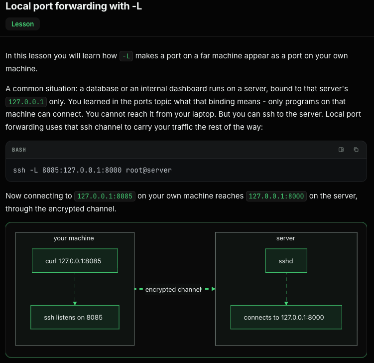
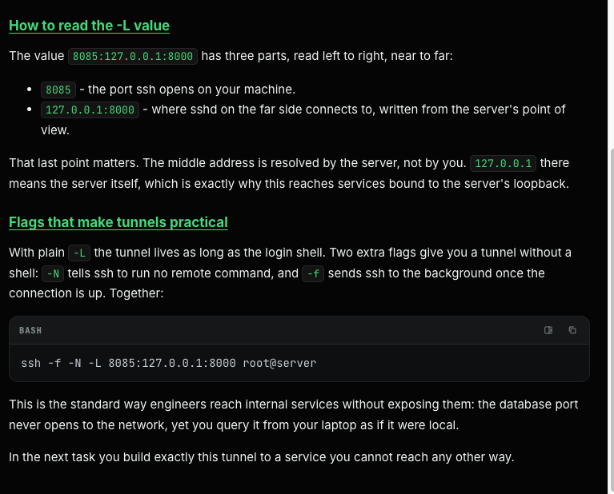
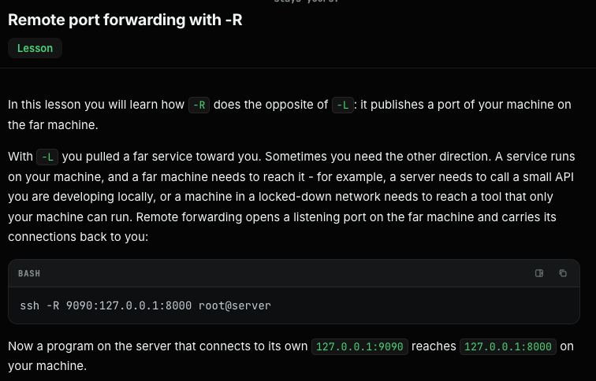
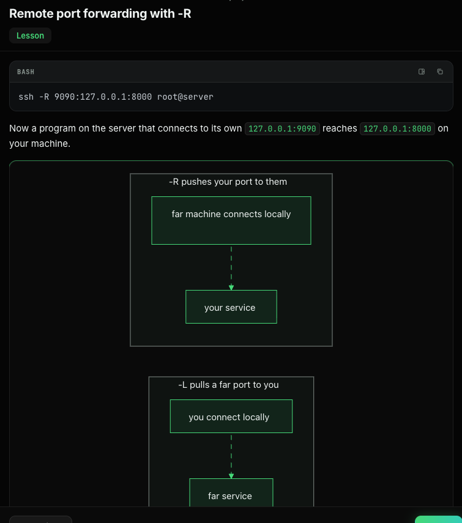
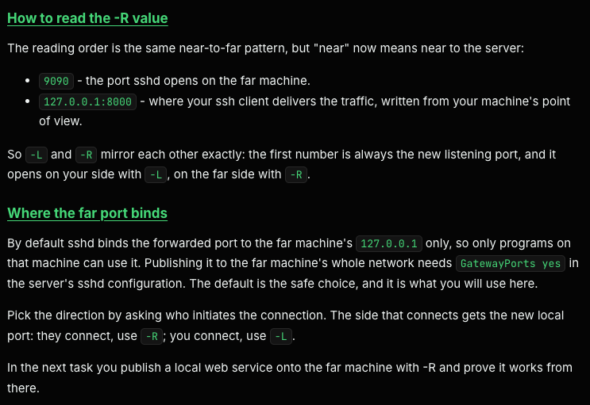

# SSH and tunnels

SSH provides an encrypted connection to a remote machine. Port forwarding uses that connection as a tunnel for selected TCP traffic, so a service can be reached from the other side without exposing the service directly.

The direction is easiest to remember by asking who needs to connect:

- Use **local forwarding** (`-L`) when you connect from your machine to a service reachable from the SSH server.
- Use **remote forwarding** (`-R`) when a program on the SSH server needs to connect to a service reachable from your machine.

## Local port forwarding with `-L`

Suppose a database or internal dashboard is listening on `127.0.0.1:8000` on a server. It is only reachable from that server, but you can open a local port and forward connections to it through SSH:

```bash
ssh -L 8085:127.0.0.1:8000 user@server
```

The value after `-L` is `local_port:destination_host:destination_port`:

- `8085` is opened on your machine.
- `127.0.0.1:8000` is the destination as seen from the SSH server. Here, `127.0.0.1` means the server itself.

While the SSH session is open, connect to `127.0.0.1:8085` on your machine. SSH carries that TCP connection through the encrypted channel, and the server connects to its own `127.0.0.1:8000`.



To keep the tunnel open without starting a remote shell, add `-N`. Add `-f` to send SSH to the background after authentication:

```bash
ssh -f -N -L 8085:127.0.0.1:8000 user@server
```

For an initial test, run SSH in the foreground so connection errors remain visible. Close that SSH process to stop the tunnel; for a background tunnel, find and stop the specific SSH process when finished.



## Remote port forwarding with `-R`

Use remote forwarding when the server needs to reach a service running on your machine. For example, forward a port on the server back to a local development service:

```bash
ssh -R 9090:127.0.0.1:8000 user@server
```

The value after `-R` is `remote_port:destination_host:destination_port`:

- `9090` is opened on the SSH server.
- `127.0.0.1:8000` is the destination as seen from your machine, where the SSH client runs.

While the tunnel is open, a program on the server that connects to `127.0.0.1:9090` reaches your machine's `127.0.0.1:8000`.



By default, the remote listening port is bound to the server's loopback interface, so it is available to programs on that server, not to other machines on its network. Exposing it on other interfaces requires server-side `GatewayPorts` configuration and should only be done when needed, with appropriate access controls.





## What must be reachable

Forwarding does not make a service reachable from nowhere: the SSH server must be able to reach the `-L` destination, and your machine must be able to reach the `-R` destination. SSH server policy must also permit TCP forwarding. The tunnel lasts only while its SSH connection is active.

These are TCP tunnels. They forward only the selected port and do not route all traffic from either machine; for broader network access, use a VPN instead.
