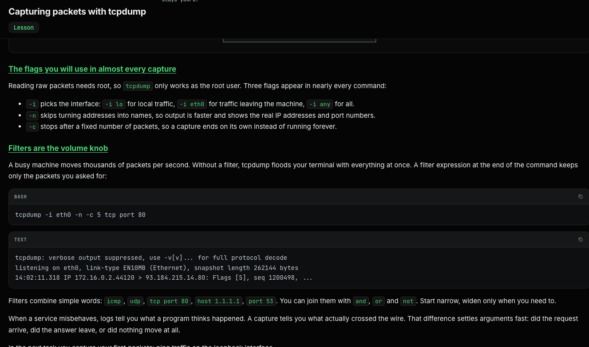
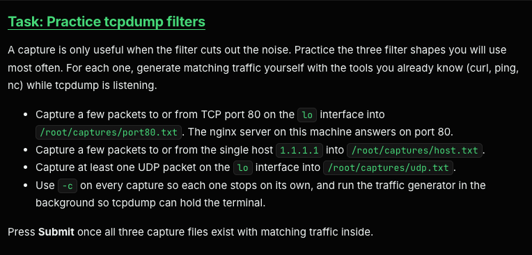
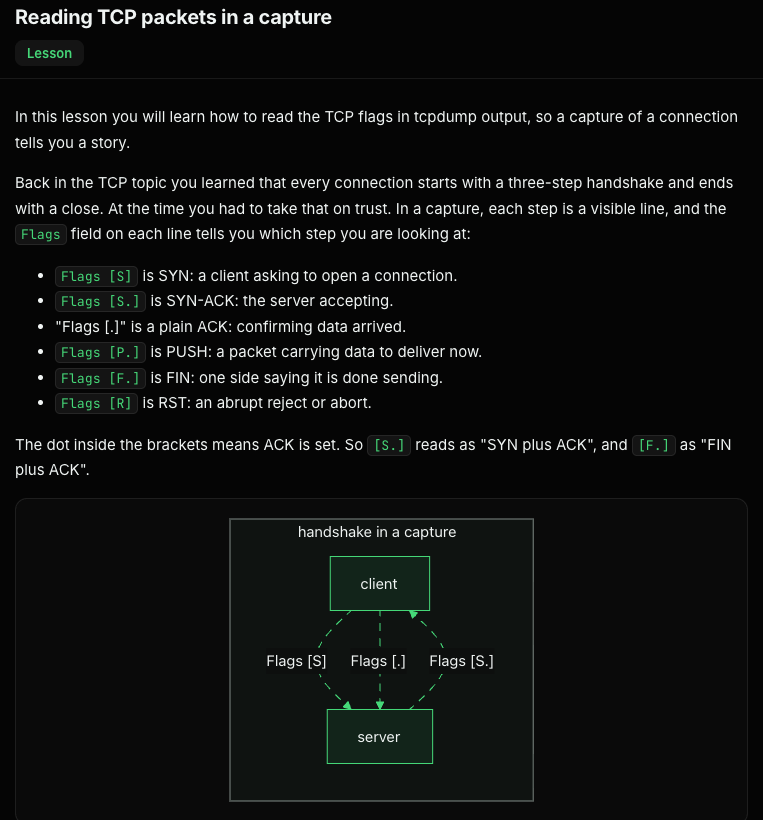
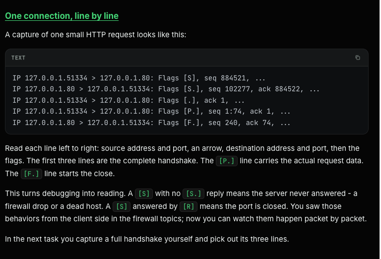
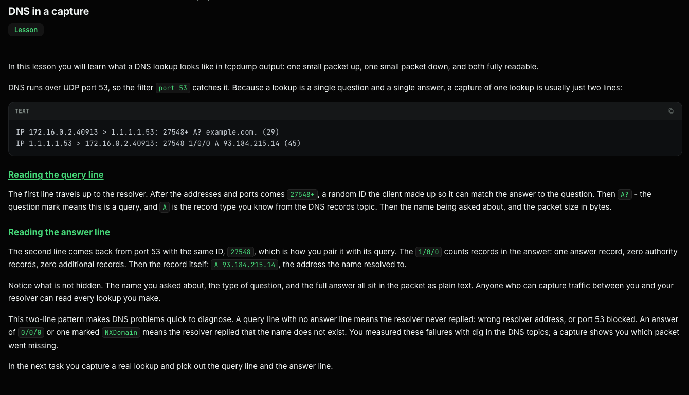

# TCPdump

`tcpdump` captures packets from a network interface so you can inspect what traffic is actually traversing the host. It is one of the fastest ways to confirm whether a packet reached a port, a host, or a specific protocol.

## Basic packet capture

```bash
# Capture loopback traffic to port 80, and stop after 5 packets
tcpdump -i lo -n -c 5 port 80

# Capture packets to or from a specific IP address
tcpdump -i any -n -c 4 host 1.1.1.1

# Capture only UDP traffic on the loopback interface
tcpdump -i lo -n -c 1 udp
```

The important flags are:

- `-i` — chooses the interface to listen on (`lo`, `eth0`, `any`, and so on).
- `-n` — avoids DNS lookups so the output shows raw IP addresses and ports.
- `-c` — limits the capture to a fixed number of packets.
- `port`, `host`, and `udp` — filter traffic by destination/source port, IP address, or protocol.

A packet capture is especially useful when a service is not responding as expected: you can check whether packets are being sent, whether the destination is wrong, or whether the traffic is arriving on the wrong interface.

## Example: HTTP request on loopback

```bash
( sleep 1; curl -s http://127.0.0.1/ > /dev/null ) &
tcpdump -i lo -n -c 5 port 80 > /root/captures/port80.txt
```

This starts a quick HTTP request to the local machine and captures the first five packets on port 80. Because the traffic stays on the loopback interface, the packets never leave the host, which is a clean way to validate local service behavior.



## Example: ping to a remote host

```bash
ping 1.1.1.1 > /dev/null &
tcpdump -i any -n -c 4 host 1.1.1.1 > /root/captures/host.txt
kill %1
```

This captures a few packets to and from `1.1.1.1` without resolving hostnames. It is useful for checking the path taken by an ICMP conversation and for confirming that traffic is actually reaching the expected network device.



## Example: UDP datagram capture

```bash
( sleep 1; echo test | nc -u -w1 127.0.0.1 9000 ) &
tcpdump -i lo -n -c 1 udp > /root/captures/udp.txt
```

This generates a quick UDP datagram and captures a single packet on `lo`. It is a simple way to verify that the socket is sending traffic and that the packet is visible at the interface layer.



## Reading the capture output

The packet list shows the source, destination, protocol, and payload information, which helps confirm whether a problem is caused by a firewall, the application, or routing.

For example, if a request is never seen on the right interface, the issue is often before the application layer. If the packet reaches the target but no reply appears, the service or firewall configuration is more likely to be the cause.




