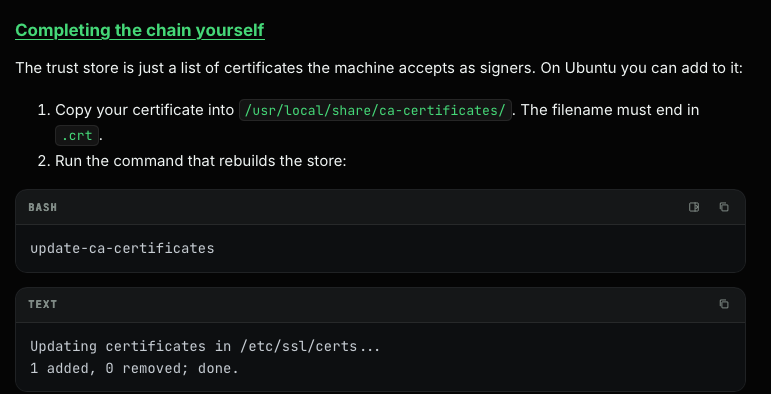

# TLS and certificates

TLS provides encryption and server authentication for HTTPS. This guide covers how to read a TLS connection, create certificates and CSRs, and configure a private CA.

## TLS connection flow

Before TLS begins, the client resolves the hostname and connects to the server over TCP. In curl’s verbose output, `Connected to ... port 443` marks that TCP connection. The TLS handshake follows:

1. The client sends `ClientHello`, including supported TLS options, key-exchange choices, and the hostname through SNI.
2. The server responds with `ServerHello` and selects connection parameters.
3. The server sends its certificate and proves it holds the matching private key.
4. The client verifies the certificate and sends its `Finished` message. The parties then exchange encrypted application data.

In TLS 1.3, most handshake messages after `ServerHello` are encrypted. A compatibility `Change Cipher Spec` message may appear in diagnostic output; it is not a separate TLS 1.3 cipher negotiation.



## Inspect a server certificate

`openssl s_client` connects to a TLS server. Use `-servername` to send the hostname via SNI, which lets a server hosting several HTTPS sites select the right TLS configuration and certificate:

```bash
openssl s_client -connect example.com:443 \
  -servername example.com < /dev/null
```

To save the server’s leaf certificate as PEM:

```bash
openssl s_client -connect example.com:443 \
  -servername example.com -showcerts </dev/null 2>/dev/null \
  | openssl x509 -out a.pem
```

To save every certificate the server sends (usually the leaf and intermediate certificates):

```bash
openssl s_client -connect example.com:443 \
  -servername example.com -showcerts </dev/null 2>/dev/null \
  | awk '/-----BEGIN CERTIFICATE-----/{p=1} p; /-----END CERTIFICATE-----/{p=0}' \
  > chain.pem
```

The root certificate is commonly omitted from the server’s chain because clients already have trusted roots.

## Create a self-signed certificate

`openssl req -x509` creates a self-signed certificate. The certificate is signed using its corresponding private key:

```bash
openssl req -x509 -newkey rsa:2048 -nodes -days 365 \
  -keyout app.internal.key \
  -out app.internal.crt \
  -subj "/CN=app.internal" \
  -addext "subjectAltName=DNS:app.internal"
```

`-nodes` leaves the private key unencrypted (newer OpenSSL also provides `-noenc`). Protect the key file. The Subject Alternative Name (SAN) is what modern TLS clients use to verify the hostname.

## Create a CSR

A certificate signing request (CSR) asks a CA to issue a certificate. Create it without `-x509`:

```bash
openssl req -new -newkey rsa:2048 -nodes \
  -keyout app.internal.key \
  -out app.internal.csr \
  -subj "/CN=app.internal" \
  -addext "subjectAltName=DNS:app.internal"
```

Inspect the CSR:

```bash
openssl req -in app.internal.csr -noout -text
```

For only a key pair, use `genpkey`; derive a separate public key with `pkey`:

```bash
openssl genpkey -algorithm RSA \
  -pkeyopt rsa_keygen_bits:2048 \
  -out app.internal.key

openssl pkey -in app.internal.key -pubout -out app.internal.pub
```

## Create a root CA and issue a site certificate

A root CA has its own self-signed certificate and private key. The root certificate is trusted by clients; the CA’s private key signs site certificates and must remain protected.

```bash
umask 077
openssl genpkey -algorithm RSA -aes-256-cbc \
  -pkeyopt rsa_keygen_bits:4096 \
  -out rootCA.key

openssl req -x509 -new -key rootCA.key -sha256 -days 3650 \
  -out rootCA.crt \
  -subj "/CN=Lab Root CA" \
  -addext "basicConstraints=critical,CA:TRUE" \
  -addext "keyUsage=critical,keyCertSign,cRLSign" \
  -addext "subjectKeyIdentifier=hash"
```

Create a site key and CSR:

```bash
openssl genpkey -algorithm RSA \
  -pkeyopt rsa_keygen_bits:2048 \
  -out app.internal.key

openssl req -new -key app.internal.key \
  -out app.internal.csr \
  -subj "/CN=app.internal"
```

Specify the extensions for the issued server certificate, then sign the CSR with the root CA:

```text
[server_cert]
basicConstraints=critical,CA:FALSE
keyUsage=critical,digitalSignature,keyEncipherment
extendedKeyUsage=serverAuth
subjectAltName=DNS:app.internal
```

```bash
openssl x509 -req -in app.internal.csr \
  -CA rootCA.crt -CAkey rootCA.key -CAcreateserial \
  -out app.internal.crt -days 365 -sha256 \
  -extfile app.ext -extensions server_cert

openssl verify -CAfile rootCA.crt \
  -verify_hostname app.internal app.internal.crt
```

The root certificate is self-signed. The site certificate is signed by the root CA, so it is not self-signed.

## Configure Nginx and trust the CA

An Nginx HTTPS server block references the site certificate and its private key:

```nginx
server {
    listen 443 ssl;
    server_name app.internal;

    ssl_certificate     /etc/ssl/lab/app.internal.crt;
    ssl_certificate_key /etc/ssl/lab/app.internal.key;

    root /var/www/app;
}
```

On Ubuntu, trust the CA certificate by copying only the root certificate to the local CA directory and rebuilding the trust store:

```bash
sudo install -m 0644 rootCA.crt \
  /usr/local/share/ca-certificates/lab-root-ca.crt
sudo update-ca-certificates
```

On RHEL 8/9, place the CA certificate in the trust anchors directory and update the extracted trust store:

```bash
sudo install -m 0644 rootCA.crt \
  /etc/pki/ca-trust/source/anchors/lab-root-ca.crt
sudo update-ca-trust extract
```

Install the root certificate—not the CA private key. Trusting the CA does not create a DNS record for `app.internal`; name resolution must be configured separately.
