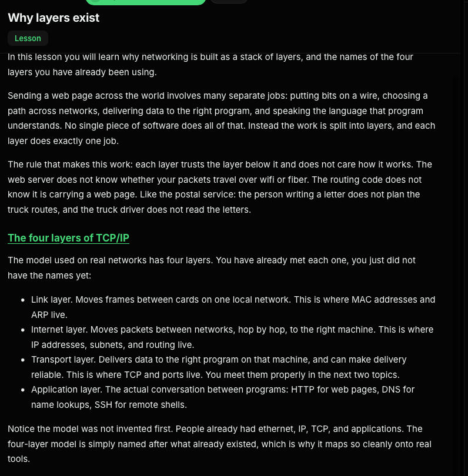
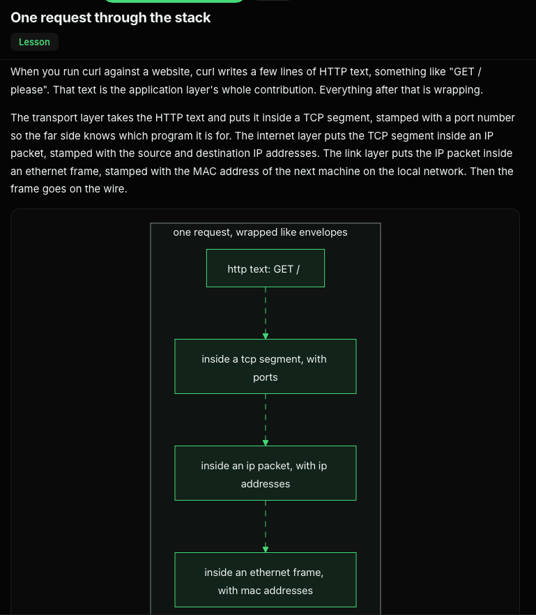
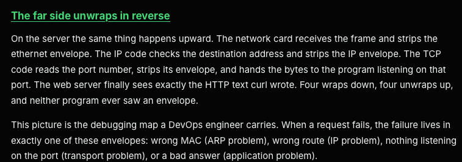
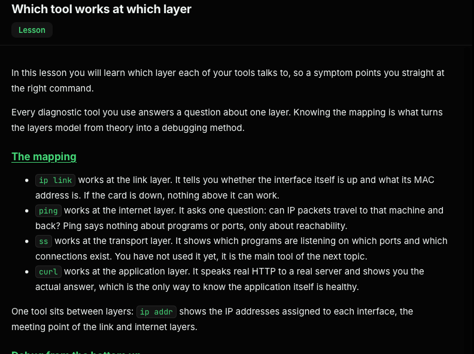
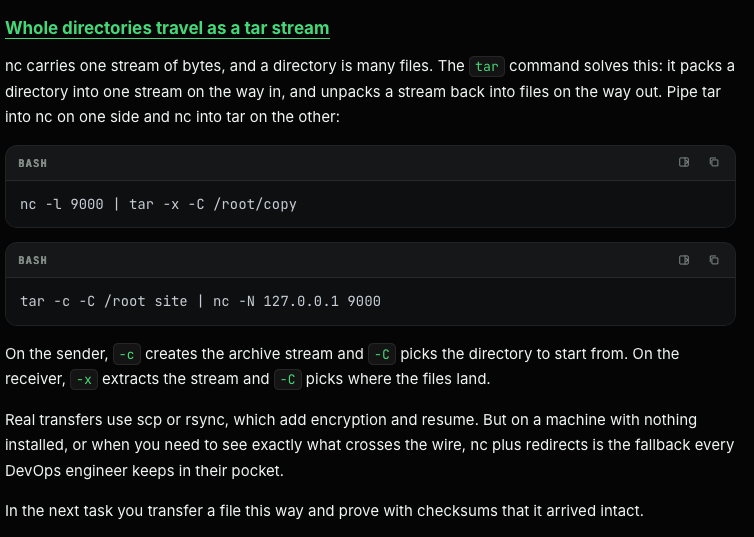
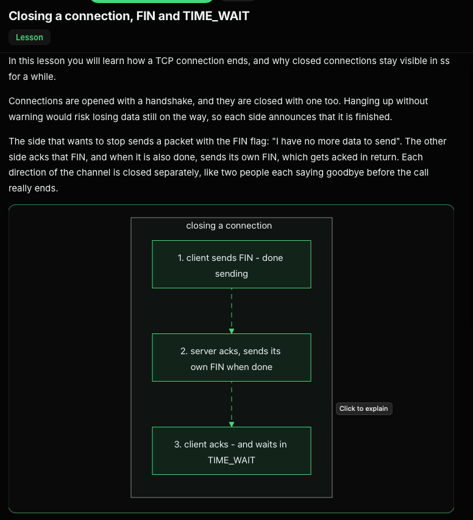
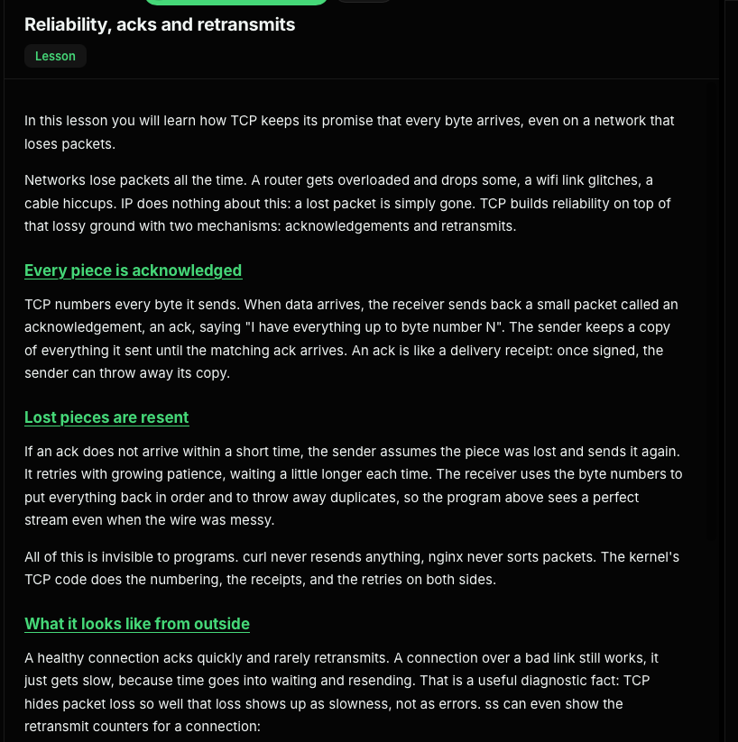

# Transport and sockets

This guide connects the TCP/IP model to practical socket troubleshooting: listening services, active connections, TCP states, and simple TCP/UDP tests.

## Network layers

The OSI model is often used for teaching and troubleshooting:

- Application
- Presentation
- Session
- Transport
- Network
- Data link
- Physical

The practical TCP/IP model has four layers:

- Link layer — local network delivery, including MAC addresses and ARP
- Internet layer — IP addressing and routing
- Transport layer — TCP/UDP and ports
- Application layer — protocols such as HTTP and DNS



As data moves through the stack, each layer adds its own header. At the receiver, the layers unwrap it in reverse order.





Different tools test different parts of the stack: `ip link` checks an interface, `ip addr` shows its IP addresses, `ping` tests IP reachability, `ss` shows sockets, and `curl` makes an application-level HTTP request.



## TCP and UDP sockets

`ss` is the modern Linux socket-inspection tool; `netstat` is the older alternative. Common `ss` options include:

- `-t` TCP
- `-u` UDP
- `-l` listening sockets
- `-a` all sockets
- `-n` numeric addresses and ports
- `-p` process information

Examples:

```bash
ss -tlnp       # listening TCP sockets
ss -tnp        # non-listening TCP connections
ss -tanp       # all TCP sockets
ss -ulnp       # listening UDP sockets
```

`ss -tlnp` answers “is a TCP service listening?” `ss -tnp` helps inspect active TCP connection states. `ss -tanp` includes listeners and non-listening TCP sockets.

Without `-t` or `-u`, `ss` is not limited to those protocols; it can also display socket families such as Unix domain sockets.

Netcat (`nc`) can create simple test listeners and clients. The exact options can vary between implementations.

```bash
# UDP listener, writing received data to a file
nc -u -l 9000 > /root/udp-received.txt &

# Send one newline-terminated UDP datagram to the listener
printf 'hello over udp\n' | nc -u -w1 127.0.0.1 9000

# TCP listener and client
nc -l 9000 > /root/incoming.txt
nc -N 127.0.0.1 9000 < /root/outgoing.txt
```

The `-w1` option sets a one-second timeout for the netcat client. UDP does not establish a connection or provide a delivery acknowledgment.

## TCP connection setup, reliability, and close

TCP’s three-way handshake establishes a connection before application data is exchanged: the client sends SYN, the server replies SYN-ACK, and the client responds with ACK.



TCP acknowledges received data and retransmits when acknowledgments do not arrive, providing a reliable byte stream to applications.



Closing a TCP connection also involves signaling each direction. `FIN-WAIT-2` means one side has finished sending and is waiting for the peer to close; `CLOSE-WAIT` means the local application has been told the peer closed, but has not closed its own socket yet.



## Sending a stream of files

Netcat carries a byte stream. `tar` can package a directory into a stream at one end and unpack it at the other:

```bash
# Receiver
nc -l 9000 | tar -x -C /root/copy

# Sender
tar -c -C /root site | nc -N 127.0.0.1 9000
```

For real transfers, use tools such as `scp` or `rsync`, which provide encryption and transfer features.
