# Transport and sockets

This guide connects the TCP/IP model to practical socket troubleshooting: listening services, active connections, TCP states, and simple TCP/UDP tests.

## Network layers

The OSI model is often used for teaching and troubleshooting:

- Application
- Presentation
- Session
- Transport
- Network
- Data link
- Physical

The practical TCP/IP model has four layers:

- Link layer — local network delivery, including MAC addresses and ARP
- Internet layer — IP addressing and routing
- Transport layer — TCP/UDP and ports
- Application layer — protocols such as HTTP and DNS

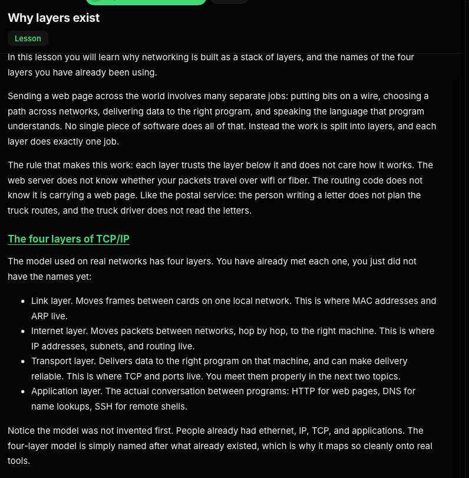

As data moves through the stack, each layer adds its own header. At the receiver, the layers unwrap it in reverse order.

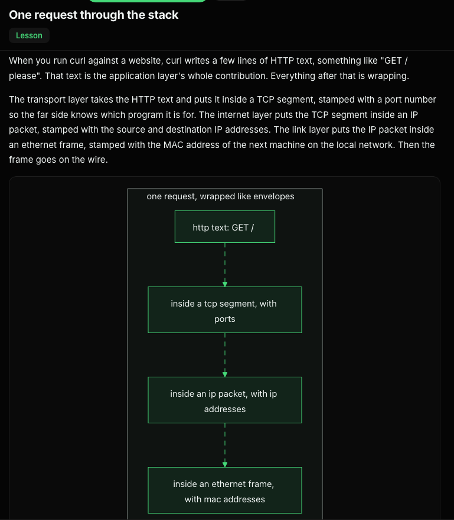

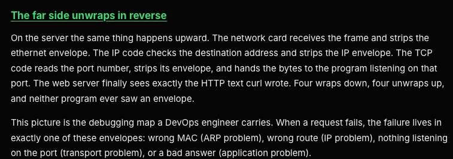

Different tools test different parts of the stack: `ip link` checks an interface, `ip addr` shows its IP addresses, `ping` tests IP reachability, `ss` shows sockets, and `curl` makes an application-level HTTP request.

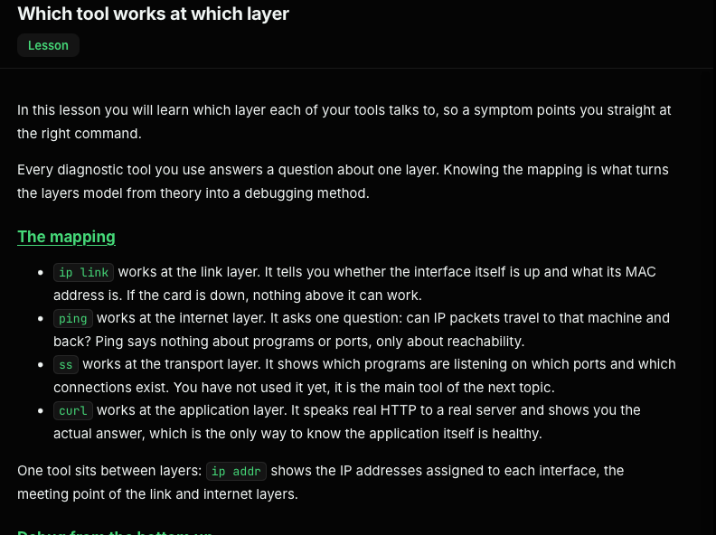

## Ports and sockets

A port identifies an application endpoint on a host. TCP and UDP use port numbers to distinguish services, while an IP address identifies the host. A socket combines the transport protocol, local address and port, and remote address and port when applicable.

`ss` is the modern Linux socket-inspection tool; `netstat` is the older alternative. Common `ss` options include:

- `-t` TCP
- `-u` UDP
- `-l` listening sockets
- `-a` all sockets
- `-n` numeric addresses and ports
- `-p` process information

Examples:

```bash
ss -tlnp       # listening TCP sockets
ss -tnp        # non-listening TCP connections
ss -tanp       # all TCP sockets
ss -ulnp       # listening UDP sockets
```

`ss -tlnp` answers “is a TCP service listening?” `ss -tnp` helps inspect active TCP connection states. `ss -tanp` includes listeners and non-listening TCP sockets.

Without `-t` or `-u`, `ss` is not limited to those protocols; it can also display socket families such as Unix domain sockets.

## UDP

UDP is a connectionless datagram transport. It adds port numbers and optional checksum validation but does not establish a connection, retransmit lost datagrams, or preserve application-message delivery guarantees.

Test a UDP listener and send one datagram:

```bash
nc -u -l 9000 > /root/udp-received.txt &
printf 'hello over udp\n' | nc -u -w1 127.0.0.1 9000
```

Use `ss -ulnp` to inspect listening UDP sockets.

## Netcat

Netcat (`nc`) can create simple test listeners and clients. The exact options can vary between implementations.

```bash
# UDP listener, writing received data to a file
nc -u -l 9000 > /root/udp-received.txt &

# Send one newline-terminated UDP datagram to the listener
printf 'hello over udp\n' | nc -u -w1 127.0.0.1 9000

# TCP listener and client
nc -l 9000 > /root/incoming.txt
nc -N 127.0.0.1 9000 < /root/outgoing.txt
```

The `-w1` option sets a one-second timeout for the netcat client. UDP does not establish a connection or provide a delivery acknowledgment.

## TCP

TCP is a connection-oriented, reliable byte stream. It establishes a session, sequences and acknowledges data, retransmits lost segments, and closes each direction explicitly.

### TCP connection setup, reliability, and close

TCP’s three-way handshake establishes a connection before application data is exchanged: the client sends SYN, the server replies SYN-ACK, and the client responds with ACK.

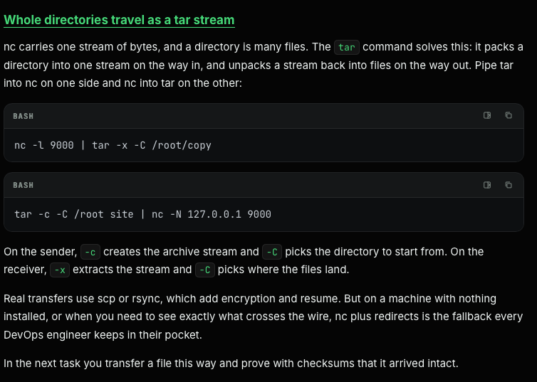

TCP acknowledges received data and retransmits when acknowledgments do not arrive, providing a reliable byte stream to applications.

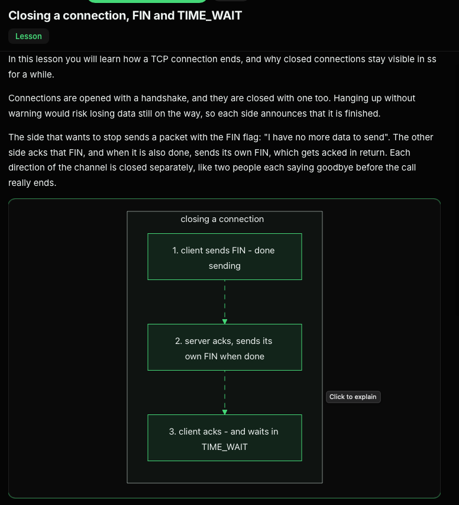

Closing a TCP connection also involves signaling each direction. `FIN-WAIT-2` means one side has finished sending and is waiting for the peer to close; `CLOSE-WAIT` means the local application has been told the peer closed, but has not closed its own socket yet.

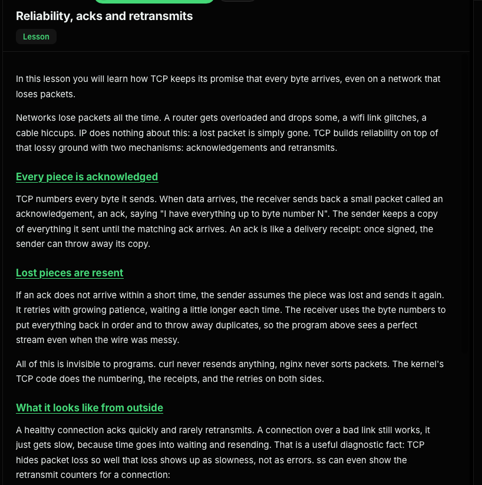

## Sending a stream of files

Netcat carries a byte stream. `tar` can package a directory into a stream at one end and unpack it at the other:

```bash
# Receiver
nc -l 9000 | tar -x -C /root/copy

# Sender
tar -c -C /root site | nc -N 127.0.0.1 9000
```

For real transfers, use tools such as `scp` or `rsync`, which provide encryption and transfer features.

## Latency and bandwidth

Latency is the time traffic takes to travel and receive a response. Bandwidth is the maximum amount of data a link can carry over time. A high-bandwidth path can still feel slow if its latency is high, and a low-latency path can become slow if the workload exceeds its bandwidth.

Use `mtr` to observe routes and packet loss over time:

```bash
mtr -r example.com
```

The `-r` option produces a report and exits instead of keeping the interactive display running.

Use `iperf3` to test throughput between two hosts. Start the server on one host:

```bash
iperf3 -s
```

Connect from another host:

```bash
iperf3 -c 10.100.1.1
```

The final sender and receiver lines summarize the test. In a clean, routed network, their bitrates should be close:

```text
[ 5] 0.00-10.00 sec 30.6 GBytes 26.3 Gbits/sec sender
[ 5] 0.00-10.00 sec 30.6 GBytes 26.3 Gbits/sec receiver
```

A much higher sender rate than receiver rate can indicate loss or a bottleneck in the test path. Run iperf3 on authorized hosts and interpret results alongside packet loss and RTT measurements; iperf3 itself can consume a link's available capacity.

## Simulating a bad network

Linux traffic control (`tc`) can add delay or packet loss to an interface. This is useful for testing whether an application behaves correctly under degraded network conditions:

```bash
sudo tc qdisc add dev veth1 root netem delay 200ms
sudo tc qdisc change dev veth1 root netem delay 200ms loss 20%
```

Inspect the active rule:

```bash
sudo tc qdisc show dev veth1
```

Remove the rule after testing:

```bash
sudo tc qdisc del dev veth1 root
```

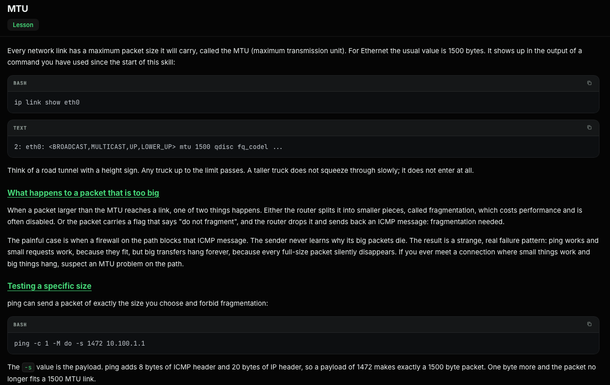

## MTU

The maximum transmission unit (MTU) is the largest frame or packet a network link can carry. Ethernet commonly uses an MTU of 1500 bytes. A path may include a link with a smaller MTU, requiring the sender to fragment packets or adjust path MTU discovery.

Inspect an interface MTU:

```bash
ip link show eth0
```

Test an ICMP payload of a specific size without fragmentation:

```bash
ping -c 1 -M do -s 1472 10.100.1.1
```

For IPv4 Ethernet, a 1472-byte payload plus 20 bytes of IP header and 8 bytes of ICMP header totals 1500 bytes. If `-M do` reports fragmentation or an oversize packet problem, test smaller payload sizes and check MTU settings on every link in the path.

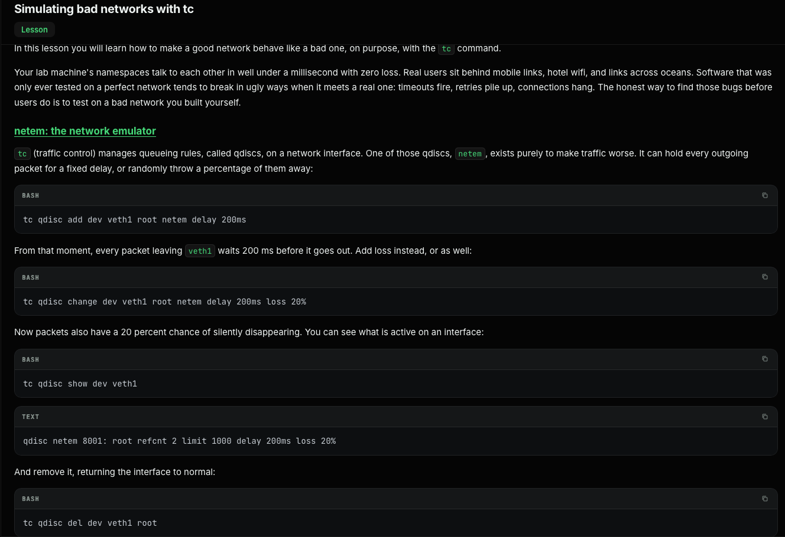

## The debugging ladder

When a service is unreachable, work upward through the network stack and stop after finding the first failed check:

1. `ip link` — verify that the interface is up.
2. `ip addr` — verify that the interface has the expected IP address.
3. `ip route` — verify that a route exists to the destination or gateway.
4. `ss -tlpn` — verify that the expected service is listening locally.
5. `iptables -L -n` or the host firewall equivalent — verify that firewall policy allows traffic.
6. `dig` — verify name resolution when a hostname is used.
7. `curl` — verify that the application answers an HTTP request.

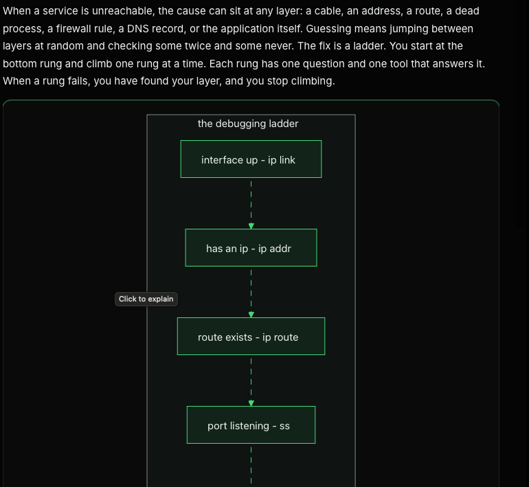

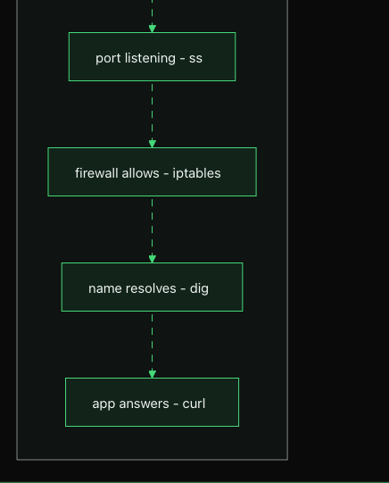

### Common error outcomes

- **Connection refused:** the network path worked, but no process is listening on the requested address and port.
- **Timeout:** packets received no response, often because a firewall dropped them or the destination machine was unreachable.
- **Connection reset:** an established connection ended unexpectedly, which can indicate a crashed process, proxy, or middleware failure.
- **Unknown host:** the hostname did not resolve to an IP address.
- **502 Bad Gateway:** the front-end server reached the network or proxy, but a downstream server could not provide the requested response.

Read the error before changing the configuration. A refusal proves the network path works, while a timeout can mean either a dropped packet or an unreachable route. A 502 commonly requires debugging the upstream server rather than the client connection.

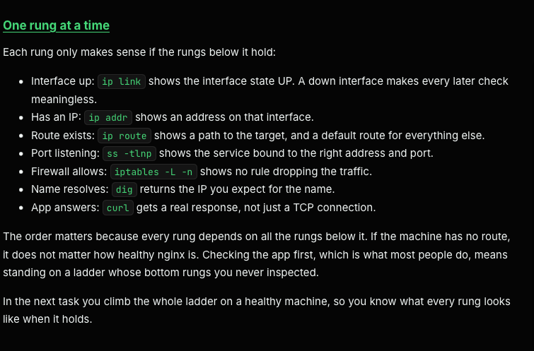

Check one rung at a time, and only change the first layer that failed. The order matters because a lower-rung failure makes higher-rung checks meaningless.

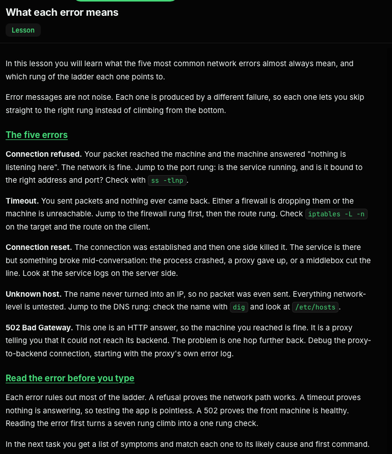

## Project: fix the broken server

Use the debugging ladder as a repeatable project workflow:

1. Confirm the interface state and assigned address with `ip link` and `ip addr`.
2. Confirm the route to the destination or gateway with `ip route` and `ping`.
3. Confirm the expected listener and port with `ss -tlnp` or `ss -ulnp`.
4. Check firewall policy and packet handling with `iptables -L -n` and `tcpdump`.
5. Resolve hostnames and verify DNS records with `dig` or `nslookup`.
6. Test the application directly with `curl -v` or the relevant protocol client.
7. Reproduce the failure, change only the confirmed faulty layer, and verify again.

Record the expected and actual values at every step. A successful lower-layer test is evidence, not a reason to guess at the next layer. Preserve the final working configuration and summarize which check identified the cause.
